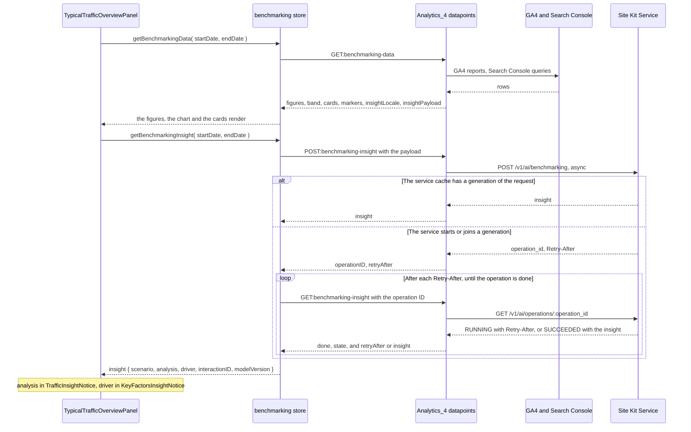
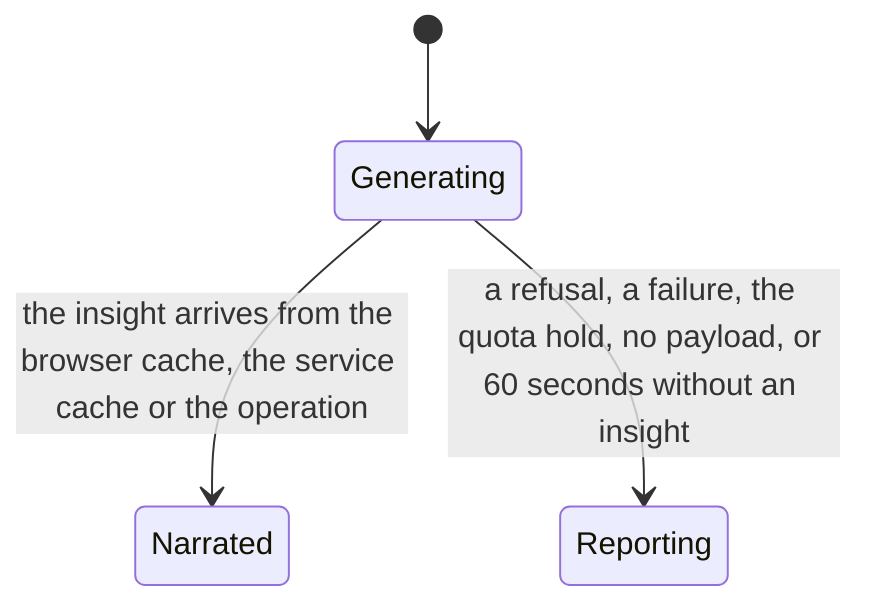

# **\[SK\] Part 3 \- Traffic Insights Design**

| Reviewer | Role | Status | Last Change |
| :---- | :---- | :---- | :---- |
| [Mariya Moeva](mailto:mmoeva@google.com) | Approver | Not Started |  |
| [Evan Mattson](mailto:emattson@google.com) | Approver | Not Started |  |

***Visibility:** Confidential*   
***Status:*** *Review*  
***Author(s):** [Eugene Manuilov](mailto:eugene.manuilov@fueled.com)*  
***PRD:** [Performance intelligence: site benchmarking & forecasts in Site Kit \[PRD\]](https://docs.google.com/document/d/1zwM9ogRlrFO__rLFVYT6SE1qqsjIwzfFUELBiLnYHUQ/edit?pli=1&tab=t.0)*  
***Figma Designs:** [Figma](https://www.figma.com/design/MWN8TXAjfTeKLF0DZ91bIX/Performance-benchmarking?node-id=552-10409&m=dev)*  
***Last Major Revision:** Nov 27, 2026* 

# **Context**

## **Objective**

This epic makes the `analyticsTrafficOverview` widget explain what the site's traffic means, instead of only reporting the traffic. It adds two things to the typical traffic view of the widget's Traffic overview tab. The first is an AI-generated insight in two parts: how the period's visits compare with what is usual for the site, and what drove the change since the previous period. The second is a set of markers on the chart. These markers show the posts that were published in the selected range and brought visits. The epic also builds the plugin-side infrastructure that is needed to reach the generative endpoint of the Site Kit Service and to wait for its result.

## **Background**

The typical traffic view reports numbers well, but it does not say anything about them. A reader gets their total visits with a change badge, and their unique visitors. They also get their own daily traffic across the selected period, shown next to the expected range that is based on their own history. Finally, they get up to three key factor cards that name the channels, pages, referring sites and campaigns that changed their traffic. But then the reader has to combine all of this information on their own. They have to decide whether the period as a whole was normal, and which of the changes explains it.

Most site owners cannot take this last step. A band under a chart shows that a day was unusual, but it does not say why. The cards say *what* changed, but they do not say whether the change was expected. Two capabilities solve this problem.

The first capability is an expectation that the period as a whole can be compared with. This expectation comes from the [expected range](./typical-traffic-design-doc.md#expected-range) that the Typical Traffic epic fits for every day of the period. The same fits give the expected range of the period's total, for a total of the period's own length. This step is arithmetic on a calculation that the Typical Traffic epic does.

The second capability is a natural-language explanation of the comparison, in the site owner's own language. This is the job of the generative endpoint for benchmarking that the Site Kit Service has built, `/v1/ai/benchmarking`. This epic builds the path from the plugin to this endpoint. It builds the path on the parts that the module's generated insights share: the read of an operation, the base of the generative datapoints and the waiting logic in the browser.

# **Design**

## **Overview**

This epic adds two things to the typical traffic view, the panel that the Traffic overview tab shows with the `typicalTraffic` feature flag:

1. **An AI-generated insight, behind a new `trafficInsights` feature flag.** It shows only in `TypicalTrafficOverviewPanel`, on the main dashboard, and it has two parts. The `analysis` compares the period's visits with the range that is usual for the site, and `TrafficInsightNotice` shows it at the top of the panel. The `driver` names the change against the previous period and what carried it, and `KeyFactorsInsightNotice` shows it above the key factor cards. One generation (one request to the AI service and the text that it produces) is used for both parts. The drivers that the generated text names are the key factor cards of the same data response. While an insight shows, the footer adds an AI disclosure. When the service has no record of the site, a user who can set up Site Kit gets a notice that offers a reset instead. The PDF export prints the insight only when the dashboard has already resolved it.  
2. **Content markers on the typical traffic chart**: a dot on the traffic line for each day in the range when a post that brought visits was published. A card that names the posts opens when the pointer moves onto the dot's day. The markers come with the typical traffic view, with or without the `trafficInsights` flag.

These additions rest on five parts:

1. **Proxy access to the generative endpoint and its operations.** `Google_Proxy::send_benchmarking_insight_request()` posts the request to the service's `/v1/ai/benchmarking` endpoint in asynchronous mode, with the user's locale as `hl`. `Google_Proxy::get_ai_operation()` reads a long-running operation from `/v1/ai/operations/:operation_id`, for every generated insight. See [Google\_Proxy additions](#google_proxy-additions).  
2. **Two datapoints that make the service calls and do nothing else.** `POST:benchmarking-insight` takes the signed payload in a request body, checks it, and submits it. It returns either an operation ID, with the service's `Retry-After`, or the finished insight. `GET:benchmarking-insight` takes an operation ID and reads that operation. Together, these two datapoints are the whole mechanism that the plugin uses to wait for the generation. See [Insight datapoints](#insight-datapoints) and [Waiting for the generation](#waiting-for-the-generation). `Analytics_4` registers them only with the flag, and neither of them runs a report.  
3. **The request, built in PHP, on the data response.** With the flag, `Response_Builder` builds the generative request with `Insight_Request_Builder`, from the reports that it has just run, when `availability` allows an insight for the range: the range has the key factor cards, and it is at most 364 days long. The request carries the period's expected range from the same `Period_Baseline` fits as the chart's band, with last year's totals and the brief spike (see [Expected baseline](#expected-baseline)). It also carries the response's key factor cards as `decomposition`, in the service's card model (see [Key factor cards](#key-factor-cards)). `Get_Benchmarking_Data` signs the request for the current user with `Insight_Payload`, into one opaque string, `insightPayload`. The string travels next to `insightLocale`, as the two members that the flag adds to the [wire format](#wire-format-additions). The browser sends the string back to `POST:benchmarking-insight` without reading it. See [Payload assembly](#payload-assembly).  
4. **The markers on the existing response.** `Content_Markers` picks the marked posts from the content report that the data response runs anyway, and the response carries them with or without the flag. `TypicalTrafficChart` draws them, and `PublishedPostTooltip` names the posts of a day. See [Content markers on the charts](#content-markers-on-the-charts).  
5. **A datastore slice that waits.** The `benchmarking` slice gets `getBenchmarkingInsight( startDate, endDate )`, two fetch stores and a resolver. The resolver takes the payload from the data response of the same dates, and hands it to `resolveAIInsight()`, the waiting logic that the module's generated insights share. Unless the slice's own cache entry already holds the outcome or a pending operation, this logic submits the payload once. Then it reads the operation that it gets back, after each `Retry-After` that the service sends, until the insight arrives or 60 seconds pass. It submits again only when the service's client contract says that it should. The panel and its footer read the insight through `useBenchmarkingInsight()`. See [Datastore slice](#datastore-slice).

**This feature caches nothing on the WordPress site.** The API layer caches the data response, with the two dates as the key, for an hour, or for a day when the range ends before the last three days. The slice caches the insight for a day, with the signed payload as the key, so an insight is kept and replaced together with the figures that it describes. Every tab of a login session shares both entries. The service keeps its own copy of the generation for 24 hours. See [Browser-side caching](#browser-side-caching).

**The generated text describes the selected range, compared with the period of the same length before it**, like the rest of the panel, on any range from 7 to 364 days. The service compares the period's total with an expected range for a total of the same length. The cards next to the text are built from the same figures, in the same pass. The request travels on the panel's own data response, so no range needs a second data request. The cost is one generation for each range, rather than one for each end date. See [Narrating the last 28 days rather than the selected range](#narrating-the-last-28-days-rather-than-the-selected-range).

**The browser calculates nothing, and it forwards the payload without reading it.** PHP calculates every number, card, row limit and bound. PHP also builds, encodes and signs the payload in the same request. The browser sends the payload back unchanged, byte for byte, through `POST:benchmarking-insight`. The widget decodes only the data that it draws. The service only writes the text: it does not run reports, and it does not do any statistical modeling.

**The numbers and the generated text come from two independent requests. This is intentional.** The figures, the chart, the band and the key factor cards render as soon as the data response resolves. The insight appears after them, no matter how long the generation takes. No PHP request contains both a report call and a call to the AI model. So neither `max_execution_time` nor a proxy in front of the site can make the widget lose its data. **If the generation fails, the numbers must never fail with it.** Splitting the requests makes this a property of the design's structure, not a result of careful coding.

**The whole panel, including the insight, works on the view-only dashboard.** The data datapoint and the two insight datapoints are shareable. So on a shared request, the reports and the generative call run with the module owner's credentials, exactly as every other shared report does. The payload is signed for the user who views the dashboard. The only part that a view-only reader never gets is the reset notice, which needs a user who can set up Site Kit. See [Dashboard sharing](#dashboard-sharing).

## **Infrastructure**

On the front end, this epic only adds to the typical traffic view that the Typical Traffic epic builds. It adds two notices for the two parts of the insight, a notice that offers a reset, and an AI disclosure in the footer. It also adds one more column on the chart, for the markers, and the card that a marker opens. These additions go into a panel. The Typical Traffic epic creates the panel's states, data flow, expected range and key factor cards. The server-side gathering of data, the datapoint that does this gathering and the calculation that produces the expected range also come from the Typical Traffic epic. This epic extends these parts, but it does not introduce them.

The design depends on these parts of the code, and on one specific property of each:

* **`Google_Proxy::request()`** injects `site_id`/`site_secret` and the bearer header. This keeps the submit and the read small. **Its `method` argument sends a `GET` through `wp_remote_request()`, with `site_id` in the query string and without `site_secret`.** The operation read needs this, because the read is a `GET`. Its `return_retry_after` argument adds a numeric `Retry-After` header of a successful response to the answer as `retryAfter`, and a failed response keeps the service's `code` as `reason` and its `Retry-After` as `retryAfter`. Also, its own `mode => 'async'` sends a request and discards the answer, and this is not what the service's `async` means. See [Google\_Proxy additions](#google_proxy-additions).  
* **`Module::set_data()` dispatches through the same `execute_data_request()` path that `get_data()` uses.** So on a shared request, `get_oauth_client_for_datapoint()` resolves the owner's client for a write exactly as it does for a read. This is why the submit works in the view-only dashboard. `create_request()` returns a closure, and `execute_data_request()` calls this closure with the client that it resolved. Each insight datapoint gets its bearer token from this client. `POST:searchanalytics-batch` makes its remote call with the owner's client in the same way.  
* **`AI_Insight_Datapoint`** is the base of the module's generative datapoints, and the conversion insight's datapoints extend it too. It makes them shareable, declares `VIEW_DASHBOARD` once, in `permission_callback()`, refreshes the token of the client that the request runs with, and passes on only the statuses that the browser acts on. `Get_AI_Insight_Operation` reads the operation of every generated insight, with the insight's own subclass of `AI_Insight_Reader`. See [Insight datapoints](#insight-datapoints).  
* **The `EDITABLE` branch of the module data route defaults to `SETUP` or `MANAGE_OPTIONS`, but the `READABLE` branch defaults to `SETUP` or `VIEW_POSTS_INSIGHTS`.** `resolve_datapoint_permission()` resolves `"{$method}:{$datapoint}"`, and it honors the callback of a `Permission_Aware_Datapoint` on both branches. This is why a view-only user can reach the submit at all.  
* **The API layer caches `GET` responses in browser storage, and it caches no `POST`.** This mechanism is wrong for each half of the insight. A `POST` is never cached. The answer of the operation read changes, but its parameters do not change. This is why the slice keeps its own cache entry instead.  
* **`API.set()` clears the whole cache group of the datapoint after the request returns.** It matches every stored key that *begins* with `modules::analytics-4::<datapoint>`. This is a correct default for a write, but it is a risk for this particular write. This behavior also decides the name under which the slice stores its own entry. See [Browser-side caching](#browser-side-caching).  
* **`getItem` and `setItem` from `googlesitekit/api/cache` are the API cache's own storage functions, and code can call them directly.** The `isWooCommerceRedirectModalDismissed()` resolver of `modules/ads` reads one stored item in this way, from inside a store. With the `shared` option, these functions keep an item in `localStorage`, for every tab of the login session. The insight's cache entry and the quota hold are built from these functions, as shared items.  
* **In a datastore, a `setTimeout` belongs in a control.** `scheduleSyncAvailableCustomDimensions()` on `modules/analytics-4` schedules a deferred fetch in this way. That control is fire-and-forget. The [wait between reads](#waiting-for-the-generation) runs in a control too, `RESOLVE_BENCHMARKING_INSIGHT`. This control returns a promise that the resolver yields, and each wait inside it is a promise that a `setTimeout` resolves.  
* **`Period_Baseline`, from the Typical Traffic epic, fits each day of the period once for each request.** `Response_Builder::build()` creates one instance. The band, and the request's `baseline`, `history_days`, `visits.last_year` and `in_period_spike`, all read this instance. As a result, this epic does no statistical modeling of its own. See [Expected baseline](#expected-baseline).  
* **`Key_Factors`, from the Typical Traffic epic, builds each card twice in one pass**: once for the panel, and once in the service's card model, which `get_decomposition()` returns. So the request carries the panel's cards without any translation. See [Key factor cards](#key-factor-cards).  
* **`Typical_Traffic_Availability` decides once, for each response, which parts of the view the range has.** Its `insight_request_allowed` holds when the range has the key factor cards and is at most 364 days long. So `Response_Builder` builds the request only for a range where the panel asks for the insight. See [Gating and visibility](#gating-and-visibility).  
* **`GoogleChart` renders `children` inside its own positioned wrapper.** The marker's card, `PublishedPostTooltip`, is attached to this wrapper. Each time the chart fires `ready`, `GoogleChart` attaches its `onMouseOver` and `onMouseOut` callbacks to the chart's mouse events, and `TypicalTrafficChart` positions the card in `onMouseOver`, from the chart's layout interface. `getChartOptions()` turns Google's own tooltip back on, and the widget's stylesheet hides that tooltip while the card is open. See [Chart construction](#chart-construction).  
* **The `availableCustomDimensions` setting of `Analytics_4` lists the custom dimensions that the property has.** `Custom_Dimensions_Data_Available` also records, on the server, that a custom dimension has data. But Site Kit records this only when a Key Metrics tile that needs the dimension is shown. So the content report that produces the markers runs when either of them names `googlesitekit_post_date`.

The new infrastructure is the generative transport and the parts that provide its input. It includes `Google_Proxy::send_benchmarking_insight_request()` and the two insight datapoints, with `Benchmarking_Insight_Reader`. It also includes `Insight_Request_Builder`, which builds the request, and `Insight_Payload`, which signs it for its trip through the browser. In the browser, it includes the insight's part of the `benchmarking` store, with its resolver and its cache entry, and the waiting logic in `datastore/utils/ai-insight.ts`, which the module's generated insights share. `Content_Markers` builds the markers from a report that the response runs anyway. The external endpoints that the insight calls are the service's `/v1/ai/benchmarking` endpoint and its companion `/v1/ai/operations/:operation_id` endpoint, which every generated insight reads its operation from. The plugin reaches the GA4 Data API and the Search Console API in the same way as always.

## **Detailed design**

### **Feature flag**

A new `trafficInsights` feature flag controls the code of this epic.

**The flag adds the generated insight to the typical traffic view.** The two insight datapoints, `POST:benchmarking-insight` and `GET:benchmarking-insight`, are added to `Analytics_4::get_datapoint_definitions()` only when the flag is enabled. `Response_Builder` builds the insight's request only under the same check, so `GET:benchmarking-data` carries `insightLocale` and `insightPayload` only with the flag. **When the flag is off, the data response has no insight members, and every other member is the same.** In the browser, `TypicalTrafficOverviewPanel` and `TypicalTrafficOverviewFooter` read the flag with `useFeature( 'trafficInsights' )`. When the flag is off, the panel asks for no insight, so it shows no analysis, no driver and no reset notice, and its notice says nothing about a range that is too long for the insight. The footer shows no AI disclosure, and the PDF export prints no insight.

**The insight also needs the `typicalTraffic` flag**, because it shows only in that flag's `TypicalTrafficOverviewPanel`. The published posts on the chart, which [Content markers on the charts](#content-markers-on-the-charts) describes, are not behind this flag. They show with the `typicalTraffic` flag alone.

When the feature is stable at 100%, an issue should be opened to remove the flag and its conditional logic.

### **Gating and visibility** {#gating-and-visibility}

**The insight shows only in the typical traffic view, and only together with the key factor cards.** `TypicalTrafficOverviewPanel` asks for the insight when all of these conditions are true:

1. The `trafficInsights` flag is enabled.  
2. The panel shows its key factors section. This means that the dashboard is the main dashboard, the property is not gathering data, and the request for the data response did not fail. See [Gating and visibility](./typical-traffic-design-doc.md#gating-and-visibility) in the Typical Traffic design.  
3. The range has the key factor cards, and it is at most 364 days long. The response says so in `availability.insightRequestAllowed`.

**The insight is requested only with the cards, because its driver describes the change that the cards show.** The cards need a range of at least 7 days, recorded traffic on every day of the period before it, and a site without low traffic. Without these, the driver would describe a change against days that were not measured, or a change of a handful of visits. Compared with days before the site was measured, any period looks like growth. **`GET:benchmarking-data` applies this rule on the server, before it does any of the work for the insight's request.** `Response_Builder` builds the request only when `insight_request_allowed` holds. Otherwise, the response has no payload, and the slice receives no insight without asking the service. The response has no payload either when neither period had a visit.

**A range longer than 364 days has the band and the cards, but no insight.** The service writes the insight for a range of up to 364 days, and it refuses a longer one. The plugin's custom date ranges can be longer, so for such a range, the panel's notice says `Select a date range of up to 364 days to see insights about your traffic.`

**The analysis also needs the band.** `availability.performanceInsightAvailable` is true only when the range has the band and the request, and the panel shows the analysis only then, because the analysis compares the visits with the band. Without the band, the analysis would only say that the service is still learning what's usual for the site, and the panel's notice already says when the band will show. The request then carries `history_days` instead of a `baseline`, as [Payload assembly](#payload-assembly) describes. The driver shows either way.

**History is counted from the first day when the site recorded traffic, not from the day when the property was created**, as in the rest of the typical traffic view. This is because a property that was created long before its site was tagged has months of zeros, and these zeros give no information about the site. `Typical_Traffic_Availability` counts every rule above from that day. The thresholds are in [Expected baseline](#expected-baseline).

### **Panel data flow** {#panel-data-flow}

`TypicalTrafficOverviewPanel` reads the insight through `useBenchmarkingInsight()`, and `TypicalTrafficOverviewFooter` calls the same hook for its AI disclosure. The hook reads the selected date range itself. Once the benchmarking response for the same two dates has arrived, it calls the [slice's](#datastore-slice) `getBenchmarkingInsight( startDate, endDate )`. Both components read the same resolved value, so the panel and its footer share one generation.

**The insight selector takes the same two dates as the data response.** The generated text describes the selected range and compares it with the period before it, as the key factor cards do, so each range has its own insight. The slice, not the panel, takes the insight's request from the data response of the same dates, so no component handles the payload.

The hook's `isEnabled` option carries the conditions of [Gating and visibility](#gating-and-visibility). The hook returns the insight, or `null` while there is none to show, whether it is still waiting, and whether the service has no record of the site. **A failed data request means no insight and no wait.** The hook asks for the insight once a retry brings the response. A failed insight request leaves no insight to show, rather than an error, so the panel shows its figures without it. On a view-only dashboard, the hook sends no request until the user's role can view Analytics.

The data response gets two fields with the flag:

| Field | Shape | Read by |
| :---- | :---- | :---- |
| `insightPayload` | one opaque string, the signed request that the insight is written from, which the browser never reads, or `null` when the range has no insight to request | the slice, which sends it to `POST:benchmarking-insight` and keys the insight's [cache entry](#browser-side-caching) on it |
| `insightLocale` | the locale that the insight is written in, such as `de_DE`, or `null` | no component, because the payload carries the locale too |

The resolved insight contains the generated fields that the panel reads, and the two fields that identify the generation that these fields came from. It contains nothing else:

| Field | Shape | Rendered by |
| :---- | :---- | :---- |
| `insight` | `{ scenario, analysis, driver, interactionID, modelVersion }` | `analysis` in `TrafficInsightNotice`, and `driver` in `KeyFactorsInsightNotice`, the [generated insight's](#generated-insight) two notices. The footer's `AIDisclosure` shows while there is an insight. No component renders `scenario`, `interactionID` or `modelVersion`. |

**No part of the data response depends on the insight, and the insight is written about the cards that the data response already contains.** The request sends the key factor cards that the response contains as `decomposition`, in the service's card model, as `Key_Factors::get_decomposition()` builds them from the same figures in the same pass. So the drivers that the generated text names are the cards next to the text. See [Key factor cards](#key-factor-cards). The cards and the text also describe the same two periods, whatever the length of the range. **Nothing changes order when the insight arrives.** Each notice holds a placeholder while it waits, so the text replaces a block that is already there, and the figures, the chart and the cards keep their places. When it is known that no insight is coming, the placeholders go.

### **Chart construction** {#chart-construction}

**Only the typical traffic chart has markers.** `TypicalTrafficChart` draws the dots and the card that [Content markers on the charts](#content-markers-on-the-charts) describes. `TrafficChart`, the chart of the Traffic overview tab without the `typicalTraffic` flag, has none. The columns and the option values are in the [appendix](#chart-data-table-and-options), and the rest of the chart is in [Typical traffic chart](./typical-traffic-design-doc.md#typical-traffic-chart).

**`GoogleChart` gives the card what it needs: mouse callbacks and children.** It renders its children inside the chart's container, so `PublishedPostTooltip` is positioned against the chart. Each time the chart fires `ready`, `GoogleChart` adds listeners for `onmouseover` and `onmouseout` to the chart, and they call the latest `onMouseOver` and `onMouseOut` with the event and the chart wrapper. `TypicalTrafficChart` passes both callbacks only when a plotted day has a post, so a range without a post adds no listeners. The card's position comes from `chartWrapper.getChart().getChartLayoutInterface()`: `getXLocation( date )` for the day, and `getYLocation( visits, 1 )` for the dot, because the line plots against the second value axis.

**Google's own tooltip stays on.** The chart's options do not declare `tooltip.isHtml`, so `getChartOptions()` turns on Google's HTML tooltip with `trigger: 'both'`, as on the chart without the flag. With `focusTarget: 'category'`, the tooltip shows the day's visits on every day. On a post's day, the widget's stylesheet hides it while the card is open, so the card takes its place.

**The legend is HTML.** `TypicalChartLegend` renders one item for each part that the chart draws, each with a swatch in the shape of its part: a bar for the line, a block for the band and a dot for a post. Because we render the legend ourselves, the `Published post` item renders only when a plotted day has a post.

### **Generated insight** {#generated-insight}

**The insight has two parts, and each part shows next to what it describes.** The service writes two strings. `analysis` compares the period's visits with the range that is usual for the site. `driver` is the change against the previous period and what carried it, with the numbers in it. `TypicalTrafficOverviewPanel` renders `analysis` in `TrafficInsightNotice`, at the top of the panel, above the figures and the chart. It passes `driver` to `KeyFactors`, which renders it in `KeyFactorsInsightNotice`, under the section's heading and above the cards that the driver names. The service writes `analysis` under 280 characters and `driver` under 220 characters in English, and under 320 and 230 characters in most other languages. These lengths are targets that the service gives the AI model, not limits that the service enforces, and nothing truncates the texts. So the layout treats them as the expected case, not as a guarantee. Either string can be absent. `Benchmarking_Insight_Reader` reads a field that the service left empty as `null`, and it refuses an answer that has neither string.

**The two notices look the same for every insight.** Each notice shows the AI icon next to its text, and nothing in its layout depends on the insight's `scenario` or on its words. **The plugin never parses the localized text.**

**Both strings contain Markdown bold, and nothing else in them is interpreted.** The service wraps the names that it highlights, such as a channel, a referring site, a category or a post's title, in `**…**`. `AIText` splits the text with `splitBoldSegments()`, and it turns each `**…**` pair into `<strong>` around plain React children. The widget's styles set these names in the medium weight. An unclosed `**` stays in the text as two characters. `AIText` renders everything else as text, including any other Markdown. So no string reaches the DOM as HTML. See [Sanitization responsibilities](#sanitization-responsibilities).

**The insight arrives after the figures, and each notice reserves its space while it waits.** The service generates the insight from the figures of the data response, so the insight arrives seconds after them. While the widget waits for the generation, each notice renders a `PreviewBlock` placeholder, 72px tall. This is because an insight *is* coming. When it is known that the insight is not coming, the notice returns `null`. Then there is no block, and no placeholder instead of a block. **Each notice is a polite live region from its placeholder on** (`aria-live="polite"`), so a screen reader reads the insight out once it replaces the placeholder. See [Insight states](#insight-states).

**The panel and its footer use the same generation.** A generation is one request to the AI service and the text that it produces. The slice keys the insight by the selected range, and the panel and `TypicalTrafficOverviewFooter` read the same resolved value. So neither of them starts a second operation. A later mount for the same figures reads the [browser cache](#browser-side-caching), not the service. This matters because the service has rate limits, and a generation that the service has not cached and is not already running counts against them.

**The footer discloses the generated text while an insight shows.** `TypicalTrafficOverviewFooter` then adds an `AIDisclosure`, with the AI icon: `Some insights on this page are created using AI and may contain mistakes. Learn more`. The `Learn more` link opens the `ai-insights` support page.

**A site that the service has no record of gets a reset notice instead of the insight.** When the service answers with `SITE_NOT_FOUND`, no insight comes until Site Kit is reset and set up again, because the site's setup needs the service's record too. `TrafficInsightResetNotice` then shows a warning at the top of the panel. Its title is `Site Kit can’t generate insights`, its text is `The Site Kit service no longer recognizes this site. Reset Site Kit to connect it again.`, and its `Reset Site Kit` button asks the user to confirm the reset. A reset disconnects every user, so only a user who can set up Site Kit sees the notice. Any other user sees the panel without the insight.

**The PDF export prints the insight only when the dashboard already has it.** The [PDF section](./typical-traffic-design-doc.md#pdf-export) of the typical traffic view prints the analysis above its figures, and the driver in its key factors section. It does so only when the dashboard has already resolved the insight for the same dates, and only where the panel would show it. The export never asks the service for a generation. When the section prints generated text, it ends with `Some insights in this report are created using AI and may contain mistakes.`

### **Content markers on the charts** {#content-markers-on-the-charts}

**The typical traffic chart puts a dot on the traffic line on each day in the selected range when a post that brought visits was published.** The dot sits at the value that the line already has on that day, and its tooltip names the day's posts. The markers come with the typical traffic view, with or without the `trafficInsights` flag. `TypicalTrafficOverviewPanel` passes them to `TypicalTrafficChart` on the main dashboard, once the property has finished gathering data, unless the benchmarking request failed. So the entity dashboard and the Traffic overview chart without the `typicalTraffic` flag have no markers.

`contentMarkers` is calculated on the server, by `Content_Markers::build()`, from the rows of the content report. This report counts `sessions` by `pagePath`, `pageTitle` and `customEvent:googlesitekit_post_date`, in both windows, for pages that have a post date. See [Report gathering](./typical-traffic-design-doc.md#report-gathering). `Response_Builder::build_content_rows()` gives each row its `publishedDaysAgo`, counted in whole days back from `endDate`. Five rules pick the marked posts:

* A post is marked when it was published on a day of the selected range and had visits in it: its `publishedDaysAgo` is below the length of the range, and its `current` is above 0. The marker's date is the post's publish date, from `customEvent:googlesitekit_post_date`. A site's time zone can be hours later than the property's, so a post dated after `endDate` counts as published on `endDate`.  
* The home page is never marked, because a marker on it would label the site's front page as something that was published. `Insight_Request_Builder::is_home_page()` reads a path in lower case and without a trailing slash, and it treats `/`, `/home`, `/index.html` and `/index.php` as the home page, as the service does.  
* Only the 10 posts with the most sessions in the selected range are marked (`Content_Markers::MAX_POSTS`, which is `Insight_Request_Builder::MAX_RECENT_CONTENT`). A tie is broken by the post's path. If the list had no limit, it would make the traffic line look like a scatter plot on a site that publishes every day.  
* Posts that have the same publish date are combined into a single marker, because one day is one x position, and therefore one dot. A marker names at most two of these posts, the two with the most sessions (`Content_Markers::MAX_POSTS_PER_DAY`), so that the tooltip of a busy day stays short. A post that a marker leaves out is not replaced by the next post in the ranking.  
* A post whose title is a placeholder, such as `(not set)`, is named by its path.

**The dots and the generated text name the same posts.** `Insight_Request_Builder::get_recent_content_rows()` picks the request's `recent_content_momentum` from the same rows with the same rules, so every marked post is among the posts that the [generated insight](#generated-insight) describes. The payload's `published_days_ago` is the same `publishedDaysAgo`.

**The markers need no history.** A publish date inside the selected range is valid without any, so a site with a short history, or with low traffic, keeps its markers. If the property has no post date custom dimension, the content report does not run. If the dimension has no data yet, the report returns no rows. In both cases, `contentMarkers` is empty, and the chart has no marker column and no marker legend item.

The markers travel as member `9` of the [wire format](./typical-traffic-design-doc.md#wire-format-layout). Each marker is its publish date, as an offset from the first plotted day, followed by its posts, each as the string-table references of its title and its path. `getPublishedPosts()` lists one `{ date, title, url }` for each post of each marker, and it turns the post's path into a full URL on the site's reference URL.

**The marker is a point style on the traffic line, not a series of its own.** `getTypicalTrafficChartData()` adds a `style` role column after the visits column and the band's columns, but only when a plotted day has a post. On such a day, the column holds `PUBLISHED_POST_POINT_STYLE`: a visible point filled with `$c-violet-v-200` (`#a983e6`), with a 3 px white stroke. The stroke separates the dot from the line that runs through it. On every other day, the column is `null`. The legend shows a `Published post` item, with a dot swatch in the same color, only when the range has a marker.

**Recently published content is shown as dots on the line, not as a `dateMarkers` line.** The `dateMarkers` prop of `GoogleChart` draws a dashed vertical line with an info icon. This is the right treatment for the single property-creation line that the chart already uses this prop for. But it is the wrong treatment for recently published content. A dot looks like a point on the site's traffic, but a full-height line looks like a boundary in the traffic. Also, the marker needs a tooltip that shows titles, a date and links, but a `dateMarkers` tooltip is one string.

**`PublishedPostTooltip` opens when the pointer moves onto a day with a post.** The chart's `focusTarget` is `category`, so the pointer anywhere on a day's column reports that day's row to `onMouseOver`. `TypicalTrafficChart` then passes the day's posts and the position of the dot to the tooltip, from the chart's layout interface: `getXLocation()` for the day, and `getYLocation()` for its visits on the line's axis. The tooltip is a React child of `GoogleChart`, and it keeps the hovered day in its own state, because a render of the chart would make Google Charts draw the chart again. The card sits centered over the dot, with its caret on the dot's edge. It moves sideways to stay inside the chart, and its caret moves back by as much, so it still points at the dot. While the card shows, it takes the place of Google's own tooltip. When the pointer leaves the day, the card closes after 300 ms (`PUBLISHED_POST_TOOLTIP_HIDE_DELAY`), unless the pointer moves onto the card first. This delay lets the pointer cross other days on its way to the card's links.

For each post, the card shows the post's title, its publish date as `posted %s`, such as `posted Apr 27`, and a `See more` link to the post's Site Kit entity dashboard. A title is cut after two lines, because the titles come from GA4's `pageTitle`, which often ends with the site's name. The browser formats the date in Site Kit's locale, and it fills translated patterns with `sprintf`. Neither the datapoint nor the service returns strings for each item. For screen readers, the chart adds one visually hidden sentence for each marked post, `Post published on %1$s: %2$s`, with the day and the post's title.

### **Key factor cards** {#key-factor-cards}

The Typical Traffic panel renders up to three [key factor cards](./typical-traffic-design-doc.md#key-factors). `GET:benchmarking-data` builds these cards, and the data response includes them. This epic adds nothing to the cards themselves. The new parts are that the generated text describes these cards, and that the insight's `driver` shows above them, in `KeyFactorsInsightNotice`.

**The service selects no cards.** The insight request carries the cards as `decomposition`: `opening_sessions`, `closing_sessions`, `residual_delta`, `shape`, and up to three `key_factors` in the panel's order. The service writes `driver` from exactly these cards, and it returns no cards at all. The cards cover the selected range, which is also the range that the generated text describes, on every range from 7 to 364 days. So **the generated text describes what the reader sees**, from the first paint. If a generation fails, the cards are still there, only without the text. When the response has no card, the `decomposition` has no cards either, so the service never names a driver that the response does not have. Only a response without any channel rows has no `decomposition`, and the service then writes from the totals and the contextual data alone. A lone card with nothing under its title is still sent, though the panel leaves it out, as the service's design asks. The `driver` can then name a driver that has no card.

**The cards are built in the service's card model.** `Key_Factors` ports the service's card algorithm (§5.10). In one pass, from the same figures, it builds each card twice: once for the panel, and once for the `decomposition`. See [Key factor scoring](./typical-traffic-design-doc.md#key-factor-scoring). So nothing is translated, and every card that the panel shows has a counterpart in the `decomposition`. In the service's card model:

* **Kinds.** A card is a `CHANNEL`, `CHANNEL_GROUP` (`Paid traffic`), `CONTENT`, `REFERRING_SITE` or `CAMPAIGN` card, with the matching `dimension`. A search keyword is never a card.  
* **Rows.** A card has at most two rows, or up to three `CHANNEL` rows on `Paid traffic`. A row is a target page, the homepage, a source, a channel, a reader device or a visitor type. A source is a `Search keyword`, `Referring site`, `Campaign` or `Assistant`. A row is part of its card's decomposition (`DECOMPOSITION`) from 25% of the card's change, and context (`CONTEXT`) otherwise. A `Search keyword` row is always context, and its share is of the site's search clicks. A channel row exists only on `Paid traffic`, and on a page that brought visits through several channels.  
* **Figures.** Each card has its `volume`, `delta` and `direction`, a role (`PRIMARY` or `OFFSET`), a metric type (`DELTA`, or `VOLUME_SHARE` on a steady period), and a `traffic_impact_pct` with the `share_basis` that it is a share of. It also has the figures that the service writes about without checking them: `excess`, `outsized` and `is_large_share`. The whole `decomposition` has a `shape`, and a `residual_delta` that reconciles the changes of the cards, in visits (GA4 sessions), with the two totals.

The panel's card and its counterpart differ in a few details. In the `decomposition`, the title of a channel's card for its other pages ends in ` (other pages)`, where the panel's card has `otherPages` and the panel words it. A paid channel's row also names the campaign that moved most with it, which the panel does not show. Only the panel's card says when a change was spread across many pages, because the service's card model has no such field.

**The service screens the `decomposition`, but never rejects it.** It ignores the smallest part that it can't use: a field, then a row, then a card. It cleans the text with its own sanitizing, never adjusts a number, and records what it ignored in its `benchmarking_inputs_ignored` warning. An ignored part only leaves the `driver` without it, and the panel still renders its own cards. The plugin runs the service's screens itself, ported in `Page_Classifier`, `Source_Classifier` and `Content_Screen`, so that a card never shows a name that the service leaves out of the text.

**The cards are sent inside the opaque payload**, so the browser keeps no separate copy of the cards that could become different from the payload. The panel renders the decoded cards, and the encoded payload sends the same selection to the service. **`decomposition` is part of the service's cache key**, as sent. This means that the card algorithm is one more thing that [payload assembly](#payload-assembly) has to keep deterministic. `Key_Factors` breaks every tie explicitly, because `usort()` is not stable on PHP 7.4, and it rounds half away from zero, as the service does.

### **Expected baseline** {#expected-baseline}

The expected range comes from the [Typical Traffic epic](./typical-traffic-design-doc.md#expected-range), which describes the model, and its [appendix](./typical-traffic-design-doc.md#expected-range-model) lists every step. `Period_Baseline` fits each day of the selected period on the history at least 28 days before that day, and the chart draws a band from these fits. The fits use daily visits (GA4 sessions), because the service compares the range with the `visits` totals of the request. This epic reads the same fits for the request. **This epic does no statistical modeling of its own.** `Response_Builder::build()` creates one `Period_Baseline`, and the band, the request's range and its brief spike all read it, so each day's fit is made once.

#### *What the service is told* {#what-the-service-is-told}

The range is not only drawn on the chart. The request describes the selected period, the `d` days that end on `endDate`, which it sends as `days_in_period`, compared with the period before it. `Insight_Request_Builder::build()` adds four fields from `Period_Baseline`:

| Field | Derived from |
| :---- | :---- |
| `baseline` | `{ expected_range_min, expected_range_max }`: the expected range of the period's visits total, from `get_range()`. The bounds are `MAX( 0, ROUND( C - M ) )` and `ROUND( C + M )`, rounded half away from zero to whole visits. `C` is the sum of the days' centers, and `M` is the margin that the fit of `endDate` gives that center. The days of the band add up to the same center and margin. The field is sent when the site has at least `d + 55` days of history up to and including `endDate`. |
| `history_days` | Only without `baseline`: the days of history up to and including `endDate`, from `get_history_days()`. |
| `visits.last_year` | `{ current_period, previous_period }`: the visits of the period and of the period before it, both moved back 364 days so that each window starts on the same weekday, from `get_last_year_visits()`. The field is left out when a day of either window is before the site's first day with traffic, because a day that wasn't measured must not count as zero. |
| `in_period_spike` | Only with `baseline`: the brief spike, `{ peak_date, start_date, end_date, days, share_of_gain_pct }`, from `get_in_period_spike()`. The field is left out when the period had none. |

History counts from the first day with recorded traffic, as on the chart.

**The range decides the analysis.** The service compares `visits.current_period` with the bounds. The period is `ABOVE_EXPECTED` above `expected_range_max`, `BELOW_EXPECTED` below `expected_range_min`, and `WITHIN_EXPECTED` otherwise. The service adds how far the total sits beyond the nearest bound, and whether the previous period sat outside the same bounds. **The range always describes a total of the period's own length**, so the service compares it with the period's total on any range, without scaling it. The bounds are part of the service's cache key, but the AI model never receives them. The model gets the status and the distance, so the text can't quote a bound.

**Without `baseline`, the status is `NO_RANGE`.** The analysis then says that the service is still learning what's usual for the site. With `history_days`, it also says when to check back: in about `CEIL( ( d + 55 - history_days ) / 7 )` weeks. The panel doesn't show this analysis, because `performance_insight_available` is false without the band. The request is still made for its `driver`, which describes the key factor cards.

**Last year's totals decide one clause, and they are never narrated.** The period can be outside its range while last year moved the same way by at least the range's relative width, `( expected_range_max - expected_range_min ) / ( expected_range_max + expected_range_min )`. In that case, the analysis adds that traffic also rose, or fell, at this time last year. The band's tooltip mentions the same time last year under the same condition that sends `visits.last_year`: both of last year's windows are in the history (`last_year_available`).

**The brief spike comes from the band.** A day is above its band when its visits exceed its `expectedMax`, or `expected_range_max / d` when the day's maximum isn't above 0. A run of one to three days in a row above their bands is a brief spike when three conditions hold. First, its excess over the bounds is at least 40% of the period's gain. Second, unless the period's visits rose by more than 5%, the excess is at least 5% of the period's visits. Third, when the period's total is above the range, the excess is at least 40% of the visits above the range. The spike is the run with the largest excess, or the earliest of the runs with the same excess, and only a period whose visits grew can have one. Its `peak_date` is the run's first day with the most visits, and its `share_of_gain_pct` is the excess as a percentage of the gain, at most 100, rounded to one decimal place. The service's design forwards the spike to the generated text, so that the text can say that the period had a brief spike.

**Each part of the insight waits for its own history.** `Typical_Traffic_Availability` decides these thresholds. They count the history up to and including `endDate`, for a period of `d` days:

| Part | Needs |
| :---- | :---- |
| The request, and its `driver` | the key factor cards: `d >= 7`, `2d` days of history and no low traffic. Also, `d <= 364`. |
| `baseline`, and, with the request, the `analysis` that the panel shows | `d + 55` days of history: 83 days for a 28-day period |
| `visits.last_year` | `364 + 2d` days of history: 420 days for a 28-day period |

A site with low traffic, under 100 visits per 28 days over the last 56 days, gets no request, however long its history. No request is built either when neither period has a visit. See [Gating and visibility](#gating-and-visibility), and the Typical Traffic epic's [Panel states](./typical-traffic-design-doc.md#panel-states).

#### *Where the code lives*

`Period_Baseline`, `Typical_Traffic_Availability` and `Insight_Request_Builder` are in `includes/Modules/Analytics_4/Benchmarking/`. `Period_Baseline` depends only on the daily rows. It needs no settings, no options and no service client. So it is unit-tested with fixed daily series. `Period_BaselineTest` runs the service's 40 conformance fixtures, including their `visits.last_year`, and `Typical_Traffic_AvailabilityTest` runs the service's availability fixtures. Both sets are copied unchanged into `tests/phpunit/integration/Modules/Analytics_4/Benchmarking/fixtures/`.

### **Generative endpoint infrastructure**

The insight reaches the service through parts that the module's generated insights share. The shared parts are the `Google_Proxy` method that reads an operation, the `AI_Insight_Datapoint` and `AI_Insight_Reader` bases, the `Get_AI_Insight_Operation` datapoint class, and the waiting logic in `datastore/utils/ai-insight.ts`. The conversion insight uses them too, with its own submit, reader and cache key. The benchmarking insight adds `send_benchmarking_insight_request()`, `Create_Benchmarking_Insight`, `Benchmarking_Insight_Reader`, `Insight_Payload`, and the insight's part of the `benchmarking` store.

#### *Google\_Proxy additions* {#google_proxy-additions}

`Google_Proxy` has two methods for the benchmarking insight, with a URI constant for each. `send_benchmarking_insight_request()` posts the request to `BENCHMARKING_INSIGHT_URI` (`/v1/ai/benchmarking`) through `request()`, with `json_request => true` and with `async: true` added to the JSON body. It never uses `request()`'s own `mode => 'async'`, because this mode fires the request and discards the answer. The method returns the answer that comes back, which is either the operation that the service started or joined, or the finished insight. `get_ai_operation()` reads an operation at `AI_OPERATION_URI` (`/v1/ai/operations/%s`, with the operation ID URL-encoded). Every generated insight reads its operation through this one method. Both methods pass `request()`'s `return_retry_after` argument, so a numeric `Retry-After` header of a successful response is added to the answer as `retryAfter`, in seconds. The service sends this header with an operation that runs, as the time to wait before the next read.

**The submit names the plugin release.** It sends `get_application_name()`, for example `wordpress/google-site-kit/1.193.0`, as its `User-Agent` header, so the service can tie each request to the release that computed it. `request()` puts `site_id` and `site_secret` into the JSON body, and the bearer token into the `Authorization` header. The submit endpoint validates all three, and it answers a mismatched `site_secret` with a 400. The operations endpoint authenticates with `site_id` and the bearer token alone. On both endpoints, a token that is missing or cannot be verified is a 403, and so is a user who is not registered with that site.

**The operation read is a `GET`.** `request()` takes an optional `method` argument. With `GET`, it sends the request through `wp_remote_request()` as a `GET`, and it puts `site_id` into the query string, together with any body arguments that the caller passes. It leaves `site_secret` out, because a URL must not carry it, and the operations endpoint does not read it. Without the argument, `request()` sends a `POST`, as every other proxy call does. The response handling, the JSON decode and the `WP_Error` shaping stay in one place. This is the reason for extending the helper, instead of writing a second helper next to it.

**A failed response keeps the service's code.** The service answers every error with `{"error": "<message>", "code": "<code>"}`. The code is its contract, and the message text may change. `request()` returns the service's status unchanged. Its `WP_Error` has the `error` as its message, and its data carries the status, the `code` as `reason`, and a numeric `Retry-After` header as `retryAfter`. An HTTP date in `Retry-After` is ignored, because the service sends seconds. The datapoints decide which statuses reach the browser (see [Insight datapoints](#insight-datapoints)).

The user's locale is sent as an `hl` **query parameter** on the submit. The service looks for the locale only there, not in a body field. Without this parameter, the service writes in English. The value is the user's locale as WordPress names it, as `get_user_locale()` returns it, for example `de_DE_formal`. The service normalizes the value itself: it treats `_` and `-` alike, it reads the `_formal` and `_informal` registers, and it looks up its glossaries by the primary language. `GET:benchmarking-data` puts the locale into the signed payload, and `POST:benchmarking-insight` passes the payload's locale to the submit method, which puts it on the URI. The locale is part of the service's own cache key. So once a payload in a new admin language is submitted, the service generates a new insight rather than returning a cached insight in the old language.

#### *Insight datapoints* {#insight-datapoints}

There are two insight datapoints, one for each service call. `Analytics_4` registers both only when the `trafficInsights` feature flag is on. Both extend `AI_Insight_Datapoint`, the base of the module's generative datapoints, which contains everything that they share. Both read the service's answer with `Benchmarking_Insight_Reader`, the benchmarking subclass of `AI_Insight_Reader`. The two datapoints are:

1. **`POST:benchmarking-insight`** (`Create_Benchmarking_Insight`) takes the signed `payload` that `GET:benchmarking-data` built. The payload comes inside the `data` object of the request body. The datapoint checks it with `Insight_Payload::decode()` for the current user, and it refuses a missing payload, or one that this site did not build for this user, with a 400, before any call to the service (see [Sanitization responsibilities](#sanitization-responsibilities)). Then it submits the payload's request with `async: true`. One of two things comes back. The first is **the finished insight**, as `insight`, when the service's 24-hour response cache already has a generation for the same request. This is possible because the service's pipeline checks this cache before its rate limiter, after the request is authenticated and validated. The second is **an operation ID**, as `operationID`, with the service's `Retry-After` as `retryAfter`. The service returns it when it has started generating in the background. It also returns it when an identical asynchronous request was already generating, and its operation had started. In this case, this submit joins the operation of the identical request.  
2. **`GET:benchmarking-insight`** is an instance of `Get_AI_Insight_Operation`, the class that reads the operation of every generated insight, with the benchmarking reader. It takes an `operationID` that an earlier submit returned, a string of at most 256 characters (`MAX_OPERATION_ID_LENGTH`). It reads that operation and returns its state, `done` and `state`: with `retryAfter` while the operation runs, or with the `insight` once it has succeeded. A failed operation is an error.

The reader keeps only the five fields of an insight: `scenario`, `analysis`, `driver`, `interactionID` and `modelVersion`. A field that the service left empty is `null`, and a field that the reader does not list is left out. The service always writes an `analysis` or a `driver`, so an answer with neither is an error (`invalid_benchmarking_insight_response`, a 500). The shapes are in [Datapoint response shapes](#datapoint-response-shapes).

**The payload is sent in a request body, and this is the reason why the submit uses `POST`.** A `GET` request has to put the payload in the query string. A default Apache or nginx server allows roughly 8 KB on a request line. A payload can reach a few hundred kilobytes, because the lists of the request come from reports of up to 500 rows. Some web application firewalls (WAFs) enforce an even lower limit. This transport limit would cause failures first on exactly the sites that have the longest page titles and search queries. A request body has no such limit. **The verbs also match the service calls that the datapoints make.** The submit uses `POST` for a submit, and the read uses `GET` for a read. Also, neither datapoint has a parameter that is an alternative to another parameter. The alternatives are discussed under [A `GET` submit carrying the payload in the query string](#a-get-submit-carrying-the-payload-in-the-query-string) and [Keeping the submit and the read on one datapoint](#keeping-the-submit-and-the-read-on-one-datapoint).

**A write datapoint has to declare its own permission check. Here, the check is essential, and not just good style.** The `EDITABLE` branch of the module data route defaults to `SETUP` or `MANAGE_OPTIONS`. In contrast, the `READABLE` branch defaults to `SETUP` or `VIEW_POSTS_INSIGHTS`. So if a submit declared no permission, only administrators could reach it. The view-only dashboard would then show every number but no generated text. Both insight datapoints declare `VIEW_DASHBOARD`, and they declare it once, in `AI_Insight_Datapoint::permission_callback()`. The declared check also refuses an administrator who has never connected Site Kit, although the default of the `EDITABLE` branch would let this administrator through.

Both insight datapoints are shareable, and they take the bearer token from the client that the reports run under. This is the caller's own client on a normal request, and the module owner's client on a shared request. The datapoints get the token through the closure that `create_request()` returns. `execute_data_request()` calls this closure with the client that `get_oauth_client_for_datapoint()` resolved. So the rules for resolving the client stay in `Module`. **If the token has expired, it is refreshed first.** No Google request runs in the call, so nothing else would refresh the token. `get_access_token()` therefore calls the client's `authorize()`, which refreshes an expired token and stores the new one, as it does before any Google API request. A token that Google refuses to refresh, or a client without a token, is a 403 (`missing_access_token`). Any other failure to refresh the token, such as a network error, is a 500 (`access_token_refresh_failed`). If no client with a usable token resolves, for example when the module owner is disconnected, the request fails with a 403, and no call to the service is made. On a shared request, the payload is still bound to the WordPress user who views the dashboard, while the token is the owner's. The owner's token also reads the operation that it started, which matters because the operations endpoint answers a 404 for an operation that another user created.

**A failure is a `WP_Error`, not a field on a 200\.** The numbers have already arrived in their own response, so a success status has nothing to protect. Each datapoint passes on only the statuses that the browser acts on (`PASSED_ERROR_STATUSES`), and it answers any other failure with a 500, including a transport error, which has no status. The submit passes on 400, 403, 404, 409, 429 and 503. The read passes on 400, 403 and 404. **Every error keeps the service's code as `reason`, and the service's `Retry-After` as `retryAfter`.** The slice acts on the code. It reads an error without a code that it knows by its status, as the service's contract asks: a 400 is `INVALID_ARGUMENT`, a 403 is `PERMISSION_DENIED`, a 404 is `NOT_FOUND`, a 409 is `GENERATION_IN_PROGRESS`, a 429 is `RATE_LIMITED`, a 500 is `INTERNAL` and a 503 is `SERVICE_BUSY`. The widget reads the outcome from the error store:

| Code | Status | When | What the slice does |
| :---- | :---- | :---- | :---- |
| `INVALID_ARGUMENT` | `400` | The service cannot read the request, or the payload is not one that this site built for the user | Stops, and keeps the failure for a day. This is a plugin defect, not a state that a site can reach |
| `NO_DATA` | `400` | Neither period had a visit | Shows no insight, and keeps that for a day. The plugin never sends such a request, so this is a safety net |
| `SITE_NOT_FOUND` | `400` | The service has no record of the site | Stops, and keeps the failure for a day. The panel offers a reset (see [Insight states](#insight-states)) |
| `PERMISSION_DENIED` | `403` | No usable token, a token that the service cannot verify, or a user who is not registered with the site | Stops, and keeps the failure for an hour |
| `NOT_FOUND` | `404`, read | The operation is unknown or expired, or another user created it | Discards the handle (the operation ID) and submits again, once |
| `GENERATION_IN_PROGRESS` | `409`, submit | An identical request is setting up its generation | Waits for the refusal's `Retry-After`, five seconds without one, and submits again, within the deadline |
| `RATE_LIMITED` | `429`, submit | The user's token bucket is empty | Holds back the requests for every generated insight for the refusal's `Retry-After`, a minute without one |
| `DAILY_CAP` | `429`, submit | The site has used up its daily cap | Holds back the requests for every generated insight for the refusal's `Retry-After`, until the next UTC day, or an hour without one |
| `SERVICE_BUSY` | `503`, submit | No free generation slot, or an instance that is shutting down | Waits for the refusal's `Retry-After`, five seconds without one, and submits again, within the deadline |
| `SERVICE_BUSY` | `503`, read | The operation is `FAILED` with code `503`, because a shutdown interrupted it or its instance died | Discards the handle and submits again, once |
| `MODEL_UNAVAILABLE`, `MODEL_OUTPUT_INVALID` or `INTERNAL` | `500`, read | The operation is `FAILED` with code `500`, because the generation failed | Stops, and keeps the failure for an hour |
| `INTERNAL` | `500` | Any other failure of the service, or of the site's request to it | Stops, and keeps the failure for an hour |
| none | none | The browser's request to WordPress failed | Stops, and keeps nothing. The next mount tries again |

**A failed generation is visible directly, so the slice does not have to guess that it failed.** This is the main advantage of the read, apart from the lower cost. The operation says `FAILED`, and its code says whether the generation failed or its instance stopped. `AI_Insight_Reader::get_failed_operation_error()` turns it into a `WP_Error` with the code `benchmarking_insight_failed`, the status `503` or `500`, and the operation's own code (its `status`) as `reason`. So the widget reaches its Reporting state, or submits again, at once. It does not have to wait for a deadline to pass, and a deadline cannot tell the difference between a failure and a slow AI model. The read returns `503` for an interrupted operation and for nothing else. A failed read, such as a 503 from a read that ran past the service's time limit, is a `500`. So the slice never mistakes a failed read for a lost generation.

#### *Waiting for the generation* {#waiting-for-the-generation}

The wait happens in the browser, not in PHP. The [slice](#datastore-slice) hands the payload to `resolveAIInsight()`, the waiting logic in `datastore/utils/ai-insight.ts` that the module's generated insights share. It submits the payload once and keeps the operation ID that it gets back. Then it reads that operation until the operation is done. The slice runs all of this in a control, `RESOLVE_BENCHMARKING_INSIGHT`, because a resolver cannot run requests and the waits between them itself. Each wait is a promise that a `setTimeout` resolves. **The wait is not cancelled.** It runs until it has an outcome, or until its deadline, even when the range changes or nothing reads the insight any more. Its outcome lands in the store and in the cache entry of its own range, so a return to that range shows the insight at once. Cancelling it would need the store to run again a resolution that has already finished, and the reads cost the service nothing.

The wait depends on five properties:

1. **Nothing that the API layer would cache is allowed to be cached.** The state of an operation changes, but its parameters stay the same. So if the API layer cached a "not ready" answer, it would return that answer again for an hour, and the loop would never finish. This is why the read runs with `useCache: false`. Instead, the slice caches the *outcome*. **The structure of the code already prevents half of this risk.** The API layer caches no `POST`, and `API.set()` disables caching for the submit, whether or not anyone asks it to.  
2. **Reading an operation uses no rate-limit token, and it starts no work.** Rate-limit tokens are used on the submit. The operations endpoint has no rate limiter in front of it at all. It also remembers a passed credential check for five minutes. As a result, a read needs only two memcache reads in the service. Only the first read in five minutes runs the full credential check. **This is why the wait reads the operation instead of submitting the payload again.** This is also why the interval between reads is only a choice about delay, and the service makes this choice. The service sends `Retry-After: 2` with the submit that creates or joins an operation, and with every read of an operation that is still running. The slice waits for that `Retry-After` before each read, and for two seconds (`AI_INSIGHT_POLL_INTERVAL`) when an answer has none. The interval does not grow. The service expects a generation to take 3 to 6 seconds, so most operations are done by the second or third read.  
3. **The deadline limits the wait, not the work.** The slice gives up 60 seconds after the wait starts (`AI_INSIGHT_DEADLINE`), which is the limit that the service's worker puts on a background generation. Within this limit, page classification takes up to 4 seconds, and the call to the AI model can run for at most 35 seconds, including its retries and one regeneration of an unusable output. If the call takes longer, the service stops it and marks the operation `FAILED`. If the slice gives up, the generation keeps running in the service. When the generation finishes, its result is stored in the service's 24-hour cache. The pending operation also stays in the slice's cache entry, for an hour. While the entry keeps the handle (the operation ID), the next mount gets the result from the operation. After that, it gets the result from one submit, which the service's cache answers. **A timeout is a decision about rendering. The generation is not lost.** The slice does not start a wait that would end at the deadline or after it. If a device sleeps through a wait, the slice stops when the device wakes up after the deadline.  
4. **An operation lives for one hour** in the service's memcache. The hour starts again when the operation's worker finishes. The operation is gone sooner if memcache evicts it. After the hour, or after an eviction, a read returns a 404. For the slice, this 404 means that the handle is stale. So the slice discards the handle and submits the payload again, but only once. Because of this limit, the slice does not alternate between the two datapoints forever.  
5. **A generation is lost when its instance stops.** The service runs a generation in the instance that received its submit. The service keeps nothing that lasts longer than that instance. If the instance shuts down, the service reports the operation as `FAILED` with code `503` (`SERVICE_BUSY`) within about a second. If the instance crashes, a read 95 seconds or more after the operation's creation reports it in the same way. The slice follows the service's client contract in both cases. It treats a `FAILED` with code `503` like a 404: it discards the handle and submits the payload again, once. It does the same when an operation is still `RUNNING` two minutes after the submit that returned its handle (`AI_INSIGHT_OPERATION_LIFETIME`). Two minutes is the longest time that the contract tells a client to poll. A wait never lasts that long, so this rule catches a handle that a later load resumed. There is a period of 90 seconds in which the service returns the lost operation's ID to an identical submit. The 95 seconds and the two minutes are both longer than this period. So the new submit starts a new generation, instead of joining the lost generation again. The new generation is charged, and the interrupted generation stays charged too.

**Two kinds of refusal use no rate-limit token, and the slice retries them.** A submit gets a 409 (`GENERATION_IN_PROGRESS`) if it arrives while an identical submit is still being set up. At that moment, the service has claimed the identical submit, but other submits cannot join it yet. A submit gets a 503 (`SERVICE_BUSY`) if it finds no free generation slot on its instance within a second, or if its instance is shutting down. The service sends the 409 before the submit reaches the rate limiter, and so does an instance with no free generation slot. An instance that is shutting down sends its 503 after the rate limiter has charged the submit, and then it gives the charge back. Both responses include `Retry-After: 5`. So the slice waits for the refusal's `Retry-After`, five seconds (`AI_INSIGHT_RETRY_INTERVAL`) without one, and submits again, for as long as the deadline allows. If the deadline stops these retries, the last refusal is the outcome. **The datapoints forward every `Retry-After` that the service sends, in seconds, as `retryAfter`**: on an error, and next to an operation that runs. The slice never waits less than a second (`AI_INSIGHT_MIN_WAIT`), so a `Retry-After` of 0 cannot make it send requests back to back. A `retryAfter` that is not a number of seconds gives the default wait.

**A wait does not always start with a submit.** A wait that resumes a handle from the cache entry reads the operation at once, without a first wait, because the operation may have finished in the meantime. Before it submits, the slice checks the quota hold. While a refusal for the service's quota holds back the requests for every generated insight, the slice sends no submit, and the stored refusal is the outcome (see [Browser-side caching](#browser-side-caching)).

No PHP request in this design is long. The submit returns as soon as the service has created the operation. Before that, the submit waits at most one second for a generation slot. Each read is one fast `GET`. As a result, the 15-second default timeout of `Google_Proxy::request()` is more than enough for both requests. For the same reason, neither `max_execution_time` nor a reverse proxy in front of the site limits anything.

#### *Payload assembly* {#payload-assembly}

The request payload has these parts: `end_date`, `days_in_period`, a `visits` object, either a `baseline` object or `history_days`, the optional `in_period_spike`, a `contextual_data` object with up to twelve members, and the optional `decomposition`. `Insight_Request_Builder::build()` calculates every field in PHP, from the reports that `Response_Builder` has just run for the selected range. `Get_Benchmarking_Data` encodes the request into one signed string, `insightPayload`, and the browser sends this string back to [`POST:benchmarking-insight`](#insight-datapoints) without reading it:

| Payload field | Derived from |
| :---- | :---- |
| `end_date`, `days_in_period` | the `endDate` request parameter, and the number of days from `startDate` to `endDate`, both included |
| `visits.current_period`, `visits.previous_period` | the daily series, summed over the selected range and over the period of the same length that ends the day before it |
| `visits.last_year` | the same daily series, summed over the same two periods 364 days earlier, as `Period_Baseline::get_last_year_visits()` returns them: `{ current_period, previous_period }`. Left out unless the series has every day of both periods. |
| `baseline` | the expected range of the selected range's total, from the same fits as the chart's band, as `Period_Baseline::get_range()` returns it: `{ expected_range_min, expected_range_max }` (see [Expected baseline](#expected-baseline)). Left out while the site has fewer than `d + 55` days of recorded traffic up to `endDate`, which is 83 days for a 28-day range. |
| `in_period_spike` | only with `baseline`: the run of one to three days above their band that carried at least 40% of the period's gain, as `Period_Baseline::get_in_period_spike()` finds it: `{ peak_date, start_date, end_date, days, share_of_gain_pct }`. Left out when the period had none. |
| `history_days` | only without `baseline`: the days of recorded traffic up to and including `endDate`, as `Period_Baseline::get_history_days()` counts them |
| `decomposition` | the key factor cards that the response contains, in the service's card model, with the figures that reconcile them, as `Key_Factors::get_decomposition()` builds them in the same pass as the panel's cards (see [Key factor cards](#key-factor-cards)). Left out when the reports have no channels. |
| `traffic_channel_surges` | the `sessionDefaultChannelGrouping` × `deviceCategory` × `newVsReturning` report that the key factors use, summed by channel: every channel, `{ channel, sessions }` |
| `device_shifts`, `user_mix_shifts` | the same rows, summed by device and by visitor type: `{ device, sessions }` and `{ segment, sessions }` |
| `channel_breakdowns` | the same rows, every one of them: `{ channel, device, segment, sessions }` |
| `channel_pages` | the `sessionDefaultChannelGrouping` × `landingPage` report that the key factors use: for each channel, the 30 pages that rose most and the 30 pages that fell most, `{ channel, url, sessions }` |
| `referrers` | the `sessionDefaultChannelGrouping` × `sessionSource` report that the key factors use, summed by source, without `(direct)` and the other placeholders, and without the sources that had at most one visit in each period: the 10 that moved most, `{ referrer, sessions }` |
| `channel_campaigns` | the `sessionDefaultChannelGrouping` × `sessionCampaignName` report that the key factors use: for each channel, the 5 campaigns that moved most, among the names that a card can show (`Source_Classifier::get_campaign_title()`), `{ channel, campaign, sessions }` |
| `search_query_shifts` | the `searchQueries` rows that Search Console's callback adds to the contextual data: the 10 queries whose clicks moved most, each with its average position in each period, `{ query, clicks, position }` |
| `search_clicks` | the `searchClicks` row that the same callback adds: the site's total Search Console clicks in each period, from one request per period with no `query` dimension, `{ current, previous }` |
| `recent_content_momentum` | the content report (`pagePath` × `pageTitle` × the post date custom dimension) that the content markers use: the 10 posts with the most visits among the posts published during the selected range, without the homepage, `{ url, title, published_days_ago, sessions }` |
| `top_pages`, `previous_top_pages` | the landing page rows, summed by path for each period: the 20 most visited paths of the period, `{ url, visits, categories }` |

Every `sessions`, `clicks` and `position` is a `{ current, previous }` pair over the selected range and the period before it. The only exception is `recent_content_momentum`, whose `sessions` is a plain count for the selected range. Every count is sent as an integer. A position is rounded to one decimal place, and a query that Search Console didn't report in a period has the position `0` in that period, which the service reads as a query without clicks. The rows that "moved most" are ranked by the size of their change, then by their larger period, and then by their labels. A field without rows is left out, never sent empty.

**Every figure counts visits (GA4 sessions), except the Search Console figures, which count clicks.** The two totals are sums of the daily series that the chart draws. The expected range, which the service compares with these totals, is calculated from the same daily series, for a total of the same length. Every breakdown row also counts sessions. A session has exactly one channel, device, visitor type, landing page, source and campaign. So the rows of a breakdown add up to the visits of their channel, except for the effect of row limits. Each breakdown report asks for up to 500 rows (`Report_Options::REPORT_ROW_LIMIT`), far above the cuts that the request makes, so that a row the request keeps is not cut off in either period. This allows the cards to reconcile with the totals that the generated text quotes.

**The payload runs no report of its own.** Every row comes from a report that the response runs anyway: the daily series, the four channel breakdowns that the key factor cards are picked from, and the content report. The content report runs on every response where the property has the `googlesitekit_post_date` custom dimension, because the content markers need it. `Response_Builder::get_insight_rows()` sums the channel breakdowns into the channel, device, visitor type and source rows. So the generated text is written from exactly the visits that the cards were calculated from. Search Console's callback on `googlesitekit_benchmarking_contextual_data` adds the query rows and the click totals in one `searchanalytics-batch` call, when Search Console has a property. It adds the queries only when the reports of both periods succeed. It adds the totals only when both of their reports succeed and either period has a click, because Search Console reports no row both for a period without clicks and for a property without data. So a site without the post date custom dimension sends no `recent_content_momentum`, and a site without Search Console sends no `search_query_shifts` and no `search_clicks`.

**The payload is built on the response for the selected range, when that range can have an insight.** The generated text describes the same range as the rest of the panel, so the panel's own data request carries the payload, and nothing is fetched twice. See [Narrating the last 28 days rather than the selected range](#narrating-the-last-28-days-rather-than-the-selected-range). `Response_Builder` builds the request only with the `trafficInsights` flag, and only when `Typical_Traffic_Availability` allows it (`insight_request_allowed`). The range must qualify for the key factor cards: it is at least 7 days long, the whole period before it is inside the site's recorded traffic, and the site doesn't have low traffic (see [Gating and visibility](#gating-and-visibility)). The range must also be at most 364 days long, which is the longest period that the service accepts. A range that meets these rules, but that has fewer than `d + 55` days of recorded traffic up to `endDate`, gets a payload with `history_days` in place of `baseline`. The service then writes an analysis that says it is still learning what is usual for the site. The panel shows the analysis only with the band, so only the driver shows.

**The plugin sends `top_pages` and `previous_top_pages`, and never sends `category_resonance`.** The service counts category resonance itself, from the site's most visited pages and the categories that each page belongs to. The service also discards any `category_resonance` that a client sends. So the plugin sends the pages: the 20 most visited paths of each period, summed over every channel. The list has pages, not only posts, and it includes the homepage. Each path has the names of its post's categories, which the plugin finds with `url_to_postid()` and `get_the_category()`, when the post was published by the period's last day. A page that is not such a post has no `categories`. The plugin doesn't count the categories. The service does: it merges the paths that differ only by a trailing slash, skips the root, and counts the categories of the 10 most visited pages of each period.

**`channel_breakdowns` and `channel_pages` are raw breakdowns that the service reduces.** For each channel that changed, the service picks the device, the visitor type and the landing page that changed most in the channel's direction. It keeps each of them, with its own change, when this change is at least 10% of the channel's change. It merges them into the `traffic_channel_surges` row of the same channel. Then it drops both arrays before it writes the prompt. **The rows are matched by channel name**, and the comparison ignores case. So every array takes its labels from the same dimension, without changing them. `channel_pages` comes from the `landingPage` breakdown that the key factors use, so its paths have no query string. Root and homepage rows stay in `channel_pages` and `top_pages`, because the service reads them for Direct's homepage and for whether the site has a front page of its own. The content markers and `recent_content_momentum` leave the homepage out.

**The cards are the only judgment that the payload contains.** The payload sends the rows as they are, within the cuts above, and the service screens and reduces its own copy of them. `decomposition` is the selection that the panel already shows. The service describes this selection as it was sent, instead of making its own selection. Several members never reach the AI model as they were sent. The service reduces the two breakdowns into the channel rows and folds the two page lists into category counts. It uses `search_clicks` only to decide whether a query can be the subject of the period. It compares the period with `baseline` and `visits.last_year`, but it doesn't pass their figures on. `channel_campaigns` doesn't reach the AI model in any form.

**The members that are present decide which subject the generated text can name, not the scenario.** The service's `scenario` combines the period's position against `baseline` with its direction against the previous period, so it doesn't depend on `contextual_data`. One contextual item can be the subject of the period, and the generated text then names it. The service checks three kinds of item, in this order. The first is a category on at least 3 of the 10 most visited pages that are not the homepage, whose count also changed by at least 2 since the previous period. The second is a post published during the range with at least `round( 50 × d / 28 )` visits and at least 1% of the range's visits. The third is a search query whose clicks rose materially, which needs `search_clicks`, a material rise of Organic Search, and the query's own row on the Organic Search card in `decomposition`. So a site without the post date custom dimension or without Search Console gets the same insight, without that subject.

**The service screens the optional fields instead of rejecting them.** For the payload's fields, it answers with a 400 only when the required core fails. This happens when `end_date` is missing, is not a `YYYY-MM-DD` date or is later than the day after today in UTC, when `days_in_period` is outside the range from 7 to 364, when a `visits` total is negative, or when both totals are zero, which has the code `NO_DATA`. The service makes these checks before it looks in its cache or charges its rate limiter. It ignores and logs a `baseline` without both bounds, with a negative bound or with its minimum above its maximum, an invalid `visits.last_year`, a negative `history_days`, a row with a negative count, the rows of a list beyond its limit, and any part of `decomposition` that it cannot use. It narrates the rest. The plugin builds every field itself, so each of these 400s would be a defect in the plugin, not a state that a site can get into. The only exception is the case where both totals are zero, which a site with no traffic at all in either period reaches without any defect. `Insight_Request_Builder` builds no request for such a site, so its response has no payload, and its insight goes directly to the [Reporting state](#insight-states).

**The payload is signed for the user it was built for.** The payload passes through the browser, so it reaches `POST:benchmarking-insight` as a REST parameter that a dashboard user could write by hand. `Insight_Payload::encode()` encodes the request and the locale as JSON, `{ locale, request }`, encodes this JSON as base64url without padding, and appends a `.` and a signature. The signature is an HMAC-SHA256 of the user's ID and the encoded body, keyed with the site's `wp_salt( 'auth' )`, and it is also base64url. `Insight_Payload::decode()` refuses a payload longer than 1 MiB (`MAX_LENGTH`), a payload that doesn't have exactly two parts, and a signature that doesn't match the current user. It also refuses a request without a string `end_date`, an integer `days_in_period` and both `visits` totals, which guards against a payload that another version of the plugin encoded. The datapoint then answers with a 400, so a payload that a user wrote by hand, or that was built for another user, never reaches the AI model. See [Sanitization responsibilities](#sanitization-responsibilities). A real payload is at most a few hundred kilobytes, because its longest lists come from reports of at most 500 rows. The service reads a body of up to 2 MiB.

**The locale travels inside the signed payload.** It is the user's own locale, as `get_user_locale()` names it, such as `de_DE_formal`. The response also carries it as `insightLocale`, next to `insightPayload`. `POST:benchmarking-insight` sends it to the service unchanged, as the `hl` query parameter. The service resolves it, so `de_DE_formal` gets an insight in German with the formal form of address. A data response that is built after a change of language has another payload, so it asks for an insight in the new language.

**The request reaches the service with the values that it was built with.** The browser sends the string back unread, and it encodes nothing. `Create_Benchmarking_Insight` decodes the request, and `Google_Proxy::send_benchmarking_insight_request()` encodes it again as the JSON body of `POST /v1/ai/benchmarking`, with `site_id`, `site_secret` and `async: true` added (see [Google\_Proxy additions](#google_proxy-additions)). PHP's JSON decoding and encoding keep every value, its type and its order.

Building the payload must be deterministic: the same reports must always give the same payload. This requires stable ordering, stable rounding, stable row limits, and a stable selection of the cards. Every list of rows is sorted with its ties broken on the rows' labels, because `usort()` isn't stable on PHP 7.4. Two caches depend on this. The service keys its 24-hour response cache on the site, the user, the locale, its own build and the request's values. The service decodes the request and encodes it again before it hashes it, so formatting cannot change the key. But a reordered row, a different rounding or a differently selected card creates a new key. A new key means a new generation. The browser keeps the insight under the payload itself (see [Browser-side caching](#browser-side-caching)), so the same figures for the same user and locale find the same entry.

#### *Wire format additions* {#wire-format-additions}

**With the `trafficInsights` flag, the response gains two members at the end: the insight's locale and its payload.** `Response_Encoder` writes them as members `12` and `13` only when the assembled response has `insightPayload`, which `Get_Benchmarking_Data::with_insight_payload()` adds only under the flag. Without the flag, the response ends at member `11`. The content markers are not an addition of this kind. They travel as member `9` of every response, as the [layout](./typical-traffic-design-doc.md#wire-format-layout) shows.

**The version integer does not change.** The decoder accepts exactly two member counts, 12 and 14, and it treats any other count as unusable, instead of guessing. The figures never depend on the insight, so an insight member that the decoder cannot read means no insight, not an unusable response. A missing value is `null`, as everywhere in the format: `Response_Encoder::encode_optional_string()` writes `null` for anything that is not a non-empty string. The two members travel as themselves, not through the string table, because no other part of the response repeats them.

**The locale is the user's own, as WordPress names it** (`get_user_locale()`, such as `de_DE_formal`). The service reads this form. The decoder returns it as `insightLocale`. The payload carries the same locale, and the browser keeps the insight under the payload. A data response that is built after a change of language has another payload, so it asks for an insight in the new language. A data response that the browser kept from before the change carries the old payload until it expires, after an hour, or a day for a settled range. See [Browser-side caching](#browser-side-caching).

**The payload is `null` when the range has no insight to request.** This is the case when `availability` allows no request, or when `Insight_Request_Builder::build()` returns none: for a range of fewer than 7 or more than 364 days, or when neither window has a visit. Every other range has a payload, whatever its length. See [Payload assembly](#payload-assembly).

**The payload is opaque to the browser.** `Insight_Payload::encode()` writes the request and the locale as base64url-encoded JSON, then a `.`, then a signature: a keyed hash of the body and of the user that the payload was built for, with the site's `auth` salt. The payload passes through the browser as one string field. The browser reads this field from the data response and puts it on the body of the submit, but it never parses the field. **The browser encodes nothing.** So the contract between the two sides stays a decoder in JS that matches an encoder in PHP, instead of a codec (an encoder and a decoder) on each side.

**The payload makes its round trip byte for byte. This gives one benefit: every value is decided in one language.** The row limits, the rounding and the card selection happen in PHP, and the service's cache key depends on exactly these values. The payload is kept as one opaque string, not as a structure. So there is no point at which the browser *could* re-serialize, re-round or reorder any of these values. The signature lets `POST:benchmarking-insight` refuse a payload that a user wrote by hand, or that was built for another user, instead of forwarding it into the model's prompt. See [Insight datapoints](#insight-datapoints). The disadvantage is that part of the data appears twice in the data response. The totals, the cards and the recently published posts appear once in positional form, so that the widget can draw them, and once inside the payload, so that the widget can forward them. The row limits of the reports set a maximum size for the payload. Its longest lists come from reports of at most 500 rows, so a real payload is at most a few hundred kilobytes, and `Insight_Payload::decode()` refuses one longer than 1 MiB (`Insight_Payload::MAX_LENGTH`).

base64url, without padding, makes the payload an ASCII string. This string needs no escaping inside a JSON body or a URL, and nothing between the two ends can reformat it.

The shared fixture covers the response without the flag. Each test suite checks the two additions on its own. `Response_EncoderTest` checks that the locale and the payload are members `12` and `13`, and that each is `null` when there is nothing to send. The decoder's test checks both member counts. `Insight_PayloadTest` checks that `Insight_Payload::decode()` reads back what `encode()` wrote for the same user, and that it refuses a payload whose body or signature changed.

#### *Browser-side caching* {#browser-side-caching}

**Nothing is cached on the WordPress site.** All caching happens in the browser, in the same storage that the API layer uses. This caching uses three entries, and every tab of a login session shares all three:

| Entry | Managed by | Key | TTL |
| :---- | :---- | :---- | :---- |
| Data | the API layer, automatically | the two dates | `HOUR_IN_SECONDS`, or `DAY_IN_SECONDS` for a range that ends before the last three days |
| Insight | the [slice](#datastore-slice), explicitly | the signed payload | `DAY_IN_SECONDS` for an insight, `HOUR_IN_SECONDS` for a pending operation, and a day, an hour or nothing for a failure, by its code |
| Quota hold | the slice, explicitly, for every generated insight | one fixed key | the refusal's `Retry-After`, at most `DAY_IN_SECONDS` |

The data entry keeps the response for an hour, as for any other report, while GA4 and Search Console may still update the figures of the range. GA4 and Search Console do not update the figures of a range that ends before the last three days, today included, so its response is kept for a day (`getBenchmarkingDataCacheTTL()`).

**The slice must manage the insight's cache entry itself, because the API layer cannot cache either half of the call.** The submit is a `POST`, and the API layer never caches a `POST`. The operation read is a `GET`, and its answer changes while its parameters stay the same. So if the read were cached by its parameters, the cache would return a "not ready" answer again and again, until the cached answer expired. Instead, `resolveAIInsight()` writes the *outcome* itself, through `getItem`/`setItem`. This lets the slice choose the key as well as the lifetime. When the API cache is off, the slice keeps nothing either.

**The slice must store this entry outside the datapoint's own cache group.** After the submit returns, `API.set()` calls `invalidateCache( 'modules', 'analytics-4', 'benchmarking-insight' )`. This call matches keys by *prefix*. It deletes every stored key that begins with `modules::analytics-4::benchmarking-insight`, including any longer name that extends this prefix. So the slice stores the entry under a group of its own, `benchmarking-generated-insight`, with the payload as the key (`getInsightCacheKey()`). This way, a submit for one range cannot delete the insight that is stored for another range. The quota hold has a group of its own for the same reason, `generated-insight-quota-hold`.

**The same entry also stores a pending operation. This makes a reload cheap.** While the wait is running, the entry is a pending marker. The marker contains the operation ID, under the same key, and the time when the submit returned the operation ID. Its lifetime is one hour, which is how long an operation lives. So after a reload, the slice reads the handle (the operation ID) back and reads the operation at once, instead of submitting a second time. While the generation runs, a second submit would only get the same operation back. So the marker saves the round trip and the service's full credential check. The marker also adds two things. First, if the generation has failed in the meantime, a reload reads the failure, instead of starting another attempt that the service would charge for. Second, the marker records the time that the [two-minute rule](#waiting-for-the-generation) counts from. Without this time, a reload would make the slice poll a crashed operation until the operation's record expired. The outcome replaces the marker when it arrives. A failed operation, a refused read, an operation that is done without an insight that the slice can read, and an operation that the two-minute rule takes for lost delete the marker. A read that fails on its way to WordPress keeps it, so the next load reads the generation that may still run.

**The key is the signed payload, so an insight is kept and replaced together with the figures that it describes.** A new data response with other figures carries another payload, whose insight is not kept yet, so the slice asks for an insight about the new figures. The payload also holds the range, the locale and the user, so a change of any of them asks for a new insight too. The insight is kept for a day, as the service keeps a generation. **A range that ends before the last three days keeps one insight for the day.** A range that reaches the last three days can get new figures each time its data entry expires, and each change asks for a new insight. Keying on the end date and the locale instead is discussed under [an alternative](#keying-the-insight-cache-on-the-end-date-and-the-locale-instead-of-the-payload).

**A failure is kept for as long as the service would only repeat it** (`getInsightFailureLifetime()`):

* `INVALID_ARGUMENT` and `SITE_NOT_FOUND` are kept for a day, as long as an insight. The service would refuse the same request again, and only a reset of Site Kit fixes a site that the service has no record of. A reset also clears the entry.  
* `MODEL_UNAVAILABLE`, `MODEL_OUTPUT_INVALID` and `INTERNAL` are kept for an hour. A later try can succeed, but each try can cost a generation from a rate limit that refills two an hour. So a failure that repeats never empties the rate limit.  
* `PERMISSION_DENIED` is kept for an hour.  
* `NO_DATA` is kept for a day as no insight, not as a failure.  
* Nothing else is kept: a 409, a 503 or a lost operation, none of which costs a generation, a passed deadline, or a request that failed on its way to WordPress. The next mount asks again. A refusal for the quota is not kept in this entry either, because the quota hold covers it.

**A refusal for the quota holds back the requests for every generated insight.** On a `RATE_LIMITED` or a `DAILY_CAP`, the slice writes the refusal to the quota hold, and it sends no submit for any insight while the hold lasts. Instead, it gives up with the stored refusal. This includes other ranges, other tabs and the conversion insight, because the service counts the generations of every insight against the same quota. So a request for another range would only be refused again. The hold lasts for the refusal's `Retry-After`, rounded up to whole seconds (`getQuotaHoldLifetime()`). For `RATE_LIMITED`, this is a minute, because the user's token bucket refills continuously. The service checks the user's bucket before it counts a request against the site's daily cap, so a refused request spends none of the site's generations, and asking again after each `Retry-After` costs nothing either. For `DAILY_CAP`, the hold lasts until the next UTC day, when the site's daily counter starts again. A refusal without a usable `Retry-After` is held for a minute (`AI_INSIGHT_RATE_LIMIT_HOLD`), or for an hour for the daily cap. No refusal is held for longer than a day.

To be precise, the browser cache prefers `sessionStorage`, which keeps an item for one tab. The three entries are written as *shared* items, which go to `localStorage` when the browser has it. Every key has a prefix. The prefix is made of the plugin version and a hash of the WordPress user's login, the user's auth session token and the blog ID. **So the entries are separate for each user and each login session, and every tab of a login session shares them.** A second tab, or the same tab after the browser restarts, reads them while they are valid. Because `localStorage` keeps an item until something deletes it, the cache deletes the expired shared items each time it writes one.

**The service's cache covers everything that the browser's cache does not cover.** It stores a generation for 24 hours. Its key is made of the site, the identity that the request runs under, the end date, the locale, the deployed build of the service and the request's values. So a deploy of the service starts with an empty cache. The service's pipeline checks this cache before the rate limiter. So a submit that this cache can answer uses no rate-limit token and no call to the AI model. A submit can also arrive while the same request is still being generated. This submit joins that generation, instead of starting a second one. The service answers it with the ID of the running operation. If the submit arrives just before that operation can be joined, the service answers with a 409, and the slice retries. Neither answer spends a token. The plugin's cache entry saves the round trip. The service's cache and the service's claims on requests that are still being generated save the generation. **This order, with the cache before the rate limiter, makes this design affordable.** See [Dependencies](#dependencies).

A request that the service has not seen still uses a token and a generation. This happens for a new range, a new locale and new figures. It also happens for a second admin, because the admin's identity is part of the service's cache key, and after a deploy of the service. A generation can also be lost when its instance stops. The new submit after such a loss also uses a token and a generation, because an interrupted generation stays charged. A failed generation also stays charged when its call to the AI model ran out of time, or when its output failed the schema or safety check. The service gives the token back when the AI model answered with an error, when its output could not be parsed even after one regeneration, or when it was never called. **Waiting uses neither a token nor a generation.** The service has default limits. Each site and user gets a burst of 10 tokens, with a refill of 2 tokens per hour. There is also a cap of 20 a day for each site. The service shares these limits with its other generative features, and it can change them for each site. **A shared dashboard is charged for each distinct request, not for each viewer.** Every viewer's request runs under the owner's identity. So viewers who load the same figures in the same locale reach the same entry in the service's cache. After the first of these viewers, nobody spends a token. But the figures change, and the request changes with them. So a dashboard that people view throughout the day can use a new generation each time that the figures change. The service charges each of these generations to the owner's rate-limit bucket and to the site's daily cap. The owner's own dashboard also uses this bucket and this cap.

#### *Datastore slice* {#datastore-slice}

The `benchmarking` store (`datastore/benchmarking.ts`) holds the insight next to the data. It has two insight fetch stores, next to the fetch store of `getBenchmarkingData`:

| Fetch store | Params | Request |
| :---- | :---- | :---- |
| `submitBenchmarkingInsight` | `{ payload }` | `API.set`, which is never cached, because of how it is built |
| `getBenchmarkingInsightOperation` | `{ operationID }` | `API.get`, `useCache: false` |

**The second fetch store is named after what it reads, not after the datapoint that it calls.** `GET:benchmarking-insight` answers this fetch store. But a fetch store called `getBenchmarkingInsight` would record its errors under the same selector name that the public selector uses. The two would differ only in their arguments. This difference is real, but a test failure does not show it, and it is not worth relying on.

**The public selector takes the panel's dates. It does not take the payload or the operation ID.** The payload and the operation ID are transport details. They are the arguments that a request sends, not the identity of what is being asked for. Because they are not in the signature, no component and no test has to keep an opaque string to ask a question about a range. The insight describes the selected range, so the selector takes the same two dates as `getBenchmarkingData`.

* `getBenchmarkingInsight( startDate, endDate )` — the insight, with its five fields; `null` when there is none to show; or `undefined` while it loads. The store's state keeps it under the same key as the data response of the range. Everything about the generative call is in the resolver of this selector. The resolver runs in this order:  
  1. If the store already has a value for the range, the resolver stops here. Otherwise, it clears the selector's error.  
  2. Resolve `getBenchmarkingData( startDate, endDate )`, and take `insightPayload` from the response. If the data request failed, or if the response has no payload, the resolver receives `null`: the insight is not coming. This is the [Reporting](#insight-states) state. A response has no payload when the feature flag is off, when the range has no key factor cards (it is shorter than 7 days, the history does not cover the period before it, or the site has low traffic), when it is longer than 364 days, or when neither period had a visit. This case has no error of its own, because there is nothing to submit.  
  3. Hand the payload to the `RESOLVE_BENCHMARKING_INSIGHT` control. The control calls `resolveAIInsight()` with the actions of the two fetch stores and with the payload's cache key. `resolveAIInsight()` reads the [cache entry](#browser-side-caching) first. If the entry is an insight or a kept failure, that is the outcome, without a request. **If the entry is a pending operation, the wait resumes there, with a read.** Otherwise, it submits the payload, unless the quota hold stops it. **If the submit returns an insight, that is the outcome.** In this case, the service answered from its own cache. If the submit returns an operation ID instead, it writes the ID and the time to the cache entry as a pending marker, and it reads the operation until it is done (see [Waiting for the generation](#waiting-for-the-generation)). Then it writes the outcome to the cache entry, where it replaces the pending marker.  
  4. Receive the outcome into the store with `receiveBenchmarkingInsight()`: the insight, or `null` with the failure recorded on the error store.  
* There is no separate loading selector. `getBenchmarkingInsight()` returns `undefined` for the whole wait. This includes the intervals between reads, when neither fetch store is in flight. So the [Generating](#insight-states) state never flickers once per tick.  
* The error store keeps the insight's failure. `getErrorForSelector( 'getBenchmarkingInsight', [ startDate, endDate ] )` contains the error that ended the wait, with the status, the service's code as `reason`, and `retryAfter`. **There are two insight fetch stores, so there are two internal error keys.** The control clears each request's own error once the request returns. The resolver records the outcome under the single key that the panel reads. A deadline that passes is also recorded under this key (`benchmarking_insight_timeout`). So a panel reads every outcome other than an insight from one place.

`useBenchmarkingInsight( { isEnabled } )` is the hook that the panel and its footer read the insight through. Both uses share one resolution, so they send one request. The hook requests the insight once the data response for the selected range has arrived, and only while the widget is in view. On a view-only dashboard, it sends no request until the user's role can view Analytics. It returns the `insight`, or `null` while there is none to show; `loading`, while the insight is on its way; and `siteNotFound`, when the outcome is `SITE_NOT_FOUND`. A disabled hook, a role that cannot view Analytics and a failed data request give no insight and no loading.

**The operation ID is kept in the running wait and in the cache entry.** A remount inside one page load starts no second wait, because the resolution of `getBenchmarkingInsight()` for the same dates is already running or has finished. The cache entry is the copy that survives a reload, and it is shared by the other tabs of the login session. Only the cache entry needs a lifetime. Its lifetime is the hour that an operation lives, not the day that an insight is kept.

**The locale reaches the service inside the payload.** The server resolves it, and JS does not derive it. The data response also carries it as `insightLocale`, but nothing in the browser reads it, because the payload, which keys the insight's entry, already holds it.

`clearBenchmarkingData( startDate, endDate )` also removes the insight of that range. It calls `clearBenchmarkingInsight( startDate, endDate )` first, while the store still has the data response, because the key of the insight's cache entry is the payload that this response carries. `clearBenchmarkingInsight()` deletes the entry through `deleteItem`, removes the insight from the store, and invalidates the resolution of `getBenchmarkingInsight()`, so the next call asks for the insight again. It reads the data response only once its resolution has finished, because reading it earlier would send the request. It deletes the entry even while the API cache is off, because the entry may have been written while the cache was on. The submit's own invalidation intentionally does not reach this entry. So these actions are the only ones that clear the entry, apart from a cleared cache, such as after a reset of Site Kit.

#### *Sanitization responsibilities* {#sanitization-responsibilities}

The service is responsible for the defense against prompt injection. It puts the data inside `<data>` delimiters, with an explicit instruction not to obey anything inside them. It removes markup from page titles and from query, channel and campaign names. It truncates titles and campaign names to 100 characters. It drops sensitive titles, queries, referrers and campaign names. It checks the JSON output of the AI model against a schema. It refuses the output if the output contains an angle bracket, a `javascript:`, `vbscript:` or `data:text/html` URI, or a system-instruction override. It generates an unusable output again once, when the first call left time for it. If the output still fails, the result is a `FAILED` operation, with `MODEL_OUTPUT_INVALID` as its code. The result is never a degraded insight. The plugin's responsibility is smaller in scope, but it is real. The payload also passes through the browser on its way out, and this adds to the plugin's responsibility:

* **Forward only a payload that this site built for this user.** The string that [`POST:benchmarking-insight`](#insight-datapoints) receives came from one of the plugin's own datapoints. But the string arrives over a REST request, and an authenticated dashboard user can write such a request by hand. So `GET:benchmarking-data` signs the payload with `Insight_Payload::encode()` (see [Payload assembly](#payload-assembly)), and the submit checks it with `Insight_Payload::decode()`, before anything is sent. The signature is an HMAC-SHA256 of the user's ID and the encoded body, keyed with the site's `auth` salt, and it is compared in constant time. The check refuses a payload that is longer than 1 MiB (`MAX_LENGTH`), one that is not a body and a signature, one whose signature does not match the current user, and one whose request lacks `end_date`, `days_in_period` or the two `visits` totals. A refused payload is a 400, and no request reaches the service. **Without this check, any user who can view the dashboard could put any text that they choose into a prompt for the AI model.** The signature also binds the payload to the user who requested the figures, so a payload that was built for another user, the module owner included, is refused too.  
* Add nothing in the browser. The browser sends back, byte for byte, the payload that the data datapoint built, and it never parses it.  
* Treat `analysis` and `driver` as untrusted text when they are rendered. `TrafficInsightNotice` and `KeyFactorsInsightNotice` render them through `AIText`, which splits them at the `**…**` bold marker and renders every part as plain React children, the bold parts inside `<strong>`. Nothing is rendered with `dangerouslySetInnerHTML`. The `**…**` bold marker is the only thing that is interpreted. Both strings are output of the AI model.  
* Treat `scenario` as an open label. The datapoints pass it through, and no component reads it, so a label that the service adds later changes nothing.  
* Pass the service's response fields through the datapoint unchanged. The insight response has the plugin's own shape, but `analysis` and `driver` come from the AI model. Re-encoding or wrapping these strings in PHP would only hide this fact from the components that must treat the strings as untrusted.

### **Insight states** {#insight-states}

The data response decides whether a panel renders at all. The insight decides only whether the panel's insight blocks render. **There are two requests, so there are two independent sets of states.** The insight shows only in `TypicalTrafficOverviewPanel`, on the main dashboard: the `analysis` in `TrafficInsightNotice`, above the total visitors, and the `driver` in `KeyFactorsInsightNotice`, above the key factor cards. The entity dashboard's panel asks for no insight. Every state below is inside a panel that draws its figures.

* **Generating** — the panel has asked for the insight, and the slice is waiting for it. `useBenchmarkingInsight()` reports `loading`. Each insight block renders a `PreviewBlock` placeholder instead of its text, and the placeholder reserves the block's space. Nothing else waits for the insight. **The widget is in this state for its first few seconds, and every number can already be read in this state.**  
* **Narrated** — the insight arrived, from the browser cache, from the service's cache through the submit, or from the operation, and it is rendered. Each block renders its text with the AI icon, and the footer shows the `AIDisclosure`. A field that the service left empty renders nothing. The `analysis` shows only where the chart draws the band, and the `driver` is shown next to the cards that it describes.  
* **Reporting** — the insight is not coming. This state covers every outcome other than an insight. The outcome can be a refusal or a failure of either datapoint: a 400, a 403, a 429, a 5xx or a transport error. It can also be a failed operation, or a generation that is lost a second time. Another outcome is that the [waiting deadline](#waiting-for-the-generation) of 60 seconds passes. This includes the case when the slice retried a 409 or a 503 until the deadline. The outcome can also be a refusal for the quota that the slice holds, a request with no visit to describe (`NO_DATA`), or a data response that failed or that has no payload. The insight blocks are absent, the footer shows no AI disclosure, and everything else stays exactly as it was in **Generating**.

**Only one outcome adds a notice: a site that the service has no record of.** On `SITE_NOT_FOUND`, `TrafficInsightResetNotice` shows a warning above the figures, titled "Site Kit can’t generate insights": "The Site Kit service no longer recognizes this site. Reset Site Kit to connect it again." It offers a **Reset Site Kit** button, which asks the user to confirm. The service's setup also needs the site's record, so only a reset and a new setup fix it. A reset disconnects every user, so only a user who can set up Site Kit sees the notice. Any other user sees the panel without the insight.

**Every other outcome renders the panel without the insight blocks, and says nothing about the insight.** The panel does not say that the insight is temporarily unavailable, and a 429 renders exactly like a failure. The panel also offers no retry for the insight. The next mount asks again on its own, once the stored failure or the quota hold has expired (see [Browser-side caching](#browser-side-caching)), and a mount after the deadline collects the generation that kept running. The API layer reports every failed insight request as an `api_error` event, as it does for every failed request, with the service's code as the `reason` in its label.

**A failure of either insight datapoint never puts a panel in its error state.** The error state belongs to the reports. The two requests are independent, so the insight can never put a panel in this state. A failed data request does not put the panel in its error state either. It takes only the parts that its response alone has, the insight among them. The panel then shows its figures from the daily visits report, with the request's error in place of the key factors, and it asks for no insight.

**The insight's parts show only where the range's availability allows them.** The panel asks for the insight only with the key factor cards, on a range of up to 364 days (`insightRequestAllowed`). The `driver` shows with the cards, and the `analysis` shows only where the chart also draws the band (`performanceInsightAvailable`). So a range that waits for its history, a site with low traffic, and a range that is shorter than 7 days or longer than 364 days ask for no insight. Wherever a part is missing, the panel's one availability notice, `TypicalTrafficAvailabilityNotice`, takes the analysis's place and says what the range lacks (see [Gating and visibility](#gating-and-visibility) and [Panel states](./typical-traffic-design-doc.md#panel-states)).

### **Architecture requirements**

New front-end code goes into the existing widget directory, `assets/js/modules/analytics-4/components/traffic-overview/`. `TrafficInsightNotice` and `TrafficInsightResetNotice` are added under `components/`, and `KeyFactorsInsightNotice` under `factors/`, next to the cards that it describes. The marker's card, `PublishedPostTooltip`, is added under `charts/`, and `getPublishedPosts()` in `utils/charts.tsx`. `getTypicalTrafficChartData()` adds the marker column, and `TypicalChartLegend` draws the marker's dot swatch. The directory also gets one hook, `useBenchmarkingInsight()`, and the PDF section reads the insight that the dashboard has resolved, in `pdf/getTypicalTrafficOverviewPDFData.ts`. `AIIcon`, `AIText` and `AIDisclosure` are in `components/ai-insight/`, next to the widget directory. The insight's part of the store is in `datastore/benchmarking.ts`, and the waiting logic that the module's generated insights share is in `datastore/utils/ai-insight.ts`. The indices of the two new wire members, `MEMBER_INSIGHT_LOCALE` and `MEMBER_INSIGHT_PAYLOAD`, are added next to the existing ones in `utils/benchmarking/constants.ts`. Components are TypeScript function components, with one component per file, and Jest tests cover each of them, directly or through the component that renders it.

New PHP code goes into three places. `includes/Modules/Analytics_4/Datapoints/` gets `Create_Benchmarking_Insight` and `Benchmarking_Insight_Reader`, next to the parts that the module's generated insights share: `AI_Insight_Datapoint`, `AI_Insight_Reader`, and `Get_AI_Insight_Operation`, which also serves as `GET:benchmarking-insight`. `includes/Modules/Analytics_4/Benchmarking/` gets `Insight_Request_Builder`, which builds the request from the reports that `Response_Builder` runs anyway, `Insight_Payload`, which signs the request, and `Content_Markers`. It also gets the two new members of `Wire_Format`, which `Response_Encoder` writes. The submit method is added to `includes/Core/Authentication/Google_Proxy.php`, next to `get_ai_operation()`, which reads the operation of every generated insight.

These existing files outside the feature also change, and they are the files to highlight in the review. `Analytics_4::get_datapoint_definitions()` gets the two insight datapoints, under the flag check. `Google_Proxy::request()` gets its `return_retry_after` argument, and every other proxy call in the plugin goes through `Google_Proxy::request()`. `AI_Insight_Datapoint`, `Get_AI_Insight_Operation` and `datastore/utils/ai-insight.ts` are shared with the conversion insight, so a change to them reaches both insights. Each insight reads the service's answer with its own subclass of `AI_Insight_Reader`, and it keeps its own cache entry. The API cache gets a `shared` option on `get()`, `getItem()` and `setItem()`, which keeps an item in `localStorage` for every tab of the login session, and `deleteItem()`, `invalidateCache()` and `clearCache()` reach these items too. `GoogleChart` gets the `onMouseOver` and `onMouseOut` callbacks that open and close the marker's card.

### **REST infrastructure**

There are two new datapoints, but no new route. The `READABLE` branch of the module datapoint route dispatches `GET:benchmarking-insight`, like any other read. The `EDITABLE` branch dispatches `POST:benchmarking-insight`, like any other write. Both datapoints implement `Permission_Aware_Datapoint`, through `AI_Insight_Datapoint`, for their own permission check. On the `EDITABLE` branch, this check is why a view-only user can reach the submit at all.

**A load of the panel consists of the data request, the submit, and one read of the operation after each `Retry-After` during the wait, which the service sets to two seconds.** The data request is the panel's own, for the selected range, so the insight adds no data request. Only the data request is expensive. The other requests exist because generation is asynchronous, and each of them is one short proxy call. The costs that are worth managing are the reports and the generations, not the round trips. A load that the browser's cache entries can answer sends none of these requests.

There are three caches between the widget and the AI model. The [API layer](#browser-side-caching) stores the data response for an hour, or for a day when the range ends before the last three days, with the two dates as the key. The [slice](#datastore-slice) stores the insight for a day, with the signed payload as the key. Every tab of a login session shares both entries. The service stores a generation for 24 hours. The key of this cache is made of the site, the user, `end_date`, the locale, the service's deployed build and the request's values, including `decomposition`. **The service checks this cache before its rate limiter.** The whole cost structure of this design depends on this fact. When a submit arrives for a request that the service is already generating, the service returns the operation of that generation. So a generation that is still running is never charged twice.

## **Common considerations**

### **Dashboard sharing** {#dashboard-sharing}

The insight follows the existing Dashboard Sharing rules for the `analytics-4` module. The typical traffic view's data datapoint and reports decide what a view-only user sees of the panel. The two insight datapoints decide only whether the panel shows the generated text. **All three datapoints are shareable, and a view-only user gets the whole panel, including the insight and the markers.** On a view-only dashboard, `useBenchmarkingInsight()` sends no request until it is known that the user's role can view Analytics. The only part that a view-only user never gets is the reset notice for a site that the service has no record of. A reset disconnects every user, so the notice needs a user who can set up Site Kit.

None of the three datapoints needs a special code branch for sharing. The reports and the generative call both run under the module owner's credentials. So the service sees the owner: a user whom the service can verify and who is registered with the site. `Module::set_data()` dispatches through the same `execute_data_request()` path as `get_data()`. So on a shared request, the submit uses the owner's client, exactly as the reads do. Because the submit is a write, its permission default is different. But its token is resolved in the same way as for a read. **The owner's token also reads the operation that it started.** The operations endpoint returns an operation only to the user who created it, and it answers a 404 for any other operation, so a submit and its reads must run under the same identity. If no client with a usable token resolves, for example when the module owner is disconnected, the datapoint answers with a 403, and no request reaches the service.

**The payload is bound to the WordPress user who views the dashboard, not to the owner.** `GET:benchmarking-data` signs the payload for the current user, and `POST:benchmarking-insight` checks the signature for the current user. So a view-only user can submit only a payload that was built for them, and a payload that was built for the owner is refused with a 400. The token that reaches the service is still the owner's. The request reads only the reports that the typical traffic view runs anyway, so it needs no dimension beyond the ones that `RequestHelpers::validate_shared_dimensions()` already allows in a shared report.

**On the site's side, no stored data is shared between users. So no plugin cache serves users on both sides of a sharing boundary.** Every stored copy of every response is kept in the browser of the user who requested it. The key of each copy has a prefix that includes a hash of this user's login and session. For example, Analytics can be shared with a view-only user while Search Console is not. The request for this user is then built without `search_query_shifts` or `search_clicks`. This user gets only the generated text that is based on this request.

**What is shared is the owner's identity at the service, and this actually helps instead of hurting.** Every viewer's submit counts against the same rate-limit bucket, which belongs to the site and the owner. But every viewer's submit also gets the same key in the service's response cache, as long as the figures and the locale are the same. The signature binds each payload to its viewer, but the service receives only the request inside it. The service's pipeline checks this cache before it checks the bucket. So the first viewer of a request causes one generation and spends one token. After that, every viewer who loads the same figures in the same locale gets the insight for free. If the generation is still running, a later viewer joins it. If the generation has finished, the service answers a later viewer from that cache. **As long as the figures stay the same, 50 viewers of a shared dashboard use one generation and one token, the same as one viewer.** Each time that the figures change, the next viewer's request is a new cache key, so it causes a new generation. This generation counts against the owner's bucket and the site's daily cap.

The alternative is shareable datapoints that skip generation on a shared request. This alternative is discussed under [Alternatives considered](#skipping-generation-on-a-shared-request).

### **Tester plugin** {#tester-plugin}

The states that matter for QA are hard to produce on a real site. They include a period outside its range while last year's traffic moved the same way, which needs `364 + 2d` days of history and adds the last-year clause to the analysis. They also include a rate-limited response, a site that the service has no record of, and a generation that is slow enough to run past the waiting deadline.

Three levers reach part of these states:

1. **The `googlesitekit_benchmarking_contextual_data` filter.** A tester plugin can add a callback to it. The callback receives the contextual rows, and what it returns replaces them, once `Contextual_Data_Validator` has checked it. So a callback can add, change or remove the rows of any key. The rows decide the key factor cards, the content markers, through the `content` rows and their `publishedDaysAgo`, and the contextual data of the request. For example, two `content` rows with visits and the same `publishedDaysAgo` give one marker that names two posts. A changed row also changes the request, so it reaches a request that the service has not generated before. The filter cannot change the daily series, so the band, the totals and `availability` always come from the property's own traffic.  
2. **`setUsingCache( false )`** turns the API cache off. Every data request then reaches the server, and the slice neither reads nor writes the insight's cache entry or the quota hold, so every page load asks the service again. The service's own cache still answers a request that it has already generated.  
3. **`clearBenchmarkingInsight( startDate, endDate )` and `clearBenchmarkingData( startDate, endDate )`**, actions of the `modules/analytics-4` store, remove the insight of one range from the store and from browser storage while the cache stays on. The second action also removes the range's data response. The next read asks again. The entries are shared items in `localStorage`, so closing the tab does not clear them. **There is nothing to clear on the server.**

The Jest tests of the `benchmarking` store and of `datastore/utils/ai-insight.ts` reach the states that no lever reaches on a site, with mocked responses: a 429, a refusal that the slice retries, a passed deadline, an interrupted or lost operation, and `SITE_NOT_FOUND`.

The view-only path needs its own test coverage, because it is the same path as on the authenticated dashboard, not a reduced one. This coverage needs two shared requests for the same date range. The first shared request generates the insight under the owner's token. In the second shared request, the caller cannot read Search Console data. So its request has no search rows, and the service generates its insight separately.

### **Site Health**

The epic adds no debug fields. No part of the feature is persisted: there is no record of the last outcome, no timings and no cache entry on the server. So a support engineer can reproduce anything that a debug field could read, by loading the dashboard.

### **Feature Discovery**

Nothing introduces the insight or the markers. There is no notification, tour step or badge. The insight appears in the typical traffic view of the Traffic overview tab, which the reader already opens: the analysis at the top of the panel, and the driver above the key factor cards. Each part's first paint is a `PreviewBlock`, followed by its text. This first paint is the insight's own introduction. The chart's legend gains a `Published post` item when a plotted day has a marker.

The only thing that the product does need to say is that the text is generated by AI. While an insight shows, the footer's `AIDisclosure` says so, with a `Learn more` link to the `ai-insights` support page. This message is a support link, not a discovery surface. See [Documentation in-product](#documentation-in-product).

### **Internal Measurement: GA4 Events**

**The insight and the markers send no GA4 events of their own.** The insight has no controls, and the marker's card is not tracked, its `See more` link included. The widget's `view_widget` and `change_tab` events, under the `<viewContext>_traffic-insights` category, and the key factor cards' `click_page_link` event are listed in the Typical Traffic design's [Internal Measurement: GA4 Events](./typical-traffic-design-doc.md#internal-measurement-ga4-events). The `Reset Site Kit` button of the reset notice is the shared `ResetButton`, which sends its existing `reset_plugin` event once the user confirms the reset.

Failures are already tracked. The API layer reports every failed request as an `api_error` event, including the 404 that discards a stale handle. It does not report a request that never reached WordPress (`fetch_error`), or a failed request to a datapoint on the `excludedEndpoints` list of `trackAPIError()`. The insight datapoints are not on this list, so every failed insight request, a 429 included, is reported, with the service's code as the `reason` in the event's label.

### **Internal Measurement: Feature Metrics**

None. Nothing persists the outcome or the timings of a benchmarking request, and `Analytics_4::get_feature_metrics()` reports nothing about the insight or the markers. This is also the reason why there are no debug fields.

## **Alternatives considered**

### **Folding the generative call into the data datapoint**

The insight could come back in the response of `GET:benchmarking-data`. Then one datapoint would run the reports, build the request, call the generative endpoint and return everything in one response. This means one request from the browser, one cache key and one loading state. Also, the request would never pass through the browser at all, so it would need no signature.

We keep the generative call separate from the data datapoint, for three reasons:

* **A response that contains both the figures and the insight cannot be cached in a useful way.** The browser keeps the figures for an hour, or for a day when the range ends before the last three days. It keeps an insight for a day, under the request that the insight describes. So figures that are fetched again, but have not changed, still find their insight. With one cache entry, every new fetch of the figures would also ask the service for the insight again.  
* **One PHP request would contain both a report call and a call to the AI model.** This request would have to finish within `max_execution_time` on shared hosting, and within the time that a reverse proxy in front of the site allows. If either limit stops the request early, the result looks the same as a service failure. A slow generation would also hold back the numbers.  
* **A failed generation would also break the numbers.** To prevent this, the code would have to be arranged carefully. With two responses, the structure itself prevents this instead. A failure of the generative endpoint can reach only a response that the endpoint is part of.

The disadvantage of the split is that the request goes out through the browser, as the payload. So the payload becomes a REST parameter that a dashboard user can write by hand. As a result, the plugin signs the payload, and the submit refuses a payload that this site did not build for the user. This duty is described under [Sanitization responsibilities](#sanitization-responsibilities).

### **Waiting for one response inside the request**

The generative endpoint can also answer synchronously. Without `async`, it runs the call to the AI model inside the request and returns the insight. This means one round trip, no operation IDs, no loop, no `setTimeout` in a control and no deadline to choose.

We wait in the browser. A synchronous call puts a cold generation (a generation that the service's cache cannot answer) inside a PHP request. The service gives a synchronous request a route with a 45-second limit. These 45 seconds include up to a second for a generation slot and 4 seconds for page classification. They also include 35 seconds for the call to the AI model with its retries, and some spare time. This limit is three times the 15-second default timeout of `Google_Proxy::request()`. It is also longer than the 30 seconds of `max_execution_time` on many shared hosts. If either of these limits stops a request early, the result looks the same as a service failure. Also, a synchronous generation lives only as long as its request. So if a PHP request gives up, the generation is lost with it. In contrast, an asynchronous worker runs to the end. Waiting in the browser costs nothing, and every plugin request completes in about a second. **The endpoint supports both modes, so this is a choice, not a constraint.** The deciding factor is what happens when the plugin gives up. If the plugin abandons a synchronous call, the call has already spent a rate-limit token. The service keeps this token for a request that is cancelled. The abandoned call has also thrown the generation away. In contrast, if the plugin gives up on a wait, the generation keeps running, and the next mount can collect it. The disadvantage of this choice is that the plugin has to accept the service's asynchronous path as it is today. This path keeps operations only in memcache, and it keeps each generation only in its own instance. See [Dependencies](#dependencies).

### **A `GET` submit carrying the payload in the query string** {#a-get-submit-carrying-the-payload-in-the-query-string}

The submit could be a read, with the payload as a query parameter. The submit changes nothing on the site and returns generated text, so `GET:` matches what it does. The slice wants the shape of a resolver that reads a value, not the shape of an action that writes one. Both calls would be on one branch of one route. Also, the default permission of the `READABLE` branch is already wide enough for a view-only user. So if a datapoint forgot to narrow this default, the result would be a small correctness issue, not a feature that silently stops working.

We `POST` the payload, because a query string sets a hard upper limit on how high the payload's row limits can be. This upper limit is roughly 8 KB of request line on a default Apache or nginx, and it is lower when some WAFs are in front of the site. A payload can reach a few hundred kilobytes. The resulting failure is of the worst kind. It is a 400 or a 414 that depends on the host. It appears only on sites with long page titles and long search queries, and it does not reproduce locally. **A transport limit is the wrong thing to decide how much data the AI model can reason over.** Encoding does not remove this upper limit. It only delays the measurement that finds the limit.

Using `POST` adds two requirements, and each of them is described where it is implemented. First, the submit needs a permission check that is mandatory, not only correct, because the `EDITABLE` branch defaults to `SETUP` or `MANAGE_OPTIONS`. See [Insight datapoints](#insight-datapoints). Second, there is one constraint on a cache key. `API.set()` invalidates the datapoint's whole cache group by prefix, so the slice's own entry has to be stored outside this group. See [Browser-side caching](#browser-side-caching).

### **Re-submitting the payload instead of reading the operation**

From the plugin's side, the submit is idempotent, for three reasons. First, the service checks its response cache before its rate limiter. Second, the background worker writes its result into that cache. Third, if an identical submit arrives while the generation runs, the service does not start another generation. Instead, the service returns the running operation, or it asks the plugin to retry a moment later. So if the plugin sends the same payload again, it gets the insight as soon as the generation has finished. Until then, sending the payload again is free. Waiting in this way needs no second datapoint, no operation ID to keep and no `GET` through the proxy. Without this `GET`, `Google_Proxy::request()` would need no `method` argument.

We read the operation. **A re-submit cannot see a failure.** After a generation has failed, the service releases its claim on the request. So the next re-submit misses the cache, spends a rate-limit token and starts another generation of the same request. The service gives this token back when the AI model answers with an error, or when its output cannot be parsed. A call that runs out of time, or output that fails the schema or safety check, keeps the token. If the generation of a request fails every time in one of these two ways, the re-submits would use up the site's burst of tokens in a loop. Every re-submit is also another call to the AI model, whether or not its token comes back. No interval between the re-submits can make this loop cheap. A read sees `FAILED`, and the operation's code says whether to stop or to submit once more. So the widget reaches its Reporting state at once, instead of waiting until the deadline. Reading is also cheaper on each tick of the wait. A read needs only two memcache reads, after a credential check that the service remembers for five minutes. In contrast, every re-submit sends the payload, and it runs the full credential check, the cache lookup and the claim.

The disadvantage of this choice is the read itself. It needs a second datapoint, a handle that the slice has to keep and expire, a 404 path, and the `method` argument on `Google_Proxy::request()`. This is a limited amount of machinery, and every generated insight shares it: `Get_AI_Insight_Operation`, `get_ai_operation()` and the waiting logic in `ai-insight.ts`. In return, the only call in the design that can spend a token stays outside the polling loop.

### **Keeping the submit and the read on one datapoint** {#keeping-the-submit-and-the-read-on-one-datapoint}

One `GET:benchmarking-insight` could take **either** a payload **or** an operation ID. Then both service calls would be under one name. Everything around the two branches is identical. This includes the `OAuth_Client` resolution, and therefore the shared-request behavior. It also includes the permission check, the shareability and the `WP_Error` mapping. So with one datapoint, all of this code is written only once. Also, the store asks only one question: "is the insight ready?" One fetch store, one error key and one in-flight flag would answer it.

We split them, and this split is not a decision that can be made on its own. The payload has to be sent in a request body, and a body means a `POST`. This means that `GET:benchmarking-insight` and `POST:benchmarking-insight` are necessarily two separate definitions. **So this alternative is possible only together with [a `GET` submit](#a-get-submit-carrying-the-payload-in-the-query-string). Because the `GET` submit is rejected, this alternative is rejected too.** Two arguments for the split are valid by themselves. The first argument is what the split avoids: a datapoint whose two parameters are alternatives to each other. The contract of such a datapoint would be "exactly one of the two parameters, or a 400". This contract would have to be stated in the datapoint's own validation, instead of being expressed in the definition array. The second argument is that the code that really has to be shared is small enough for an abstract base, `AI_Insight_Datapoint`, to hold. The read is also the same for every generated insight, so `GET:benchmarking-insight` is an instance of the shared `Get_AI_Insight_Operation`.

### **Keying the insight cache on the end date and the locale instead of the payload** {#keying-the-insight-cache-on-the-end-date-and-the-locale-instead-of-the-payload}

The slice could key its cache entry on the end date and the locale, and keep the insight for a day. Then there would be one generation for each end date, each locale and each day. The entry would stay valid when the figures change later in the day. So the figures of a range that reaches the last three days could change, and change its payload, without costing a generation.

We key the entry on the signed payload. **The insight and the figures that it describes are always kept and replaced together.** When a new data response has other figures, it carries another payload, whose insight is not kept yet. So the slice asks for an insight about the new figures, and the widget never shows an insight about numbers that it is not showing. The payload also holds the range, the locale and the user. The insight describes the selected range, so ranges that end on the same day have different insights, and a change of language asks for an insight in the new language. Keying on the payload is also simple to implement, because the payload is already in the data response.

There is one consequence to be honest about. Each change in the figures of a range that reaches the last three days is a new payload. Unless the service has already generated an insight for it, a new payload is a real call to the AI model, and it spends a real rate-limit token, while the rate-limit bucket refills at two tokens an hour. A range that ends before the last three days has figures that GA4 and Search Console do not update, so its insight lasts the day.

### **Narrating the last 28 days rather than the selected range** {#narrating-the-last-28-days-rather-than-the-selected-range}

The generated text could always describe the 28 days that end on `endDate`, compared with the 28 days before them, whatever range the header shows. The service would then always judge a 28-day total against a 28-day range. One generation would also serve every range that ends on the same day, in each locale.

We describe the selected range, compared with the period of the same length before it, like every other part of the panel. `days_in_period` is the length of the range, from 7 to 364 days. The expected range that the service compares the total with is calculated for a total of that length: `Period_Baseline::get_range()` uses the same fits as the chart's band, and the days of the band add up to it. So a 90-day total is never compared with a 28-day range. The payload carries the cards that the panel shows, built in the same pass from the same figures. So on every range, the generated text describes the cards next to it, and a 7-day chart never sits next to a text about 28 days. The payload is also built from the reports that the panel's own data request runs, so no range needs a second data request. The cost is one generation for each range rather than one for each end date, because `days_in_period` and every figure change with the range. A range shorter than 7 days or longer than 364 days gets no insight, because the service doesn't write one for such a period (see [Gating and visibility](#gating-and-visibility)).

### **Returning the expected baseline from the service instead of computing it in the plugin** {#returning-the-expected-baseline-from-the-service-instead-of-computing-it-in-the-plugin}

The service could add a series of expected values, one for each day, to its response schema. The plugin would then only plot the values that the service returns, and the model would have one implementation instead of two.

We calculate the expected range in the plugin. See [Expected range](./typical-traffic-design-doc.md#expected-range). The service's Go model is the reference implementation, and `Period_Baseline` ports it. The [calculation](#expected-baseline) is arithmetic over a report that the datapoint runs anyway. There is no state to keep, and there is nothing to train. Calculating the range in the datapoint also keeps the chart independent of the generative call. This matters more than anything else here. The bounds arrive in the data response, which never calls the service. So a 429 or a timeout cannot remove the band, which is the central part of the view. The band also shows where the panel requests no insight: on a period of more than 364 days, on a period whose key factor cards still wait, and on a dashboard without the `trafficInsights` feature. Otherwise, the service would need one of two things: more than a year of daily rows in every request, or the ability to query GA4 itself. The service has neither of these. It takes the finished range as `baseline`. It also logs a range that looks implausible, such as one whose center is far from the previous period's total, so a client whose port drifts from the reference model shows up in the service's logs. The cost is two implementations of one model. The service's 40 conformance fixtures keep them identical, and `Period_BaselineTest` runs these fixtures.

### **Letting the service select the key factor cards** {#letting-the-service-select-the-key-factor-cards}

The service could choose the cards itself, from the rows that the payload sends. It could then return the cards next to the generated text, and the panel would render them. The plugin would calculate no cards. Also, a change to how the cards are chosen would ship with the service, instead of with a plugin release.

We build the cards in the plugin. These cards render as soon as the data response arrives, seconds before any generated text. They also show where no text is generated: with the `trafficInsights` feature off, on a range longer than 364 days, and when a generation fails or is rate-limited. So cards that the service chooses would either replace the panel's cards when the insight arrives, or disagree with them. The cards are chosen only once, in the plugin. So from the first paint, the cards on the screen are the cards that the generated text describes. The cost is a port of the service's card algorithm, which the plugin has to keep in step with the service. See [Technical debt](#technical-debt).

### **Translating the panel's own cards into the service's card model** {#translating-the-panel's-own-cards-into-the-service's-card-model}

The panel could keep a card selection of its own, scored by rules written for the panel, and the payload could translate its cards into the service's card model. The translation would map each card kind and each attribute onto the service's kinds and rows. It would derive each card's role, share basis and figures, and the `shape` and `residual_delta` of the whole `decomposition`, from the rows that the cards were scored on. A cheaper variant of the same idea is to send no `decomposition` at all. The service would then write `driver` from its own ranking of the rows.

We port the service's own card algorithm, and send its selection as `decomposition`. The service writes `driver` from the cards that it receives. Two selections would differ in their card kinds, in what passes their floors (their minimum thresholds) and in their ranking. So the drivers that the generated text names would often be different from the cards next to the text. Without a `decomposition`, the service ranks the rows itself, with the same result: the text could name a channel or a page that no card shows, or describe a change when no card is shown. But this epic exists to make the drivers in the text agree with the cards next to the text. A translation would also have cases without a counterpart in the service's card model. Examples are a search keyword card, whose clicks can't add up with the visits of the other cards, and a traffic channel attribute on a landing page card. The translation would also have to keep each figure consistent with the service's definitions, because the service writes about these figures without recomputing them. The port builds the cards in the service's card model from the start, so nothing needs to be translated. Its cost is that it has to follow the service's changes to the algorithm. See [Technical debt](#technical-debt).

### **Skipping generation on a shared request** {#skipping-generation-on-a-shared-request}

The narrower understanding of dashboard sharing is that the generative call belongs to the user who owns the token. In this understanding, a shared request returns the data but no insight. So the view-only dashboard is in the [Reporting state](#insight-states), which the widget already implements. This approach needs no new decision about whose identity leaves the site. No view-only user can cause a generation. Also, no matter how many people the dashboard is shared with, none of them can use the owner's rate-limit budget.

We generate on a shared request, under the owner's token: both insight datapoints are shareable. Every shared report in Site Kit already leaves the site under the owner's credentials. The insight is based on the same figures that those reports return. So if the design treated the generated text differently from the numbers that it describes, it would make a distinction that the data does not support. The narrow understanding would lose the feature itself. The interpretation of the numbers *is* what this epic adds. A view-only dashboard that shows the charts and the cards without the explanation is exactly the state that this epic exists to replace. The exposure is acceptable, and not unlimited, because of the service's 24-hour cache. This cache answers repeat viewers of the same figures in the same locale, so these viewers use no rate-limit token and cause no generation.

## **Future Work**

### **A generation shared across a site's admins** {#a-generation-shared-across-a-site's-admins}

The key of the service's response cache includes the user, together with the site, the end date, the locale, the deployed build and the request's values. So two admins of the same site each trigger their own generation of an identical insight. View-only readers do not have this problem, because all of them resolve to the module owner. But a site with three people who log in has three generations of the same text about the same site.

If the identity were removed from that key, a generation would become a site-level artifact. A generation really is a site-level artifact: it is based on aggregate figures, and it contains no information about who asked for it. This change is not obviously free of risk. The key probably includes the user so that the request of one user cannot return the data of another user. But the request's values are already in the key, and a request is built only from data that the requesting identity could read. This decision belongs to the service, not to this document. This is why the change is future work. The plugin needs no change in either case.

### **Low-traffic language**

Low-traffic sites need more careful language, and less emphasis on short-term change. A site with low traffic, under 100 visits per 28 days over the last 56 days, gets no insight at all. The panel requests none, and it shows neither the band nor the key factor cards. See [Panel states](./typical-traffic-design-doc.md#panel-states). Above that threshold, the band handles its part. Without misses of the site's own, its margin is about 61% of its center at 10 visits a day, and about 45% at 25 visits a day. So ordinary noise (normal random variation) stays inside the expected range. See [Expected range](./typical-traffic-design-doc.md#expected-range). What remains is the language of the generated text for a small site just above the threshold. The service generates this text from the same request, so this remaining part belongs in the service's prompt and heuristics.

## **Dependencies** {#dependencies}

The epic depends on the Site Kit Service's `/v1/ai/benchmarking` endpoint, which writes the text with Gemini on Vertex AI, and on its companion `/v1/ai/operations/:operation_id` endpoint. The service implements the request and response schemas, the scenario set, rate limiting, caching, the merging of identical requests that are in flight, output validation and asynchronous execution. The request's baseline, the content markers and their card call no endpoint of the service, so they work, and their tests run, without it.

The epic also depends on the Typical Traffic epic, whose panel the insight is part of. It uses three elements of that epic. The first is its [expected range](./typical-traffic-design-doc.md#expected-range), whose `Period_Baseline` fits also give the request's `baseline`, `visits.last_year` and `in_period_spike`. The second is its [key factor cards](./typical-traffic-design-doc.md#key-factors), which the request carries as `decomposition`. The third is its availability rules, `Typical_Traffic_Availability`, which count the history from the first day with recorded traffic and decide whether a range can have an insight (see [Gating and visibility](#gating-and-visibility)). **The request needs four things from the Typical Traffic epic's response:**

1. **The daily series counts visits (GA4 sessions), and so does the expected range that is calculated from it.** This is because the service compares the bounds with the request's `visits` totals, and because every total and breakdown that the service reads counts sessions.  
2. **The cards are in the service's card model.** `Key_Factors` ports the service's card algorithm, so it builds the panel's cards and the `decomposition` in one pass, and nothing is translated (see [Key factor cards](#key-factor-cards)). The service screens the `decomposition`, and it never refuses a submit over it.  
3. **The daily report reaches back far enough for the band and for last year.** It covers `max( d + 392, 364 + 2d )` days, 420 days for a 28-day range. So it reaches the reference of the band's first day, and the selected period and the period before it as they were 364 days earlier, which the request sends as `visits.last_year`. It is one report, and the chart shares it.  
4. **Search Console's average position of each query, and the site's total clicks in each period.** Search Console's callback on `googlesitekit_benchmarking_contextual_data` adds them under the `typicalTraffic` flag, and the request sends them as `search_query_shifts` and `search_clicks`. Without the total, no query can become the period's subject.

**The design depends on three properties of the generative endpoint's pipeline. Every claim about cost in this document depends on the first property:**

1. **The service checks its response cache before the rate limiter.** If the service can answer a submit from its 24-hour cache, the submit uses no rate-limit token and no call to the AI model. Because of this, a shared dashboard uses one generation for each distinct request, not one for each viewer. Also, if the slice gives up on [the wait](#waiting-for-the-generation), the next mount can still collect the result for free. This order also makes the plugin's own cache lifetimes less critical. **If the order were reversed, the change would affect what this feature costs a site, not only how fast the feature is.** It is important to know this before anyone changes the order of that pipeline. The key of this cache includes the service's deployed build, so a deploy of the service starts with an empty cache, and the next request for each insight is generated again.  
2. **An asynchronous submit can get a synchronous answer.** On a cache hit, the service returns the insight and no operation ID. This is the same mechanism, seen from the other side. The background worker writes its result into that cache. So the submit that comes after a finished generation returns this result.  
3. **The service merges identical requests that are in flight.** An asynchronous submit may find that the same request is already being generated. In that case, the submit gets the operation of that generation, and it uses no rate-limit token and no generation slot. A submit may also arrive just before that operation can be joined. In that case, it gets a 409, which tells it to retry. This is why two tabs, a reload or the simultaneous viewers of a shared dashboard do not use a second rate-limit token or a second generation for the same text.

The [wait](#waiting-for-the-generation) depends on three properties of the operations endpoint. First, **it has no rate limiter in front of it**. So reading an operation uses no rate-limit token, no matter how often this happens. Second, **it remembers a successful credential check for five minutes**. So a read needs only two memcache reads. Only the first read in five minutes runs the full credential check. Third, **an operation lives for one hour**, and this hour starts again when the operation's worker finishes. After this hour, a read returns a 404. The 404 can also come sooner, if memcache evicts the operation. The slice treats this 404 as a stale handle, that is, an operation ID whose operation is gone. **The endpoint reads only an operation that a request of the same user created, and it answers any other with a 404.** On a shared request, the owner's token both starts the operation and reads it. See [Security](#security) and [Dashboard sharing](#dashboard-sharing).

**This design makes asynchronous generation the service's main path for benchmarking, but the service's operations are not durable.** The service keeps an operation only in memcache. It runs the operation's generation only in the instance that received the submit. So a generation is lost when its instance stops, and a read of the operation returns a 404 if memcache evicts it. The slice recovers from each of these cases by following the service's own client contract. But a recovery from a shutdown or a crash needs a new generation, which counts against the rate limit. A recovery from an eviction costs nothing unless the generation failed: the service's cache answers the new submit, or the new submit joins the generation that is still running. The first phase of the service's design for durable operations is built: an instance that shuts down saves its operations as `FAILED` with code `503` within about a second, and a read 95 seconds or more after an operation's creation reports a `RUNNING` operation in the same way. The plugin follows the client contract of this phase (see [Waiting for the generation](#waiting-for-the-generation)), so it needs nothing more. The second phase, which keeps operation records in Datastore and runs each generation as a Cloud Tasks task, is not built. It would make lost generations rarer, and it would change nothing in the plugin.

The service's schema can change, and this is the risk that is worth naming. This design is based on the contract of [the service's design](./benchmarking_feature_design.md). The service returns `scenario`, `analysis`, `driver`, `interaction_id` and `model_version`, and it returns no cards. It answers every error with `{"error", "code"}`, and the code is the contract. The plugin sends `visits` totals, breakdowns that count `sessions`, `search_clicks`, `top_pages` and `previous_top_pages`, and the panel's own cards as `decomposition`, in the service's card model. It also names its release in the `User-Agent` header. The plugin sends `in_period_spike`, as the service's design asks, but the service's endpoint (`BenchmarkingDTO`) doesn't decode it, so the spike reaches the generated text only once the endpoint does. **The plugin treats the response as additive.** `Benchmarking_Insight_Reader` keeps the five fields that it knows and drops any other field. No component reads `scenario`, so a scenario that the service adds changes nothing. The slice reads an error code that it doesn't know by its status. In the other direction, the service ignores a request field that it doesn't know.

Two more properties of the service affect what a site experiences. **The service's rate limits are shared by all of its generative features**: a token bucket for each site and user, and a daily cap for each site. So the generations of another feature, such as the conversion insight, use the same tokens and the same daily cap. **The service normalizes the WordPress locale itself.** It treats `_` and `-` alike, it reads the `_formal` and `_informal` registers, and it looks up its glossaries by the primary language. So the plugin sends the user's locale unchanged, as `get_user_locale()` returns it, for example `de_DE_formal`. A locale that names no language falls back to English.

When the service is unavailable, the panel renders everything except the insight. This is a result of the structure of the design, not of careful ordering. The numbers arrive in a response that calls no endpoint of the service. Only a GA4 outage breaks the panel, and the panel's error state shows it (see [Panel states](./typical-traffic-design-doc.md#panel-states)). During a Search Console outage, the search query rows are missing, and the service writes the insight without them.

## **Migrations**

No migrations are required. The plugin stores nothing on the site for this epic. The request, the payload and the content markers are built inside the request that returns them, and they are discarded with it. The payload's signature is keyed with the site's existing `auth` salt, so it needs no key of its own. On the site's side, the only copies are in the requesting user's own browser storage: the data response, the insight and the quota hold, each of which expires on its own.

## **Technical debt** {#technical-debt}

There are five items:

1. **One cache key must stay outside a group that the API layer clears.** After each submit, `API.set()` invalidates `modules::analytics-4::benchmarking-insight` and every key that starts with this prefix. So the slice stores its own insight entry under a separate group, `benchmarking-generated-insight`. But nothing enforces this. A later rename could put the slice's group under the datapoint's prefix. Then every submit would silently evict the insight of every other range. The symptom would look like nothing more than a cold (empty) cache. The mitigation is a test in `benchmarking.test.ts` that asserts that a submit leaves the entry of another request in place. See [Browser-side caching](#browser-side-caching).  
2. **The plugin calculates analytical inputs for an AI model that it does not own.** The service may later gain the ability to query GA4 itself. In that case, `Insight_Request_Builder` and `Insight_Payload` become unnecessary, and they should be removed, not maintained. They are kept in classes with no REST or widget dependencies. Because of this, removing them is a simple deletion, and it needs no careful work to separate them from other code. The calculation of the expected range itself stays, because the chart is drawn from it. But `Period_Baseline` is a port of the service's baseline model, so each change of the service's model has to be ported, and the service's conformance fixtures have to be copied again into `fixtures/baseline-conformance/`, which `Period_BaselineTest` runs. A port that falls behind the service's model still passes its own tests, and it shows up only in the service's logs of implausible ranges.  
3. **The payload's fields appear twice in one response.** The totals, the cards and the recently published posts appear once in positional form, for the widget to draw, and once inside the payload, for the widget to forward. The row limits of the reports set a maximum size for this duplication, and the duplication is intentional (see [Wire format additions](#wire-format-additions)). But a later reader will want an explanation of this duplication, and only this document gives it. The comments of `Response_Encoder` and `Insight_Payload` don't.  
4. **The plugin ports the service's card algorithm.** `Key_Factors`, `Page_Classifier`, `Source_Classifier` and `Content_Screen` port §5.8 to §5.10 of [the service's design](./benchmarking_feature_design.md), with their constants and term lists, and they must change when the service's rules change. The service never refuses a submit over its `decomposition`: it ignores the part that it can't use, and the `driver` then leaves that part out. The riskier half is the figures that the service writes about without checking them: `excess`, `traffic_impact_pct`, `outsized` and `is_large_share`. If the port calculates one of them differently, the service misreads it. PHPUnit cases in `Key_FactorsTest` cover each rule. The service's checkpoint fixtures (§5.10 *Parity*) are not in the plugin's repo.  
5. **The post card has no keyboard path.** `PublishedPostTooltip` opens only when the pointer moves onto a day of the chart, so a keyboard user cannot reach its `See more` links. A screen-reader user gets each marked post's title and publish date from the chart's visually hidden sentences, but not the link to the post's entity dashboard.

# **Quality attributes**

## **Security** {#security}

The new attack surface has these parts. Two outbound proxy calls reach the service: the submit, which contains the site's own analytics data, and the operation read. One REST parameter contains a payload that comes back out of the browser. There are six risks:

**Prompt injection.** Page titles, campaign names, referring sites and search queries in `contextual_data` and in the cards come from site content, from campaign tags, from other sites and from visitors' searches. The service separates system instructions from data, and it puts the data between delimiters. It also strips markup, truncates titles and campaign names, drops sensitive titles, queries, referrers and campaign names, and checks the AI model's output (see [Sanitization responsibilities](#sanitization-responsibilities)). The plugin adds to this defense in three ways. First, it sends only structured fields, and the payload has no free-text field. Second, `Contextual_Data_Validator` checks what each callback of the public `googlesitekit_benchmarking_contextual_data` filter returns. It removes a key or a field that the response doesn't define, and a row that misses a field or has a value of the wrong type. It does this before these values reach the payload at all. Third, the key factor cards run the service's own screens before they become the `decomposition`: `Content_Screen` leaves out a sensitive or personal name, and a name with a marker that the service's output check rejects.

**A payload that arrives from the browser.** This is the only risk that is really new. `POST:benchmarking-insight` takes the payload in a request body, so an authenticated dashboard user could send any string instead of the one that the site built. **This is why the payload is signed.** `Insight_Payload::encode()` appends an HMAC-SHA256 of the user's ID and the encoded body, keyed with the site's `wp_salt( 'auth' )`. `Insight_Payload::decode()` compares this signature with `hash_equals()`, in constant time, for the current user. It also refuses a payload longer than 1 MiB, one that is not a body and a signature, and a request without its required fields: a string `end_date`, an integer `days_in_period` and both `visits` totals. A forged payload, a changed payload, or a payload that was built for another user, the module owner included, is a 400, and no request reaches the service (see [Sanitization responsibilities](#sanitization-responsibilities)). So the content that reaches the AI model is always content that this site built from its own reports, for the user who sends it. A payload has no expiry, and its user can send it more than once, but it only asks again for the text about the same figures. What an attacker can gain is limited, even without this check. The generated text comes back to the attacker and to nobody else. Also, the service still delimits the data and validates the output, as a further defense. But the check keeps the payload a document that the site wrote, not a free-text channel into a prompt. For this reason, the check is not optional.

**Rendered output of the AI model.** `analysis` and `driver` are both generated by the AI model, and the panel renders both. Each string is treated as untrusted text. `AIText` renders it as React children, never as HTML, and only the `**…**` bold marker is interpreted: each pair becomes a `<strong>` around plain text. The service has its own safety checks for the generated text. These checks are a second line of defense, not a reason to trust the string. No component reads `scenario`, so a label that the service adds later changes nothing. The content markers' titles are the site's own `pageTitle` values from GA4, which the plugin does not screen. `PublishedPostTooltip` and the chart's screen-reader sentences render them as React text too.

**Authorization.** Both insight datapoints implement `Permission_Aware_Datapoint`, so the existing permission dispatch of `REST_Modules_Controller` applies to them. This dispatch applies on both branches of the route. It resolves `"{$method}:{$datapoint}"` before it uses the default of the branch. **The read and the submit declare the same capability, `VIEW_DASHBOARD`, for opposite reasons.** If the datapoints left the choice to the route, the read would get `SETUP` or `VIEW_POSTS_INSIGHTS`, and the submit would get `SETUP` or `MANAGE_OPTIONS`. The read's default is too wide, and the submit's default is too narrow. The submit's default fails closed, so it does not leak anything. Instead, it removes the generated text from every shared dashboard. The service also verifies the bearer token, independently of the plugin. It resolves the token to a hashed Google user ID, and it requires this user to be registered with the requesting site. So a valid `site_id`/`site_secret` pair alone is not enough to get an insight.

**An operation can be read only by the user whose request created it.** The service's operations endpoint verifies that the caller is registered with the site. It answers a read of an operation that another user's request created with a 404, as it answers a read of an operation that does not exist, and it logs the read, because only a leaked operation ID or a client that reads with another user's token makes one. A registered user's bearer token is the only credential that a read needs, and it reads only this user's operations. On a shared request, the owner's token both starts the operation and reads it. The IDs are `shortuuid`s. They are never rendered, and they live for one hour, and for one hour again after the generation finishes. An operation contains the generated text about this site's aggregate Analytics data. Every reader of the widget already has access to this data, through authentication or through a sharing role. When a credential check passes, the service remembers the result for five minutes. So a user who was removed from the site can still read their own operations for up to five minutes. The same is true for a token that was revoked.

**A view-only user's request generates the insight under the owner's identity.** Every shared GA4 report already uses the same delegation, under the same conditions. This design does not widen this delegation. The payload is still signed for the viewer, so a viewer can send only the payload that the site built for this viewer. The service's own cache limits what the delegation can be spent on, because the service's pipeline checks this cache before its rate limiter. So if a dashboard is shared with 50 people, the owner's rate-limit budget is charged one generation for each distinct request that the viewers load. It is not charged one generation for each viewer.

## **Reliability**

The generated insight is best-effort, and the widget is designed to work without it. If a generation fails, is rate-limited or is abandoned, every metric, chart, band and factor stays in place. This is the most important reliability property of the design. It is worth stating plainly: **the numbers must never disappear because the generation failed.**

**Splitting the requests makes this property structural, so it does not depend on careful implementation.** The numbers arrive in a response that never goes through the proxy. So no failure of the generative endpoint, no timeout and no rate limit can affect them.

No plugin request in this design is long. The data request consists of reports and arithmetic. The submit returns as soon as the service has created an operation. Every read after the submit is the same short call. So `max_execution_time` and a reverse proxy in front of the site are not limits that the design must plan for. **The only failure that still takes the panel's figures away is a failed GA4 report that they come from:** the totals report, a breakdown report, or the daily visits report that replaces a failed data request. The panel then shows its error state, a `ReportError` with a retry. A failed data request alone takes only what its response has, the insight among them. The panel keeps its figures, from the daily visits report, and it shows the request's error in place of the key factors (see [Insight states](#insight-states)).

**Every failure mode of the wait recovers through something that the design already does.** If the deadline passes, the generation keeps running in the service, and its result is stored in the service's 24-hour cache. So a later mount gets the result for free. If the handle (the operation ID) has expired, reading it returns 404, and the slice submits again. A generation can also be lost together with its instance. In this case, the operation is reported as `FAILED` with code `503`, or it is still running two minutes after its submit. In both cases, the payload is submitted again, once. Only this last case loses work. The new submit is a new generation, and the lost generation still counts against the rate limit.

Ordinary navigation does not use the rate-limit budget. A repeated load of the same dates in any tab of the login session is answered from the [browser cache](#browser-side-caching), so it does not reach the server. A new login session or a view-only reader does reach the server. But when the request is the same, the service's cache answers it, and no token is spent. Only a request that the service has not generated an insight for uses a token: a new range, new figures, a new locale or another identity. A generation that keeps failing does not empty the budget either, because the slice keeps such a failure for an hour, and the budget refills two tokens an hour. After the budget is used up, the panel renders without the insight, and the browser holds back the requests for every generated insight until the refusal's `Retry-After` ends (see [Browser-side caching](#browser-side-caching)).

## **Privacy** {#privacy}

The payload sends the site's own analytics data to the Site Kit Service:

* aggregate visit counts for the selected range and the period before it, and for the same two periods a year earlier (`visits.last_year`)  
* the expected range of the period's visits (`baseline`, its two bounds) or the days of recorded traffic (`history_days`), and the period's brief spike (`in_period_spike`)  
* session counts by channel, device, visitor type, source, landing page and campaign  
* the key factor cards that are built from these session counts  
* recently published URLs, with their titles and how long ago each one was published  
* the most visited paths of each period, with the names of their posts' categories (`top_pages` and `previous_top_pages`)  
* search queries with their clicks and positions, and the site's total search clicks

The submit also names the user's locale (`hl`) and the plugin's release (`User-Agent`). The requesting user can already read this data, in the dashboard or on the site itself. All of it is derived from reports that the plugin runs for the widget, and from the site's own posts and categories.

No personally identifiable information is sent. The search queries are Search Console's queries, which are already aggregated and anonymized. The pages are paths from GA4's `landingPage` and `pagePath` dimensions, which carry no query string, so nothing that a shared link puts in its query string leaves the site.

**The service keeps each generation for 60 days.** It keeps the sanitized request (including the cards), the AI model's output, the scenario, the AI model version, the latency, the locale, the site and the plugin's release. It stores them under the generation's `interaction_id`, with no user identifier. The service uses the user's identity only in memcache: for the rate limit, in the key of its response cache, and as the owner of an operation.

No new OAuth scope is requested. No new custom dimension is created, so no additional data is collected from site visitors.

**The site stores nothing that this feature reads or sends.** Both responses and the payload are built and discarded inside the PHP request that produced them. They are kept in browser storage instead, in three entries: the data response with its payload, the insight, and the quota hold. The slice writes the insight's entry and the quota hold through the same storage helpers that the API layer uses. So these entries inherit the same scoping, and the slice does not invent a scoping of its own. All three are shared items, which go to `localStorage` when the browser has it, so every tab of the login session reads them. The key of each entry has a prefix that is based on a hash of the WordPress user's login, the user's auth session token and the blog ID. So an entry never reaches another user of the same browser, or a later login session of the same user. An entry is valid for a day at most. The cache deletes the expired shared items each time it writes one, and a reset of Site Kit or a disconnection clears all of them (`clearCache()`). There is no other record: nothing about the insight is kept beyond these entries.

## **Scalability**

**The feature scales with the number of distinct requests for each identity each day.** A distinct request is a range, in a locale, with the figures that the range had when it was loaded. A full miss (a request that no cache can answer) needs the data response's reports, one rate-limit token and one generation. A repeat over the same dates in any tab of the login session is answered from the [browser cache](#browser-side-caching), so it does not reach the server. A repeat of the same request from anywhere else is answered from the service's cache, so it spends no token. A range that ends before the last three days keeps its figures for the day, and so its insight. A range that reaches the last three days can get new figures each time its data entry expires, after an hour, and new figures make a new request. **The cost of a shared dashboard grows with the distinct requests that its viewers load, not with the number of viewers.** This is because the requests of all viewers resolve to the module owner's identity. But a second admin does add distinct requests, because the service's cache key includes the identity. See [Future Work](#a-generation-shared-across-a-site's-admins).

**The insight adds no GA4 report.** The payload is built from the reports that the data response runs anyway, with or without this epic's flag: the daily series, the four channel breakdowns that the key factor cards are picked from, and the content report, when the property has the post date custom dimension. These are 5 or 6 GA4 reports, in 1 or 2 `GET:batch-report` calls of up to 5 reports each. The search queries and the site's total clicks come from the one `searchanalytics-batch` call that Search Console's callback makes, with 4 requests. The daily series covers `max( d + 392, 364 + 2d )` days, for the band and for last year's totals, also without the flag. The reading that this epic adds is arithmetic on fits that already exist: `Response_Builder` creates one `Period_Baseline`, and the band, the request's range and its brief spike all read it. With the flag, the response grows only by the locale and the payload.

The payload is the only data that leaves the site for the service. Its size is limited by the row limits of the reports, at most 500 rows each, not by the size of the site. This is true whether the site has 10 posts or 100,000 posts. A real payload is at most a few hundred kilobytes. `Insight_Payload::decode()` refuses a payload longer than 1 MiB, and the service reads a body of up to 2 MiB.

Waiting adds requests, but it adds no load that is worth counting. Each of these requests is one proxy call, and the service answers it with two memcache reads. The service runs its full credential check at most once every five minutes. Each request is outside the rate limiter, and it starts no work. The slice reads the operation after each `Retry-After`, which is two seconds. The service expects a generation to take 3 to 6 seconds, so most waits need two or three reads, and no wait reads for longer than the 60-second deadline. The submit happens once for each generation. A submit that the service refuses with a 409 or a 503 is retried after the refusal's `Retry-After`, five seconds without one, within the same deadline, and no token is spent. **A refusal for the quota stops the requests instead of repeating them.** The quota hold holds back the submits of every generated insight, in every tab of the login session, until the refusal's `Retry-After` ends. So a site that has used up its quota sends no repeated refused requests. Nothing is requested before the widget is in view.

## **Accessibility (a11y)**

**The insight arrives seconds later than the rest of the panel, so each of its notices is a polite live region from its placeholder on.** `TrafficInsightNotice` and `KeyFactorsInsightNotice` keep the same `aria-live="polite"` container from the placeholder to the text that replaces it. Otherwise, text that appears in the panel is silent for a screen-reader user who has already started to read the panel. The placeholder, a 72px `PreviewBlock`, reserves the space for the insight during the [wait for the generation](#waiting-for-the-generation). This stops the arriving insight from moving the content that the user is reading. **The arrival of the insight does not move focus.**

**Each notice states in text that its text is generated by AI. An icon alone is not enough.** The AI icon carries a visually hidden `AI-generated`, which a screen reader reads before the text. While an insight shows, the footer's `AIDisclosure` also says so in visible text. Nothing in a notice depends on the scenario. The only emphasis is the medium weight of the names that the text puts in `**…**`, which `AIText` renders as `<strong>`.

The typical traffic chart gains new information: the content markers. A screen reader reaches the marked posts without the plot: the chart adds one visually hidden sentence for each marked post, `Post published on %1$s: %2$s`, after the hidden sentence of its day. **The post card opens only when the pointer moves onto a day, so the card and its `See more` links have no keyboard path.** A screen-reader user gets the titles and the publish dates of the posts, but not the links to their entity dashboards.

The reset notice for a site that the service has no record of is a WARNING `Notice`, with its title and its text as text. Its `Reset Site Kit` action is a `ResetButton`, which asks the user to confirm in a modal dialog before it resets anything.

## **Internationalization (i18n)**

Plugin-side strings are translated as usual.

The generated insight is different. The AI model writes `analysis` and `driver` in the language of the `hl` parameter, and neither string passes through the WordPress translation pipeline. `hl` is the user's locale as `get_user_locale()` returns it, unchanged, for example `de_DE_formal`. The service normalizes it: it treats `_` and `-` alike, it reads the `_formal` and `_informal` forms of address, and it looks up its glossaries by the primary language. It has glossaries for 20 languages, and it writes every other language with generic translation rules. A locale that names no language falls back to English. The locale is inside the signed payload, so a data response that is built after a change of language asks for an insight in the new language, and the service's cache, which is keyed on the locale too, never answers it with the text in the previous language. The browser keeps a data response for an hour, or a day for a range that ends before the last three days. So until the range's data entry expires, or until a new login session, the panel keeps the insight in the previous language.

The notices render the generated text on its own, next to the AI icon, so no plugin string is concatenated with it. The footer's disclosure and the PDF's disclosure are plugin strings of their own. The AI model formats the numbers inside the insight, not `numFmt()`. This is a consistency risk that is worth watching during QA. In particular, `driver` exists to quote figures, and the key factor cards below it format theirs with `numFmt()`. So if the AI model formats numbers differently from `numFmt()` in a locale, one section will show two conventions for numbers.

The service asks the AI model for an `analysis` under 280 characters and a `driver` under 220 characters in English, and under 320 and 230 characters in other languages. Languages in scripts that write vowels as combining marks, such as Devanagari or Thai, get a provisional 1.25 times the localized targets. Nothing truncates the texts. The targets are counted on the localized string, and languages that get longer in translation will be at the top of that range. So both notices grow with their text, from a minimum height of 72px, instead of being sized for the English case.

# **Project management**

## **Work estimates**

| \# | Title | Design Doc Points | GH Points |
| :---- | :---- | :---: | :---: |
| 1 | Traffic Insights feature flag | 3 |  |
| 2 | Add the submit and operation-read proxy methods and the `GET` capability to `Google_Proxy` | 11 |  |
| 3 | Add the shareable `POST:benchmarking-insight` and `GET:benchmarking-insight` datapoints, built on their shared base | 15 |  |
| 4 | Read the request's range, last year's totals and the brief spike from `Period_Baseline` | 7 |  |
| 5 | Collect the payload's rows: the content report, the top pages with their categories, and Search Console's query positions and click totals | 15 |  |
| 6 | Build the request for the selected range in PHP when `availability` allows it, sign it, and add the locale and the payload to the wire format | 15 |  |
| 7 | Build the `decomposition`, the key factor cards in the service's card model, in `Key_Factors` | 15 |  |
| 8 | Derive the content markers in `GET:benchmarking-data` | 7 |  |
| 9 | Extend the `benchmarking` slice with the insight resolver and its own cache entry, and the shared wait loop with the quota hold | 19 |  |
| 10 | Generated insight: the analysis and driver notices, and the insight in the PDF export | 11 |  |
| 11 | Content markers on the typical traffic chart | 19 |  |
| 12 | Generating and Reporting states of the insight, and the reset notice | 11 |  |
| 13 | Add the footer's AI disclosure and its support link | 3 |  |

**TOTAL: 151 STORY POINTS across 13 issues**

**The proxy work is intentionally separate from the datapoints.** The `Google_Proxy` issue comes first. The reason is that the `GET` capability changes a Core class, and every proxy call in the plugin passes through this class. Such a change deserves its own review, not a review inside a feature issue. The issue for the two datapoints comes next. These datapoints are built on top of `Google_Proxy`. The datapoints issue contains the check of the payload's signature, the `WP_Error` statuses, the permission check that each branch of the route needs, and sharing. Neither issue touches a report, so both issues can be tested with only a mocked proxy.

Sharing is on the critical path, not a follow-up. Without sharing, the view-only dashboard shows every number but no generated text. The shared base, `AI_Insight_Datapoint`, extends `Shareable_Datapoint`. So on a shared request, `get_oauth_client_for_datapoint()` resolves the owner's client for both datapoints. The acceptance criteria of the datapoints issue include dispatching each datapoint as a view-only user with a mocked proxy, and refusing a view-only user a payload that was built for the owner. The submit's permission test is the assertion that fails if the datapoint ever stops declaring its own permission check.

**The payload's rows are separate from building the payload, and so is the `decomposition`.** The work on the payload's rows includes the content report, the top pages that are summed from the landing page rows with the names of their posts' categories, and Search Console's query positions and click totals. These changes are report options, WordPress lookups and a filter contribution, and they can be reviewed as changes of these kinds. The payload issue owns the shaping of the rows into the service's contract, the rule that `availability` applies, the signature and the encoding. The payload issue builds on these changes, and it is merged after them. The `decomposition` is a separate issue, because it ports the service's card rules, and the service writes about its figures without checking them. The acceptance criteria of this issue are PHPUnit cases that check the port against those rules, including the service's own examples. This issue is merged before the payload issue is finished, not after it.

**The expected-range model belongs to the Typical Traffic epic, and this epic only reads it.** `Period_Baseline` ports the service's model, and the Typical Traffic epic adds it with the service's conformance fixtures. The issue that reads it adds the methods that only the request uses, `get_range()` and `get_in_period_spike()`, next to the fits. These methods are asserted on fixed daily series, in the same way as the fits. The code that builds the payload uses these methods. So these methods are merged before that code is finished, not after it.

**The datastore work has the biggest single risk of an invisible mistake in this epic.** The datastore issue owns these parts, many of them through the shared `resolveAIInsight()`:

* two fetch stores  
* the resolver that first resolves the data and then the insight  
* the slice's own cache entry, which holds an insight, a pending operation or a failure, each with its own lifetime  
* the quota hold that every generated insight shares  
* the handle (the operation ID) that the slice keeps between reads, and the time when the submit returned this handle  
* the control that schedules the next read  
* the deadline  
* the retries after a 409 or a 503, after the refusal's `Retry-After`  
* the single re-submit after a 404, after an interrupted operation, or when a handle is two minutes old  
* the mapping from the status of either fetch store to the insight states

Each of these parts can be wrong in a plausible way that looks identical on screen. For example, a cache entry that never hits uses one generation for each mount. A re-submit that is not limited to one time uses a rate-limit token on every new attempt at a generation that keeps getting lost. An entry that is kept for one tab, instead of as a shared item, makes every other tab of the login session submit again. An entry that is stored inside the datapoint's own cache group is removed by the submit for the next range. **The acceptance criteria of this issue must include request counts and cache reads, not only the rendered result.** This is why its estimate is 19\.

**The chart issue covers more than a plain `LineChart` would need.** On the typical traffic chart, the content-marker issue builds the point style on the traffic line, the post card that opens on hover, with its position from the chart's layout interface and its hide delay, the dot swatch in the legend, and the screen-reader sentences. It builds them next to Google's own tooltip, which this chart keeps. See [Chart construction](#chart-construction).

The states issue is merged late, because it needs every other section to be present before it is worth reviewing. It owns the two states of each insight notice that show no text. The first state is the placeholder that is shown while a generation is coming. The second state is nothing at all, once the generation is not coming. It also owns the reset notice that takes the insight's place for a site that the service has no record of.

The whole server-side half is on the critical path. The markers and the request's fields from `Period_Baseline` can be built and tested with fixtures before the service's endpoints are available in production. But the acceptance of the two insight notices and the Reporting state needs the live endpoints, because only a real generation shows how long the **Generating** state actually lasts.

## **Documentation in-product** {#documentation-in-product}

The insight needs one support link of its own, which `DocumentationLink` resolves through `getDocumentationLinkURL()` on `core/site`. **This is the `Learn more` link of the AI disclosure in the widget's footer.** `TypicalTrafficOverviewFooter` shows the disclosure while the panel shows an insight: `Some insights on this page are created using AI and may contain mistakes. Learn more`. The link opens the `ai-insights` support page. The page explains what the insight is, how it is generated, and that it is generated by AI. This last point is required. The PDF export prints its own disclosure, `Some insights in this report are created using AI and may contain mistakes.`, without a link.

The support team drafts the `ai-insights` page before rollout.

## **Testing plan considerations**

The hard part is the data. A meaningful insight needs a property with real history: `d + 55` days of recorded traffic for the analysis, and `364 + 2d` days for the clause about last year. The mix of scenarios depends on figures that are above, inside and below the expected range. So QA depends on access to Analytics properties with real history, and on the levers that [Tester plugin](#tester-plugin) lists: the `googlesitekit_benchmarking_contextual_data` filter, the API cache turned off, and the actions that clear the browser's entries. No E2E or Playwright test covers the insight, so the live endpoints are covered by manual QA.

**The request's fields from `Period_Baseline` are the part of the feature whose numbers can be asserted exactly.** `Period_BaselineTest` runs the service's 40 conformance fixtures, which pair daily series with the range and the `visits.last_year` that they must produce. It also covers the brief spike: a run of more than 3 days, days that do not follow each other, a tiny gain and a period above its range throughout have no spike, and the run with the largest excess wins. `Typical_Traffic_AvailabilityTest` runs the service's 30 availability fixtures. `Insight_Request_BuilderTest` checks the request at its boundaries. A 28-day period gets `history_days` with 82 days of recorded traffic, and `baseline` from 83, which is `d + 54` and `d + 55`. Periods of 6 and 365 days get no request, and periods of 7 and 364 days get one. Two periods without a visit get none. The brief spike is sent only with `baseline`, and `visits.last_year` is left out while a day of either window is before the site's history.

The [rule](#gating-and-visibility) that decides whether a range has a payload is tested at its boundary too. With 55 days of recorded traffic up to `endDate`, a 28-day period has no key factor cards and gets no payload, and with 56 days, it gets one: `2d − 1` and `2d`. `Response_BuilderTest` checks this on the response. `Typical_Traffic_AvailabilityTest` checks it on `availability`, together with the analysis that waits for the band until 83 days, a range of 364 and of 365 days, and the low-traffic threshold of 100 visits per 28 days over the last 56 days.

**The payload's signature is tested in PHPUnit, not in QA.** `Insight_PayloadTest` checks that a payload reads back only for the user it was built for. It refuses a payload that is not a string, one longer than 1 MiB, one that is not a body and a signature, one whose body or signature changed, a signed body that is not base64url JSON of an object, and a signed request without its required fields. `Create_Benchmarking_InsightTest` sends hand-written requests to `POST:benchmarking-insight`. A missing payload, a payload built for another user, a payload whose body changed after it was signed, and a body without its signature are all refused with a 400, and no request reaches the service. The test also checks that the payload's locale, such as `de_DE_formal`, is sent unchanged as `hl`. `Get_AI_Insight_OperationTest` covers the mapping from a proxy status or a `FAILED` operation to a `WP_Error`. An operation `FAILED` with code `503` maps to a `503`, and an operation `FAILED` with code `500` maps to a `500`. A 503 from the operations endpoint itself maps to a `500`. `Google_ProxyTest` covers the submit's `User-Agent`, the read, and the `reason` and `retryAfter` of an error.

**The submit has a permission test of its own.** A view-only user reaches `POST:benchmarking-insight`, with the owner's account. This assertion fails if the datapoint ever stops declaring its own permission check and uses the default of the `EDITABLE` branch instead. Next to it, an administrator who has not connected Site Kit is refused, a payload that was built for the owner is refused for a view-only reader, and no request is sent for a view-only reader whose owner is disconnected. The read has the same tests for a view-only user and for a disconnected owner. `Get_Benchmarking_DataTest` covers the data datapoint's side: the payload of a view-only reader is signed for the reader, the response has 12 members without the `trafficInsights` flag and 14 with it, and the request writes nothing to the site.

**The `decomposition` is tested as a port of the service's card rules**, with one case for each rule, not one for each card. `Key_FactorsTest` has 72 cases. Among them:

* `get_decomposition()` returns the service's own wire format example and its request example.  
* A rise that is spread over its channels gets the `shape` of its cards.  
* The cards add up from the site's totals when the channels count fewer previous visits than the totals.  
* A search keyword is never a card, and it is listed on `Organic Search`, in clicks.  
* A card without `excess`, `outsized` and `is_large_share` leaves these fields out.  
* Reports without channels give no `decomposition`.

`Response_BuilderTest` checks that the request sends the response's cards as its `decomposition`.

**The wait loop and the slice's cache entry are tested by counting requests and cache reads, not only states.** Every possible mistake here renders correctly, but it uses rate-limit tokens or generations. So `ai-insight.test.ts`, `benchmarking.test.ts` and `useBenchmarkingInsight.test.ts` assert the following:

* **No request at all** when the slice's entry holds an insight, `null` or a kept failure.  
* **One** submit for an insight that the service already had, and one submit with a read after each `retryAfter`, or every two seconds, until the operation is done.  
* A read, not a submit, when the entry holds a pending operation.  
* Exactly one fresh submit when a read answers 404 or reports an operation `FAILED` with code `503`, and none after a second loss.  
* One fresh submit, instead of more reads, when a resumed handle still runs two minutes after its submit.  
* A new submit after the `retryAfter` of a 409 or a 503, or five seconds after one without it, until the deadline.  
* No further request after the deadline, with the pending operation kept for the next load.  
* No submit for any insight while a refusal for the quota is held, a submit once the hold has passed, and no hold after a refusal of another kind.  
* A single submit when the panel and the footer both use the hook.  
* A new submit when the request changes, such as for new figures or another locale.  
* **A submit for one range that leaves the stored insight of another range in place.** If the slice's own key ever moves inside the datapoint's group, `API.set()`'s prefix invalidation breaks this property.  
* Entries that every tab of the login session reads, so another tab loads the data response without a request.

Rendering is unit-tested too. `AIText.test.tsx` and the tests of `splitBoldSegments()` check that only a `**…**` pair becomes bold, that HTML in the text renders as characters, and that an unclosed `**` stays as characters. `TrafficInsightNotice.test.tsx` checks that the notice keeps the same polite live region from its placeholder to the insight. `TypicalTrafficOverviewPanel.test.tsx` checks the panel's rules for the insight: the analysis above the figures and the driver above the cards, the placeholders while the insight loads, no request without key factor cards or for a range longer than 364 days, the driver without the analysis on a range without the band, the figures without the insight after a failure, and the reset notice only on `SITE_NOT_FOUND` and only for a user who can set up Site Kit. `TypicalTrafficOverviewFooter.test.tsx` checks that the AI disclosure, with its `ai-insights` link, shows only with an insight. The PDF tests check that the export prints only an insight that the dashboard has already resolved, and the AI disclosure only with it.

**The chart table can be unit-tested, but the chart itself cannot.** The [marker column](#chart-data-table-and-options) holds `PUBLISHED_POST_POINT_STYLE` on a day with a post and `null` on every other day. The tests of `getTypicalTrafficChartData()` in `utils/charts.test.tsx` check that a day is marked once however many posts it has, that the column comes after the band's columns, and that a range without posts has no column. `Content_MarkersTest` checks which posts are marked: posts published in the period with visits in it, at most 10, never the home page, and the posts of one day in one marker that names at most two of them. `TypicalTrafficChart.test.tsx` checks the post card's mouse callbacks and the hidden sentence of each post. VRT (visual regression testing) covers the rest: the dots placed on the traffic line, their white stroke, and the post card above the dot that it belongs to. The `Published Post Tooltip` story of `TypicalTrafficChart` hovers the first dot, the widget's `Typical Traffic` story captures the band with the dots, and its `Typical Traffic With Insights` story captures both notices.

**The wire format is the only thing that both test suites test, and both suites test it with the same file**, `datastore/__fixtures__/benchmarking-data.json`. The fixture is the response without the flag, with its 12 members, so each suite checks the two insight members on its own. `Response_EncoderTest` checks that the locale and the payload are members `12` and `13`, and that each is `null` when there is nothing to send. `decodeBenchmarkingResponse.test.ts` decodes both members from a response of 14 members, and it leaves them out of a response of 12. It decodes an unusable insight member to `null` and keeps the rest of the response. The version integer does not change, so the decoder rejects a response of 9, 10, 11, 13 or 15 members, instead of guessing.

Three cases are worth naming, because they are easy to miss and hard to reach naturally. The first is two posts that share one publish date. These posts must produce one marker that names both of them. The second is a site with no traffic in either period. This site must submit nothing: its response has a `null` payload. The third is a site that the service has no record of. Only a user who can set up Site Kit gets the reset notice, and another refusal with the same status, `INVALID_ARGUMENT`, offers no reset.

No request in this design is long enough for `max_execution_time` to fire during the request. So there is no host-timeout scenario to construct.

## **Launch plans**

The epic follows Site Kit's usual staged rollout. The `trafficInsights` flag is first enabled for 20% of users through the Site Kit Service. If there are no critical issues, the flag is enabled for the remaining 80% two weeks later.

**The rollout cannot start before the service's `/v1/ai/benchmarking` endpoint is live in production.** This is because everything that the `trafficInsights` flag adds is about the insight: the content markers show with the `typicalTraffic` flag alone. See [Dependencies](#dependencies). The plugin work can be completed and shipped before this dependency is ready, with the flag disabled. The request's fields from `Period_Baseline` and the content markers can be tested without it. The plugin follows the client contract of the first phase of the service's durable operations, which is built (see [Waiting for the generation](#waiting-for-the-generation)). The second phase would make lost generations rarer, and it would change nothing in the plugin.

Three things should be watched during the first cohort. The first is how long the **Generating** state lasts, against the 60-second deadline. The second is how often a 429 is reached. The plugin reports every failed insight request as an `api_error` event, with the service's code in its label, so the refusals for the quota can be counted by their code. The third is how often a generation is lost when its instance stops: the interrupted operations and the two-minute re-submits. All three can be measured at 20%.

When the feature is stable at 100%, an issue should be opened to remove the `trafficInsights` flag and its conditional logic.

# **Open questions**

## **How often should a recent range get a new generation?** {#how-often-should-a-recent-range-get-a-new-generation?}

The browser keeps the insight under its signed payload, and the payload carries the figures (see [Browser-side caching](#browser-side-caching)). So the analysis always matches the figures on screen. The cost is more generations. A range that reaches the last three days gets new figures each time its data response refreshes, so it gets a new generation at most once an hour while someone opens the dashboard. A settled range gets one a day. By default, the service gives each user of a site 2 generations an hour after a burst of 10, and each site 20 a day, which conversion insights share. If that is too many, a range that reaches the last three days could keep its data response longer, at the cost of figures that are older than the rest of the dashboard's. See also the Typical Traffic [question](./typical-traffic-design-doc.md#should-a-site's-response-be-shared-across-its-users?).

## **Does the insight point out an Organic Search rise that Search Console clicks don't confirm?** {#does-the-insight-point-out-an-organic-search-rise-that-search-console-clicks-don't-confirm?}

GA4 can count a rise in `Organic Search` visits that Search Console's clicks don't show. A crawler that sends a Google referrer looks like this: almost all of its visits are new and on desktop, with about one visit for each page. The request already carries the site's search clicks (`search_clicks`), but the service's design has no rule for this pattern. It has a similar rule for `Direct` alone (`direct_surge_pattern`): a rise of almost only new visits, with no landing page or spread thinly across many pages. So neither the generated text nor the cards point out such a rise. The text would need a rule in the service, and a mark on the cards would need a design.

## **Should the content markers screen post titles?** {#should-the-content-markers-screen-post-titles?}

`Content_Screen` screens the names that a key factor card may show and the rows of the insight request, by the service's rules. The content markers show the site's own post titles without this screen, rendered as text (see [Content markers on the charts](#content-markers-on-the-charts)). So a title that the screen keeps off a card can still name a marker. Whether the markers use the same screen is not decided.

## **Which copy of the insight still needs sign-off?** {#which-copy-of-the-insight-still-needs-sign-off?}

These texts are new and have no design yet:

* The reset notice for a site that the service has no record of: `Site Kit can’t generate insights` and `The Site Kit service no longer recognizes this site. Reset Site Kit to connect it again.` (see [Generated insight](#generated-insight)).  
* The notice for a range longer than 364 days: `Select a date range of up to 364 days to see insights about your traffic.`  
* The PDF export's AI disclosure: `Some insights in this report are created using AI and may contain mistakes.`

# **Appendices**

The following sections contain implementation details: the shapes of the datapoints' responses, the members of the wire format, the chart's data table and options, and the service's request and response fields, with what the plugin sends for each field.

### **Datapoint response shapes** {#datapoint-response-shapes}

This section shows what the responses gain, after the data response is decoded. For this reason, it also shows the fixtures that every front-end issue uses. These shapes are the plugin's own shapes. They use camelCase, and they are not related to the service contract below. The only exceptions are the values of the generated fields and of the two fields that identify a generation.

These fields are added to the decoded `GET:benchmarking-data` response:

| Field | Type | Present |
| :---- | :---- | :---: |
| `contentMarkers` | `Array<{ date, posts: Array<{ title, url }> }>`, with each `date` as `YYYY-MM-DD` and each `url` as the post's path. The days are oldest first. A day has at most two posts, most visited first, and there are at most 10 posts in all | Always. It is empty when the property has no post-date custom dimension, or no data in it yet, or when no post published in the range had visits. |
| `insightLocale` | `string` or `null`, the user's locale as WordPress names it, such as `de_DE_formal` | With the `trafficInsights` feature flag. Nothing in the browser reads it, because the payload carries the locale too. |
| `insightPayload` | `string` or `null`, the signed request, opaque to the browser | With the `trafficInsights` feature flag. It is `null` when the range has no insight to request: it has no key factor cards, it is longer than 364 days, or neither period had a visit. |

`POST:benchmarking-insight` takes a `payload` in the `data` object of the request body. It answers with one of two groups of fields, and never with both. The groups are `operationID` with `retryAfter`, and `insight`:

| Field | Type | Present |
| :---- | :---- | :---: |
| `operationID` | `string`, the handle that the slice uses to poll the operation | When the service started generating, or when an identical request was already generating |
| `retryAfter` | `number`, the seconds to wait before the first read of the operation: the service's `Retry-After` | With `operationID`, when the service sent `Retry-After` |
| `insight` | the insight fields below | When the service answered from its own cache |

`GET:benchmarking-insight` takes an `operationID`, and it answers with these fields:

| Field | Type | Present |
| :---- | :---- | :---: |
| `done` | `boolean` | Always |
| `state` | `RUNNING` or `SUCCEEDED` | Always |
| `retryAfter` | `number`, the seconds to wait before the next read: the service's `Retry-After` | When the state is `RUNNING` and the service sent `Retry-After` |
| `insight` | the insight fields below | When the state is `SUCCEEDED` |

The insight has five fields. Each field is a `string`, or `null` when the service left it empty. An answer with neither an `analysis` nor a `driver` is an error:

| Field | Type | Meaning |
| :---- | :---- | :---- |
| `scenario` | `string`, `<STATUS>.<DIRECTION>` | The service's label for the period: `ABOVE_EXPECTED`, `WITHIN_EXPECTED`, `BELOW_EXPECTED` or `NO_RANGE`, with `UP`, `DOWN` or `STABLE`, such as `ABOVE_EXPECTED.UP`. The set of labels is open. |
| `analysis` | `string`, localized, with bold text marked as `**…**` | The period's visits, and how they compare with what is usual for the site |
| `driver` | `string`, localized, with bold text marked as `**…**` | The change against the previous period, and what carried it |
| `interactionID` | `string`, a 26-character ULID | The identity of the generation, as the service records it |
| `modelVersion` | `string` | The AI model that wrote the insight |

Every failure is a `WP_Error`, so the slice reads every failure from one place. Its data has the `status`, the service's code as `reason`, and the service's `Retry-After` as `retryAfter`, when the service sent them. A `FAILED` operation also becomes a `WP_Error`, with the code `benchmarking_insight_failed`. The status of this `WP_Error` is `503` if a shutdown interrupted the operation or its instance died, and `500` otherwise. **The insight contains no cards.** The service returns no cards. The cards that the service describes are the panel's own cards, which are already on the data response.

### **Wire format members**

This section lists the members that the [format](#wire-format-additions) gains with the `trafficInsights` flag, after the members that every response has. The index names are in `utils/benchmarking/constants.ts` on the JS side (`MEMBER_INSIGHT_LOCALE` and `MEMBER_INSIGHT_PAYLOAD`), and in the constants of `Wire_Format` on the PHP side.

| Envelope member | Holds |
| :---- | :---- |
| `0`–`11` | version, string table, first plotted date, daily series, period totals, the key factor cards, their attributes, the band of each day, the availability, the content markers, whether traffic was steady, and the days that the band is fitted on. See the [layout](./typical-traffic-design-doc.md#wire-format-layout) |
| `12` | the locale that the insight is written in, as WordPress names it, such as `de_DE_formal`, as a plain string, or `null` |
| `13` | the payload, as one opaque string, or `null` when the range has no insight to request |

The payload is `<body>.<signature>`. `<body>` is the base64url encoding, without padding, of the JSON object `{ "locale": …, "request": … }`. `request` is the body of `POST /v1/ai/benchmarking` as `Insight_Request_Builder::build()` returns it, keyed by the service's field names, without the site's credentials and the `async` flag. See [Payload assembly](#payload-assembly). `<signature>` is the base64url encoding of an HMAC-SHA256 of the user's ID, a `.` and `<body>`, keyed with `wp_salt( 'auth' )`.

### **Chart data tables and options** {#chart-data-table-and-options}

This section shows the data table of the typical traffic chart, in column order, as `getTypicalTrafficChartData()` builds it. The chart of the tab without the `typicalTraffic` flag has no marker column. A `null` in the marker cell means a day without a marker.

| \# | Typical traffic chart |
| :---- | :---- |
| 0 | `date`, labelled `Day` |
| 1 | `visits`, labelled `Visits` |
| 2 | `expectedMin`, `role: 'interval'`, on a range with a band |
| 3 | `expectedMax`, `role: 'interval'`, on a range with a band |
| 4 | the day's visits as text, `role: 'tooltip'`, on a range with a band |
| last | marker: `PUBLISHED_POST_POINT_STYLE` on a day with a published post, otherwise `null`, `role: 'style'` |

The marker column is absent when no plotted day has a post. It comes after the band's columns, and on a range without a band, it is column 2. Every role column annotates the series column before it, and the visits column is the table's only series. So the style applies to the traffic line's own point on that day, and the band's columns keep annotating the line.

These options reflect a decision, not a preference:

| Option | Value | Why |
| :---- | :---- | :---- |
| `focusTarget` | `'category'` | The day under the pointer opens the post card, wherever the pointer is on that day. |
| `tooltip` | not set, so `getChartOptions()` sets `isHtml: true` and `trigger: 'both'` | The day's tooltip shows the day's visits. The widget's stylesheet hides it while the post card is open. |
| `legend` | `position: 'none'` | The legend is `TypicalChartLegend`. It draws the marker's dot swatch, and it shows the marker's item only when the range has a post. |
| `series` | no entry for the marker | The marker is a style on the traffic line's own point, so it needs no series, no `lineWidth: 0` and no axis of its own. |
| `onMouseOver` and `onMouseOut` of `GoogleChart` | passed only when a plotted day has a post | The callbacks open and close the post card. A range without a post adds no mouse listeners to the chart. |

### **Request and response field mapping**

This section shows the service contract, from [the service's design](./benchmarking_feature_design.md), as a reference for [Payload assembly](#payload-assembly). It also shows what the plugin sends for each field. Every field outside the required core is optional, and each `MetricPair` is `{ current, previous }`. The service ignores unknown keys instead of rejecting them, so it treats a misspelled key as an absent key. It also screens every optional field instead of rejecting the request. It drops a row with a negative count, and keeps only the rows that moved most from a list over its limit. It ignores a `baseline`, a `visits.last_year` or a `history_days` that it cannot use, and the parts of `decomposition` that it cannot use. The plugin sends every field of the contract:

| Request field | Type | Required | The plugin sends |
| :---- | :---- | :---: | :---- |
| `site_id`, `site_secret` | `string`. `site_secret` must match the site. | Yes | Always. `Google_Proxy::request()` adds them, so they are not part of the payload. |
| `async` | `boolean`. When it is true, the service returns an operation instead of generating during the request. | No | Always `true`, which `Google_Proxy::send_benchmarking_insight_request()` adds |
| `end_date` | `string` (YYYY-MM-DD), no later than the day after today in UTC | Yes | Always: the `endDate` request parameter |
| `days_in_period` | `integer`, from 7 to 364 | Yes | Always: the length of the selected range |
| `visits.current_period`, `visits.previous_period` | `integer` visits in the `days_in_period` days that end on `end_date`, and in the `days_in_period` days before them. Neither can be negative. | Yes. They cannot both be `0`. | Always |
| `visits.last_year` | `{ current_period, previous_period }`: `integer` visits in the same two periods 364 days earlier. It only decides whether last year moved the same way, and its figures are never narrated. | No | When the daily series has every day of both periods |
| `baseline` | `{ expected_range_min, expected_range_max }`: `integer` bounds for a total of `days_in_period` days. Neither can be negative, and the minimum is at most the maximum. The bounds never reach the AI model. | No | From `d + 55` days of recorded traffic up to `end_date` |
| `history_days` | `integer`, the days of daily history up to and including `end_date`. Read only without `baseline`, to say in about how many weeks the site will have a range. | No | Only without `baseline` |
| `in_period_spike` | `{ peak_date, start_date, end_date, days, share_of_gain_pct }`: dates as YYYY-MM-DD, with `start_date` ≤ `peak_date` ≤ `end_date`, `days` from 1 to 3, and `share_of_gain_pct` above 0 and at most 100. The contract forwards it to the analysis, which can then mention a brief spike. | No | With `baseline`, when the range had a brief spike |
| `decomposition` | `{ opening_sessions, closing_sessions, residual_delta, shape, key_factors }`, with up to 3 `key_factors`. The service screens it field by field, and it never rejects a request over it. | No | When the reports have channels. Its `key_factors` is empty when the panel shows no cards. |
| `contextual_data.traffic_channel_surges` | `Array<{ channel, sessions: MetricPair<int> }>`, at most 50 kept | No | Every channel |
| `contextual_data.channel_breakdowns` | `Array<{ channel, device, segment, sessions: MetricPair<int> }>`, at most 1,000 kept | No | Every row |
| `contextual_data.channel_pages` | `Array<{ channel, url, sessions: MetricPair<int> }>`, at most 10,000 kept | No | The 30 pages that rose most and the 30 pages that fell most, for each channel |
| `contextual_data.channel_campaigns` | `Array<{ channel, campaign, sessions: MetricPair<int> }>`, at most 100 kept | No | The 5 campaigns that moved most, for each channel |
| `contextual_data.referrers` | `Array<{ referrer, sessions: MetricPair<int> }>`, at most 100 kept | No | The 10 sources that moved most |
| `contextual_data.device_shifts` | `Array<{ device, url?, sessions: MetricPair<int> }>`, at most 50 kept | No | Every device, without `url` |
| `contextual_data.user_mix_shifts` | `Array<{ segment, url?, sessions: MetricPair<int> }>`, at most 50 kept, where `segment` is the `newVsReturning` value | No | Every visitor type, without `url` |
| `contextual_data.search_query_shifts` | `Array<{ query, url?, clicks: MetricPair<int>, position: MetricPair<float> }>`, at most 100 kept. A row whose position isn't finite, is negative or is above 1,000,000 is dropped. | No | The 10 queries whose clicks moved most, without `url` |
| `contextual_data.search_clicks` | `MetricPair<int>`, the site's total Search Console clicks, never negative. It is used only for the search keyword tests, and it is never narrated. | No | When Search Console reports both totals and either period has a click |
| `contextual_data.recent_content_momentum` | `Array<{ url, title, published_days_ago, sessions: int }>`, at most 50 kept | No | The 10 posts with the most visits among the posts published during the range, when the property has the post date custom dimension |
| `contextual_data.top_pages`, `contextual_data.previous_top_pages` | `Array<{ url, visits: int, categories?: Array<string> }>`, at most 50 of each kept. The service folds them into category counts. | No | The 20 most visited paths of each period |

`category_resonance` is not a request field. The service derives it from `top_pages` and `previous_top_pages`, and it discards a value that a client sends. A list longer than its limit keeps the rows that moved most, or the rows with the most visits for `recent_content_momentum` and the two page lists, in the order that the client sent them.

| Response field | Type | Present |
| :---- | :---- | :---: |
| `operation_id` | `string` | On the answer to an asynchronous submit, unless the response cache answered. When an identical asynchronous submit is already generating, it is the ID of that operation. A response with it carries `Retry-After: 2`. |
| `interaction_id`, `model_version` | `string` | With `operation_id`, and on a generated or cached answer |
| `scenario` | `string`, `<status>.<direction>` | On a generated or cached answer |
| `analysis` | `string`, localized: how the total compares with `baseline` | On a generated or cached answer, when it is not empty |
| `driver` | `string`, localized: the change against the previous period, and what carried it | On a generated or cached answer, when it is not empty |

`scenario` joins the range status and the direction with a dot. Today it is one of the 12 combinations of `ABOVE_EXPECTED`, `WITHIN_EXPECTED`, `BELOW_EXPECTED` or `NO_RANGE` with `UP`, `DOWN` or `STABLE`, such as `ABOVE_EXPECTED.DOWN`. The service calculates the scenario from the payload. The AI model does not write it. The status compares `visits.current_period` with `baseline`, and it is `NO_RANGE` without a `baseline`. The direction compares the two totals, with a band of ±5% for `STABLE`. The set of scenarios is open, so a client must handle a value that it doesn't know. Both texts put Markdown bold around the names that they mention, such as channels, sites, pages, campaigns, categories, post titles and queries. Every field is left out when it is empty, and a client must ignore a field that it doesn't know. `Benchmarking_Insight_Reader` reads `scenario`, `analysis`, `driver`, `interaction_id` and `model_version`, and it refuses an answer that has neither `analysis` nor `driver`. The service caches a generated answer for 24 hours. A repeated submit gets the cached answer before the rate limiter, so it costs no token.

In `decomposition`, a card's `entity_kind` is one of `CHANNEL`, `CHANNEL_GROUP`, `CONTENT`, `REFERRING_SITE` or `CAMPAIGN`, and its `dimension` is one of `TRAFFIC_CHANNELS`, `PAGES`, `SOURCES` or `CAMPAIGNS`. A row's `kind` is one of `TARGET_PAGE`, `HOMEPAGE`, `SOURCE_TYPE`, `CHANNEL`, `READER_DEVICE` or `VISITOR_TYPE`, and its `role` is `DECOMPOSITION` or `CONTEXT`. A `CHANNEL` row appears only on a `CHANNEL_GROUP` card, and on the `CONTENT` card of a page that brought visits through several channels. The `shape` is one of `CONCENTRATED`, `OFFSETTING`, `DIFFUSE` or `STEADY`.

`GET /v1/ai/operations/:operation_id` takes `site_id` as a **query parameter**, and the bearer token as a header. It takes no `site_secret`. It answers with the operation resource. This resource has `name`, `site_id`, `done` and `state`, which is `RUNNING`, `SUCCEEDED` or `FAILED`. It also has `created_at`, and `finished_at` once the operation is done. On success, it has `response`, which contains the fields of the answer above. On failure, it has `error`, with `code`, `message` and `status`. This answer has the status 200 in every state, including `FAILED`. For a generation that failed, `code` is `500`, and `status` is the code of the error that a synchronous submit would have answered with, such as `MODEL_OUTPUT_INVALID`, `MODEL_UNAVAILABLE` or `INTERNAL`. For a worker that panicked, the message is `internal error`. For a generation that a shutdown interrupted, `error` contains code `503`, the message `operation interrupted` and the status `SERVICE_BUSY`. A read gets the same error for an operation that is still running 95 seconds after it was created, because its instance died. The answer to a read of a running operation includes `Retry-After: 2`. The operations endpoint applies no rate limit, and it remembers a passed credential check for five minutes. It reads only an operation that the token's user created: another user's operation, of the same site included, is a `404`. An operation is kept for one hour after it was created, and again for one hour after its worker finishes. After that, a read returns a `404`. A read also returns a `404` sooner if memcache evicts the operation.

`Google_Proxy::request()` injects `site_id` and `site_secret` into the submit's body, and `site_id` into the read's query string. `Google_Proxy::send_benchmarking_insight_request()` adds `async: true`, sends the body as `application/json`, and names the plugin's release in the `User-Agent` header, as `Google_Proxy::get_application_name()` builds it: `wordpress/google-site-kit/` and the version. It sends `hl` as a query parameter on the submit, not in the body. Its value is the user's WordPress locale, as `get_user_locale()` returns it, such as `de_DE` or `de_DE_formal`. The service resolves `hl` to a language, and a locale that names no language falls back to English. The body can be at most 2 MiB. Every count in it is an integer: the service reads a whole number written as a float, such as `12.0`, but a fraction in an integer field fails to parse. The service describes the cards that the plugin sends in `decomposition`. It screens them against its own rules and its page verdicts, but it never checks their figures against the `contextual_data` rows. It returns no cards.

Every error body is JSON `{"error", "code"}`. The `code` is the contract, and the message may change. `Google_Proxy` keeps the message, passes the code on as `reason`, and passes the `Retry-After` header on as `retryAfter`. These failure responses need to be distinguished:

* `400` `INVALID_ARGUMENT` for a body that can't be read, such as one larger than 2 MiB or with malformed JSON, and for a missing or invalid field of the required core. These cases include an `end_date` that isn't a date or is in the future, a `days_in_period` outside the range from 7 to 364, and a negative `visits` total. The service also answers this way on the submit for a mismatched `site_secret`.  
* `400` `NO_DATA` when both `visits` totals are `0`.  
* `400` `SITE_NOT_FOUND` for an unknown or deleted site, which only a reset of Site Kit fixes.  
* `403` `PERMISSION_DENIED` for a missing or unverifiable token, or for a user who is not registered with the site. This applies to both the submit and the read.  
* `404` `NOT_FOUND`, on the read only, for an operation that does not exist, has expired or belongs to another user.  
* `409` `GENERATION_IN_PROGRESS` with `Retry-After: 5` for a submit that is identical to another submit that is still generating, when this submit cannot join it. An asynchronous submit joins the other one once its operation has started, so the plugin's submit gets this answer only before then. Neither a generation slot nor the rate limit is charged.  
* `429` `RATE_LIMITED` with `Retry-After: 60` when the user's token bucket is empty, and `429` `DAILY_CAP` with a `Retry-After` that reaches the next day in UTC when the site has spent its daily allowance.  
* `500` on a synchronous submit when the call to the AI model fails or runs out of time (`MODEL_UNAVAILABLE`), or when its output fails parsing or validation (`MODEL_OUTPUT_INVALID`). On any submit, `500` `INTERNAL` also when the service cannot evaluate its quota or look up the user, and on an asynchronous submit when it cannot start the operation for a reason other than a shutdown.  
* `503` `SERVICE_BUSY` with `Retry-After: 5` when no generation slot becomes free within a second, or when the instance is shutting down. Neither of these two cases spends a token. An instance with no free slot refuses the submit before the rate limiter, and an instance that is shutting down gives back the charge of the submit that it refuses. The service also answers `503`, without a code, with `request timed out` when a request runs longer than the time limit of its route. This limit is 45 seconds on the submit and 15 seconds on the read.

The router answers a timeout itself. Its body is JSON only on a request that was sent as JSON. The read is a `GET`, which is not sent as JSON. So the read can get a 503 whose body is a single space. **A failure inside an asynchronous generation is not a status on any response.** Instead, the failure marks the operation as `FAILED`. The operation read reports this state, and the datapoint turns it into a `WP_Error`: status 503 for code `503`, and status 500 otherwise, with the operation's `status` as `reason`.

**A submit that passes the rate limiter is charged before its generation runs.** The service gives the charge back when the submit got nothing from the AI model. This covers an interaction ID that cannot be created, an operation that cannot be started, a prompt that cannot be built, an error answer from the AI model after the service's retries, and a last output that is not JSON, even after one regeneration. It keeps the charge when the call runs out of time or gets no answer, when the request is cancelled, when a shutdown interrupts the generation, and when the output parses but fails the schema or the safety check. So a `FAILED` operation may or may not have spent a token.
