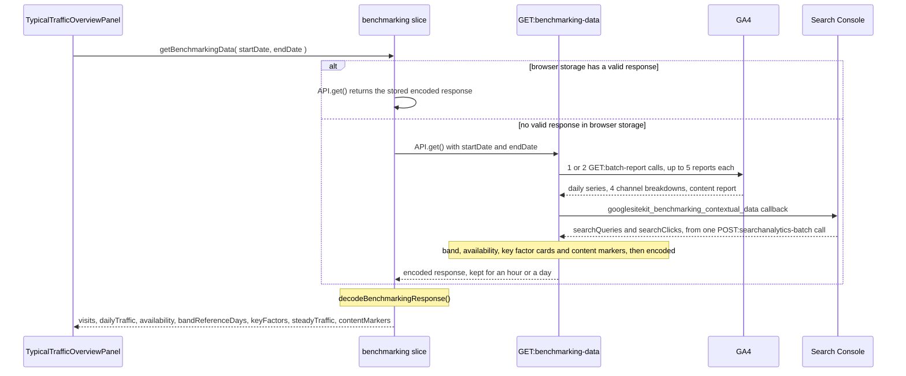

# **\[SK\] Part 2 \- Typical Traffic Design**

| Reviewer | Role | Status | Last Change |
| :---- | :---- | :---- | :---- |
| [Mariya Moeva](mailto:mmoeva@google.com) | Approver | Not Started |  |
| [Evan Mattson](mailto:emattson@google.com) | Approver | Not Started |  |

***Visibility:** Confidential*   
***Status:*** *Review*  
***Author(s):** [Eugene Manuilov](mailto:eugene.manuilov@fueled.com)*  
***PRD:** [Performance intelligence: site benchmarking & forecasts in Site Kit \[PRD\]](https://docs.google.com/document/d/1zwM9ogRlrFO__rLFVYT6SE1qqsjIwzfFUELBiLnYHUQ/edit?pli=1&tab=t.0)*  
***Figma Designs:** [Figma](https://www.figma.com/design/MWN8TXAjfTeKLF0DZ91bIX/Performance-benchmarking?node-id=552-10409&m=dev)*  
***Last Major Revision:** Nov 27, 2026* 

# **Context**

## **Objective**

This epic adds the typical traffic view to the Traffic overview tab of the `analyticsTrafficOverview` widget on the main dashboard. The view adds no tab: it replaces the tab's panel and footer. The view is shown for every site, no matter how much history the site has. Its chart shows the site's daily visits across the selected period. It compares each day's visits with the range that is typical for that day, based on the site's own history. Its key factors section names what changed traffic in the selected period, compared with the period before it. The epic also adds the server-side datapoint that collects and calculates everything that the view adds. On the entity dashboard, the tab gets a panel with the same layout for the page's own traffic, without the parts that describe the whole site. The widget's PDF export prints the view.

## **Background**

The Traffic overview tab answers the question "how many visitors did I get, and where did they come from?" for the selected date range. But it cannot answer whether the number is normal.

Most site owners do not have the analytics knowledge or the historical context to judge a 12% drop. If they do not know what their own traffic normally looks like, they misread it. A quiet weekend looks like a drop. A dip that is still inside the site's normal day-to-day variation looks like a crisis. The day after a viral spike looks like a collapse. Answering whether the number is normal needs three things that the tab does not have without this epic:

1. The site's own history, which reaches far before the selected date range. Every day of the range needs up to a year of this history, ending four weeks before the day.  
2. An expectation for every day of the range, forecast from this history. The expectation is a range that is centered on the site's long-term usual level. The shape of the range follows the site's weekday pattern. The range stays steady through a viral day or an outage of up to four weeks. This way, a dip is compared with what this site normally does, not with the reader's memory of it.  
3. A comparison across every driver of traffic at once. A driver is a channel, the paid channels as one group, or the part of one channel that carried most of the channel's change: a post, a referring site or a campaign. A page that brought visits through several channels is a driver too. Each driver is described in more detail by the values inside it that carried its change, such as a landing page, a search keyword, a device or a kind of visitor. This way, a change in traffic can be linked to the few things that were responsible for it, instead of only being observed.

The browser should not calculate any of these three things. To build one view of a 90-day range, the browser would need 544 days of daily rows. It would need a model fit over up to a year of those rows for each day on the chart. It would also need five breakdowns of the range and the range before it, and four Search Console requests, from two modules. Together, this means about ten reports and requests, and 90 model fits. Some of those requests are Search Console requests, and an Analytics widget would have to send them. This epic does this work on the server instead, in one datapoint. The only parameters of this datapoint are the two dates that the dashboard already has.

# **Design**

## **Overview**

This epic adds a typical traffic view to the Traffic overview tab of the existing `analyticsTrafficOverview` widget. A new `typicalTraffic` feature flag controls the view. **The view adds no tab.** With the flag, the tab's panel on the main dashboard is `TypicalTrafficOverviewPanel`, and its footer is `TypicalTrafficOverviewFooter`. The panel renders these sections, from top to bottom:

1. **One notice** — what the selected range lacks, and when each waiting part will show. With the flag of the [Traffic Insights](./traffic-insights-design-doc.md#generated-insight) epic, the generated `analysis` shows in the notice's place once the range has every part.  
2. **The figures** — `Total visits`, with its change against the previous period, and `Unique visitors`.  
3. **Typical traffic chart** — daily visits across the selected date range. The chart shows the typical range of each day as a band under the traffic line, and it marks each day when a post that brought visits in the range was published. Each day's band is forecast from up to a year of the site's own history before that day. This way, each day is compared with what this history expected for that day.  
4. **Key factors** — what changed traffic in the selected period, compared with the period before it. The section shows up to three cards. Each card names one driver: a channel, the paid channels as one group, a post, a referring site, a campaign, or a page that brought visits through several channels. Each card shows the driver's change in visits, and up to two attributes that carried this change, or three on the `Paid traffic` card. The cards show only for a range of at least 7 days, when the site has recorded traffic on every day of the period before the selected period. With the Traffic Insights flag, the generated `driver` shows above the cards.  
5. **Traffic breakdown** — the selected range's visits by channel, location and device.

To support the view, the epic adds five new parts:

1. **A datapoint that collects and calculates the data.** `GET:benchmarking-data` on `Analytics_4` runs five GA4 reports, or six with the content report, in one or two `GET:batch-report` calls. It collects Search Console's rows through a filter. It calculates the daily series and its band, decides which parts of the view the range has (`Typical_Traffic_Availability`), builds the key factor cards (`Key_Factors`) and picks the published posts that the chart marks. It returns everything that the view adds. See [Data datapoint](#data-datapoint).  
2. **An expected-range model.** `Period_Baseline` is a PHP port of the Site Kit Service's expected-range model. It forecasts each plotted day's band from the up to 365 days up to 28 days before that day. See [Expected range](#expected-range).  
3. **A filter that Search Console answers.** The search keyword rows and the site's search clicks come from the `googlesitekit_benchmarking_contextual_data` filter. As a result, no module holds a reference to another module. See [Cross-module contextual data](#cross-module-contextual-data).  
4. **A flat wire format.** It is one positional encoding: the position of each value shows which field it is. PHP writes this encoding and JS reads it. The encoding keeps the response compact in browser storage. The response has a daily row for every day of the range with its bounds, the availability of each part, up to three key factor cards and the published posts. See [Wire format](#wire-format).  
5. **A datastore slice.** `modules/analytics-4` gets a new `benchmarking` slice. The slice resolves the response and decodes it. See [Datastore slice](#datastore-slice).

**This feature caches nothing on the server.** Search Console and Analytics report data is not stored on the server, so the datapoint cannot use a transient as a cache. The API layer caches the response in browser storage, as it does for any other `GET` request, for an hour, or for a day when the range ends before the last three days. Every browser tab of the login session reads the same cached response. The cache key uses the two dates that the response depends on.

**PHP calculates the expected range from the daily series that the datapoint already collects.** The expected range comes in the same response as the traffic line that it is drawn next to, so it needs no request of its own. The browser draws the bounds that it receives, and it does not calculate any bounds itself. See [Expected range](#expected-range). **No part of the expected range is generated by AI.** Every bound is calculated with arithmetic from the site's own history. No bound comes from a call to an AI model. **The band ends on `endDate`, as the traffic line does.** The chart draws nothing for a day that has not happened yet. **The band covers every day of the range or none of it.**

**The expected range shows what is normal for the site's current level, not for the time of year.** Each day's band is centered on the site's long-term usual level, the median of up to 12 four-week blocks plus half of the site's drift, in the history that ends 28 days before that day. The shape of the band follows the site's weekday pattern in that history. As a result, the band follows a seasonal rise or fall only as fast as the site's level does, and it does not expect this change in advance. This also means that a yearly January decline and a first-time January decline look the same when they are compared with the band. Telling these two declines apart needs a comparison with the same weeks a year earlier. Only the [generated insight](./traffic-insights-design-doc.md#what-the-service-is-told) makes this comparison, from last year's totals for the same two periods, and it does so in words, not on the chart. See [Expected range](#expected-range).

**Every count in the view is a visit (a GA4 session), except a search keyword's clicks and the unique visitors.** The traffic line, the period totals, the expected range, the key factor cards and the breakdown all count sessions. This is because sessions add up across the channels, pages, sources and campaigns that the cards name. Also, when the traffic line uses the same unit, the visits on each card are part of the visits on the traffic line. The panel without the flag counts visitors, so the two panels plot different numbers for the same day. See [Report gathering](#report-gathering).

**The view is shown for every site, no matter how much history the site has.** What the panel draws depends on how much traffic the site has recorded, counted from its first day with visits. The band needs `d + 55` days of recorded traffic up to the range's last day, where `d` is the range's length. The key factor cards need a range of at least 7 days and recorded traffic on every day of the period before the range. Until the site has enough recorded traffic, the notice says when each waiting part will show. A site with low traffic gets a warning instead, and no band, no cards and no insight, however long its history. The figures, the traffic line and the breakdown always show. See [Gating and visibility](#gating-and-visibility) and [Panel states](#panel-states).

**The analysis of the whole site is only on the main dashboard.** The band, the cards and the insight describe the whole site, and the entity dashboard does not ask about a year of traffic for one URL. `GET:benchmarking-data` has no URL parameter at all. On the entity dashboard, the flag gives the tab `EntityTypicalTrafficOverviewPanel`, which keeps the panel's layout for the page's own traffic: its visits, its unique visitors, its daily visits and its breakdown, with no band, no key factors and no notice. See [Gating and visibility](#gating-and-visibility).

**The view works in the view-only dashboard.** The datapoint is shareable. So on a shared request, the reports run with the module owner's credentials, exactly as every other shared report does. See [Dashboard sharing](#dashboard-sharing).

**The widget's PDF export prints the view.** With the flag, the widget's PDF section prints the notice or the analysis, the figures, the chart with its band, the key factors without their attribute rows, and the breakdown. It reads `GET:benchmarking-data` through the same slice as the panel. See [PDF export](#pdf-export).



## **Infrastructure**

Most of the front end is reused. The widget shell already keeps its tabs as a list of descriptors, and each descriptor names the panel and the footer of its tab. So the flag swaps the panel and the footer of the Traffic overview descriptor, and it adds no tab. The chart component, the loading placeholders, the notices, the change badges and the error state are the same ones that the rest of the dashboard uses. Email Reporting is a working precedent for the server-side half. It already runs GA4 and Search Console reports to build a payload, not to answer a single report request.

Six of the reused parts are important to the design, because the design depends on one specific property of each:

* **`Module::get_data()` and `Module::set_data()` dispatch a datapoint in-process (inside the same PHP process).** The data datapoint runs its reports in this way. There is no HTTP hop and no REST round trip, and the datapoint uses the module's own service client. See [Report gathering](#report-gathering).  
* **`Module::get_oauth_client_for_datapoint()` resolves the client for each datapoint**, including for a nested in-process dispatch. This makes the data datapoint work in the view-only dashboard. See [Dashboard sharing](#dashboard-sharing).  
* **`GET:batch-report` on `Analytics_4` runs up to five report requests in each GA4 call.** So the five reports that every response needs take one round trip, and the content report, which runs when the property has the post date custom dimension, takes a second one. `Response_Builder::run_reports()` chunks the reports in the same way that `Email_Reporting_Data_Requests::collect_batch_reports()` chunks them.  
* **`POST:searchanalytics-batch` on `Search_Console`** returns the query rows of both windows and the site's clicks in each window, in one call with four requests. The [contextual-data filter](#cross-module-contextual-data) returns these rows. This Search Console datapoint also returns them on a shared request.  
* **The API layer caches `GET` responses in browser storage, keyed on the datapoint and an MD5 hash of its query parameters.** This cache stores the response. The cache key uses the two dates that the response depends on. The epic adds a `shared` option to this cache: a shared item is kept in `localStorage`, so every browser tab of the login session reads it. The slice adds no browser cache of its own.  
* **`GoogleChart` passes Google Charts role columns through unchanged.** `getFilteredChartData()` returns the table unchanged when no `selectedStats` is passed. `getChartOptions()` does not change `intervals`. So the expected range is added as two interval columns and an option, not as a change to the component, and the day of a published post is marked by a `style` column. See [Typical traffic chart](#typical-traffic-chart).

The new infrastructure is the report gathering, the ports of the Site Kit Service's models, and the transport between them and the panel. It has five parts. The first three are one `Analytics_4` datapoint, the classes that port the service's [expected range](#expected-range), [availability rules](#panel-states) and [card algorithm](#key-factor-scoring), and the filter that Search Console answers. The last two are the [wire format](#wire-format) that both languages read, and the `benchmarking` datastore slice in the browser. The external dependencies are the GA4 Data API and the Search Console API. They are accessed in the same way as always.

## **Detailed design**

### **Feature flag**

A new `typicalTraffic` feature flag controls the code of this epic.

**The flag changes what the Traffic overview tab shows. It adds no tab.** When the flag is on, `TrafficOverviewWidget` gives the tab `TypicalTrafficOverviewPanel` on the main dashboard and `EntityTypicalTrafficOverviewPanel` on the entity dashboard, with `TypicalTrafficOverviewFooter` on both. When the flag is off, the tab keeps `TrafficOverviewPanel` and its `TrafficOverviewSourceLink` footer, so the widget renders as it does without this epic. The widget's PDF section follows the same flag: `registerWidgets()` gives it `TypicalTrafficOverviewPDF` and `getTypicalTrafficOverviewPDFData()` only when the flag is on. See [Gating and visibility](#gating-and-visibility) and [PDF export](#pdf-export).

On the server, Search Console adds its [contextual-data callback](#cross-module-contextual-data) only when the flag is enabled. `GET:benchmarking-data` is in `Analytics_4::get_datapoint_definitions()` whether the flag is on or not, but only the panels of the flag request it. As a result, when the flag is off, no request runs any benchmarking code.

Two additions do not depend on the flag. First, `sessionSource`, `landingPage` and `sessionCampaignName` are in the [shareable dimensions](#report-gathering). Second, `propertyCreateTime` is in the view-only settings keys that `Analytics_4\Settings::get_view_only_keys()` returns, so the [chart](#typical-traffic-chart) can mark the property's creation for a view-only reader. Both additions are entries in allow-lists that the rest of the plugin reads on every request. Letting a feature flag decide what a shared report may query is worse than widening these lists. When the flag is off, no panel of this epic reaches either addition. The only visible effect of either addition is then the property-creation marker that the chart of `TrafficOverviewPanel` draws for a view-only reader.

### **Gating and visibility** {#gating-and-visibility}

The Traffic overview tab shows the typical traffic view when all of these conditions are true:

1. The `typicalTraffic` flag is enabled.  
2. The Analytics module is connected. The widget adds the Traffic overview tab only then, because everything that the tab draws comes from Analytics reports.  
3. The view context is the main dashboard, either authenticated or view-only. `useKeyFactorsVisibility()` combines this condition with the flag as `isAvailable`, and every part that describes the whole site waits for it.

**On the entity dashboard, the tab shows the page's own traffic, without the typical traffic view.** `EntityTypicalTrafficOverviewPanel` keeps the layout of the main panel under a `Traffic over time` heading: the total visits and the unique visitors, the chart of daily visits and the traffic breakdown. `useEntityTrafficReports()` reads them from GA4 reports that `useTrafficReport()` limits to the entity URL. The panel requests no benchmarking response, so it has no band, no published posts, no key factors, no generated insight and no notice about what the range lacks. Its total visits show no change, because the panel reads no visits for the period before. `GET:benchmarking-data` has no URL parameter, because the band, the cards and the insight describe the whole site. A per-page version would be a different analysis, not the same analysis with a filter. Every band reads up to a year of traffic, and for a single page, this year is dominated by the page's own publication date. Also, the breakdowns behind the key factor cards have little data for most pages. The footer is `TrafficOverviewSourceLink`, which opens the Analytics report filtered to the page's path.

**The typical traffic view is shown no matter how much history the site has.** A property that was connected yesterday gets it. The amount of traffic that the site has recorded decides which parts the panel draws, not whether the view is there. The figures, the traffic line and the breakdown always show. One notice, in the place of the generated analysis, says what the range lacks and when each waiting part will show. See [Panel states](#panel-states).

**History is counted from the first day when the site recorded traffic, not from the day when the property was created.** This is because the band and the cards both use the recorded daily series. Also, a property that was created long before its site was tagged has months of zeros, and these zeros give no information about the site. `Typical_Traffic_Availability` decides on the server which parts the range has, from this history, and the response carries the result as `availability`. So the panel decides every state from this single response, and it never works the rules out again. See [Response assembly](#response-assembly).

**The band needs `d + 55` days of recorded traffic up to the range's last day, which is 83 days on a 28-day range.** Each day's band is forecast from the up to 365 days up to 28 days before it. **The band covers every day of the range or none of it.** So a range never shows a band that starts partway into it. See [Expected range](#expected-range).

**The key factor cards need a range of at least 7 days and recorded traffic on every day of the period before it.** A card compares the selected period with the period before it. So the cards wait until the site's first recorded day is on or before the first day of that previous period, which takes `2d` days of recorded traffic up to the range's last day. See [Key factor scoring](#key-factor-scoring).

**A site with low traffic, under 100 visits per 28 days over the 56 days that end on `endDate`, keeps the traffic line, the published posts and the breakdown, but it gets no band, no key factor cards and no insight, however long its history.** At a few visits a day, the band is so wide that it holds almost any number of visits, and a card can name a change of a handful of visits. Time fixes a short history, but not a low volume. A warning in the analysis's place says why. The threshold, `LOW_TRAFFIC_VISITS_PER_28_DAYS` and `LOW_TRAFFIC_DAYS` in `Typical_Traffic_Availability`, is provisional until product decides it. See [Panel states](#panel-states).

**A property that is still gathering data shows none of these parts.** `useKeyFactorsVisibility()` also reads `isGatheringData()`. While it is true, the panel leaves out the key factors, the notice, the published posts and the insight, and the figures, the chart and the breakdown show their gathering-data state.

### **Widget shell changes**

The shell keeps its tabs as a list of descriptors, and it keeps its active tab in component state. Each descriptor names the panel and the footer that the widget renders while its tab is active, as `PanelComponent` and `FooterComponent`. **The flag changes the panel and the footer of the Traffic overview descriptor. It adds no descriptor.** The widget picks `TypicalTrafficOverviewPanel` or `EntityTypicalTrafficOverviewPanel` with `useDashboardType()`, and both panels are under `traffic-overview/tabs/`. The `Recent activity` tab is the same with or without the flag, and it is never on the entity dashboard.

The shell has two consequences for the panel:

* **A panel is unmounted when it is not active, and it requests nothing until the card has been in view.** The panel's hooks read their selectors through `useInViewSelect`. So `GET:benchmarking-data` is not requested before the card comes into view, and it is not requested while the `Recent activity` tab is active. The card opens on the Traffic overview tab, so on the main dashboard, every load that brings the card into view reads the response. The slice and the API layer keep it, so a second visit to the tab is instant, and a reload while the response is still valid sends no request. See [Datastore slice](#datastore-slice).  
* **Tab state resets on reload**, as it does without the flag. The card opens on Traffic overview every time, and no preference is saved.

**The footer follows the panel.** `TypicalTrafficOverviewFooter` reads `useKeyFactorsVisibility()`. Where the tab has no key factors, which is on the entity dashboard, the footer is `TrafficOverviewSourceLink`, as without the flag. On the main dashboard, the footer is `SourcesLinks`, `Sources: Analytics Search Console`, which links to the reports in both services, because the search keywords of the key factor cards come from Search Console. `SourcesLinks` renders nothing on the view-only dashboard. While the panel shows a generated insight, the footer adds the AI disclosure of the [Traffic Insights](./traffic-insights-design-doc.md#generated-insight) epic. The footer reads the insight through the same hook as the panel, so it reads the panel's resolved value and sends no request of its own.

### **Panel data flow** {#panel-data-flow}

**The panel reads the reports and the response, and its sections only render them.** `TypicalTrafficOverviewPanel` reads everything that it draws through hooks and helpers in `traffic-overview/`, and it passes rows and figures to its sections as props:

* `useTypicalTrafficOverviewReports()` resolves the panel's GA4 reports and the benchmarking response. The reports are the totals report, which counts the unique visitors (`totalUsers`) of the selected range and of the range before it, and the three reports of `TypicalTrafficBreakdown`, which count the sessions by `sessionDefaultChannelGrouping`, `country` and `deviceCategory`. The response comes from `useBenchmarkingData()`, which reads the selected date range from `core/user` and calls the [`benchmarking` slice's](#datastore-slice) selectors with those two dates. The hook requests the response only where the tab has the key factors: on the main dashboard, with the flag.  
* `useKeyFactorsVisibility()` says whether the tab has the key factors, and whether the panel shows them, which it doesn't while the property is gathering data.  
* `getTypicalTrafficAvailability()` reads the response's `availability`. Until the response arrives, it says that every part is available, so each part keeps its placeholder.  
* `getTrafficOverviewVisits()` picks the daily traffic and the period totals that the chart and the figures draw.  
* `useBenchmarkingInsight()` resolves the [generated insight](./traffic-insights-design-doc.md#panel-data-flow) of the Traffic Insights epic.

The response decodes into the fields that the sections render:

| Field | Shape | Rendered by |
| :---- | :---- | :---- |
| `visits` | `{ current, previous }`: the sessions of the selected period and the sessions of the period before it | `TypicalTotalVisitors`, as `Total visits` and its change. The [generated insight's payload](./traffic-insights-design-doc.md#payload-assembly) sends the same totals. |
| `dailyTraffic` | one row for each day of the selected range: `{ date, visits, expectedMin, expectedMax }`. `visits` is the day's sessions. The bounds are `null` on every day of a range without a [band](#expected-range). | `TypicalTrafficChart` |
| `availability` | which parts the range has: `bandAvailable`, `keyFactorsAvailable`, `insightRequestAllowed`, `performanceInsightAvailable`, `lastYearAvailable`, `rangeTooShort`, `rangeTooLong` and `lowTraffic`. It also has the last day of the first range of this length with the band, `bandAvailableFrom`, and with the key factors, `keyFactorsAvailableFrom`. | No section by itself. The panel's [states](#panel-states) and `TypicalTrafficAvailabilityNotice` use it. |
| `bandReferenceDays` | the days of traffic that the band of the range's last day is fitted on, at most 365, or `null` without a band | The band's legend item in `TypicalTrafficChart` |
| `keyFactors`, `steadyTraffic` | up to three cards, in rank order, and whether no channel changed notably. See [Key factors](#key-factors). | `KeyFactors` |
| `contentMarkers` | `{ date, posts }` for each day of the range with a published post, oldest first. Each post is `{ title, url }`. | `TypicalTrafficChart`, as published posts, through `getPublishedPosts()` |

The shape of the response and its field names are both defined by the plugin. They are camelCase, and they are not related to anything that the reports return. The response is sent to the browser in the positional [wire format](#wire-format). The table above shows what the slice's decoder produces from the wire format. Every section component is written for this decoded shape. With the Traffic Insights flag, the response also carries the insight's request, which no section reads.

**A failed benchmarking request takes only the parts that the response alone has.** These parts are the band, the published posts, the key factors and the insight. `useTypicalTrafficOverviewReports()` then requests the daily visits report, which counts the sessions of each day of the range and of the range before it, and `getTrafficOverviewVisits()` reads the traffic line and the period totals from it. So the panel keeps its figures, and it shows the request's error, with a `Retry` button, in the place of the key factors. A failed GA4 report is different: the panel then shows the errors in place of all its sections. See [Panel states](#panel-states).

No section component reads the response or a report itself. The sections read from the stores only what the response doesn't carry, such as the selected date range and the property's creation time. So Storybook and the tests render each section from one decoded fixture for each state, not from a set of report responses for each section.

### **Typical traffic chart** {#typical-traffic-chart}

`TypicalTrafficChart` renders `GoogleChart` with `chartType="LineChart"`. A pure function in `traffic-overview/charts/`, `getTypicalTrafficChartData()`, builds the chart's table from the daily traffic. The table has the date and the daily visits (GA4 sessions), and, on a range with a band, the band's lower and upper bounds. The options are `TYPICAL_TRAFFIC_CHART_OPTIONS` in `typicalTrafficChartOptions.ts`. The columns and the option values are in the [appendix](#chart-table-and-options). The legend is below the plot, as the [chart's design](https://www.figma.com/design/MWN8TXAjfTeKLF0DZ91bIX/Performance-benchmarking?node-id=1747-32704&m=dev) shows it.

**The traffic line plots the site's sessions, and the panel calls them visits.** The column for the traffic line is labelled `Visits`, and the figure above the chart is `Total visits`. The chart of the tab without the flag counts visitors (`totalUsers`), so the two charts have different values for the same day. See [Report gathering](#report-gathering).

**The chart's window is the selected date range, as on every other chart of the dashboard.** The chart plots every day from the `startDate` of the selected range to its `endDate`, with one point for each day. It plots nothing after `endDate`, so it never draws a day that has not happened yet. The question that the view answers needs the site's history, and this history is in the band, not in the traffic line. Each day's [expected range](#expected-range) is forecast from up to a year of the site's traffic before that day. As a result, each day is compared with what is normal for that day, based on the site's recent traffic. The chart does not plot that history itself. The band has no term for the time of year. So the chart shows whether a day is normal for the site's current level, not whether the period is normal for the time of year. Only the [generated insight](./traffic-insights-design-doc.md#generated-insight) compares the period with the same time last year, and it does so in words.

The chart keeps the axes of the chart without the flag, and its value axis also covers the band:

* **The x axis has one tick for each plotted day, starting from the second day.** Google Charts would hide the first day's label against the edge of the plot. The tick labels use the format `MMM d`, and the gridlines are transparent. Google Charts shows fewer labels when there is not enough space. The axis ends on `endDate`, where a baseline draws the gray line along the right edge of the plot.  
* **The value axis is on the right, and it covers both the traffic line and the band.** The traffic line plots against the second value axis, which Google Charts draws on the right. The axis starts at zero, and Google Charts ends it above both the largest daily value and the largest upper bound. So the band is not cut off on a day when the site gets fewer visits than expected. If no day is above zero and the range has no band, the axis ends at 100, so a line of zeros runs along the bottom of the plot, not across its middle.

**The expected range is drawn under the traffic line when every day of the range has one.** The two bound columns are declared with `role: 'interval'`, and they come after the visits column that they annotate. The `intervals` option draws them as a filled area, as the [chart's design](https://www.figma.com/design/MWN8TXAjfTeKLF0DZ91bIX/Performance-benchmarking?node-id=1747-32704&m=dev) shows it. The option uses `style: 'area'` and `lineWidth: 0`, so the band has no edge lines. The band's color is `$c-violet-v-50` at an opacity of 0.5, a lighter shade of the traffic line's violet. **The band covers the whole range or none of it.** The response has bounds on every day of a range with a band, and on no day of a range without one. The chart adds the bound columns only when every plotted day has both bounds. So a site with a short history gets no band until every day of the range has one, and never a band that starts partway into the range. Every bound comes from the response, and the chart calculates no bounds itself. Google Charts gives the band's area a hover of its own, with no tooltip. So the widget's stylesheet finds the band by its fill and lets the pointer through it, and a day's tooltip opens over the band too.

**A day's tooltip is Google's own, and it shows the day's visits.** The chart keeps `focusTarget: 'category'`, so the tooltip and the crosshair follow the day under the pointer. Google Charts adds a day's interval values to its tooltip, as in `Visits: 25 [31, 52]`. So a range with a band has one more column, with `role: 'tooltip'`, which holds the day's visits alone, formatted for the user's locale.

**The band's legend item says how much traffic the band is based on.** The item, `Typical traffic range`, has an info tooltip: `Site Kit estimates a typical range from your traffic history, so you can see when visits are higher or lower than expected. Based on %d weeks of your traffic. Learn more`. The number of weeks is the response's `bandReferenceDays`, the days of traffic that the band of the range's last day is fitted on, divided by 7 and rounded down. So the tooltip never claims more history than the band read. When `availability.lastYearAvailable` is true, the second sentence ends with `, including the same time last year`. It is true when the site's history has every day of the range, and of the period before it, as they were 52 weeks earlier. The `Learn more` link opens the `typical-traffic-range` support page that [Documentation in-product](#documentation-in-product) describes. Without `bandReferenceDays`, the item has no tooltip. The item also has a `Beta` badge.

**The chart marks the days when a post that brought visits in the range was published.** The panel passes the posts of the response's `contentMarkers` to the chart as `publishedPosts`, through `getPublishedPosts()`. Each such day gets a dot on the traffic line, in `$c-violet-v-200` with a white edge. Hovering the day opens a card that names the day's posts, with a `See more` link to each post's Site Kit dashboard, and the card takes the place of the day's own tooltip while it is open. The posts come from the response, so there are none while the post-date custom dimension has no data, on the entity dashboard, or after a failed request. See [Content markers on the charts](./traffic-insights-design-doc.md#content-markers-on-the-charts).

**The chart marks the property's creation date, as the chart without the flag does.** If the day when the property was created is inside the selected range, the chart passes this day to `GoogleChart` in `dateMarkers`, through `getPropertyCreatedMarkerDate()` and `getPropertyCreatedDateMarkers()`. `GoogleChart` draws a dashed line on that day, with an icon whose tooltip says `Google Analytics property created`. The chart also renders the screen-reader sentence that `TrafficChart` renders next to its own marker, `PropertyCreatedScreenReaderText`. As a result, the chart shows which days are before the property existed. The marker reads `propertyCreateTime`, which is in the module's view-only settings keys, so a view-only reader sees it too.

**The legend is HTML, and it lists only what the chart draws.** `TypicalChartLegend` renders one item for each part, below the plot: the traffic line, the band when the range has one, and `Published post` when a plotted day has a post. The first item names the traffic line with the label of the chart without the flag, from `getTrafficLegendItem()`, for example `Last 28 days traffic` on a 28-day range. This label names traffic, not a unit, so it is correct for a line of visits. Each item has a swatch in the shape of its part: a short bar for the line, a filled block at the band's opacity for the band, and a dot for a post. So no part is identified by its color alone. The built-in legend of Google Charts stays off. That legend cannot show a band in any case, because an interval column is not a series. `TypicalChartLegend` is a component of its own, so `ChartLegend`, the legend of the chart without the flag, stays as it is.

**The chart has a placeholder and a gathering-data state.** While the panel's figures load, `GoogleChart` shows its 276px placeholder, and the chart renders no legend and no screen-reader text. While the property is gathering data, the chart passes `gatheringData` to `GoogleChart`, which draws its gathering-data overlay. Under the overlay, the chart draws a flat line at zero through the range's first, second and last days, with no band and no posts, and the value axis ends at 100. The chart then sets a horizontal view window of its own, because otherwise `getChartOptions()` drops the ticks of a chart in this state.

**Screen readers get each day in text.** Once the chart has its data, and while the property is not gathering data, the chart renders a visually hidden sentence for each day, `%1$s: %2$s visits, typical range %3$s to %4$s`, without the range on a range without a band. It renders one more sentence for each post: `Post published on %1$s: %2$s`, with the day and the post's title.

### **Key factors** {#key-factors}

`KeyFactors` ([Figma](https://www.figma.com/design/MWN8TXAjfTeKLF0DZ91bIX/Performance-benchmarking?node-id=2096-14304&m=dev)) renders up to three cards under the heading `Biggest traffic shifts vs. the previous %d days`, where `%d` is the length of the selected range. An `InfoTooltip` beside the heading reads `Shows what changed most compared with the previous period.`, with a `Learn more` link to the `typical-traffic-shifts` documentation. The cards are in the order that the response gives them. Each card names one **driver**: a thing whose visits changed in the selected range, compared with the range before it, or, on a steady period, one of the channels with the most visits. The card describes the driver in more detail with at most two **attributes**, or three on the `Paid traffic` card. An attribute is one of the values inside the driver that carried the driver's change, with its own figure. Every figure, share and mark comes from `keyFactors`, and the section only formats them.

**Every card is rooted in a channel.** Every visit has exactly one channel of the default channel grouping. So a driver is a channel, the paid channels as one group, or a part of one channel that carried most of that channel's change:

| Kind | A card names | Its title |
| :---- | :---- | :---- |
| `CHANNEL` | a channel of the default channel grouping | the channel's name, with `Cross-network ads` for `Cross-network` and `Uncategorized traffic` for `Unassigned` |
| `CHANNEL_GROUP` | the paid channels as one group, when at least two of them moved materially | `Paid traffic` |
| `CONTENT` | a post published in the selected range that carried most of its channel's change, or a page that brought much of the site's change through several channels | the page's title, or its path when it has none |
| `REFERRING_SITE` | a referring site or a platform that carried most of its channel's change | the source's name, such as `Facebook` |
| `CAMPAIGN` | a campaign that carried most of its channel's change | the campaign's name, written for readers |

**Search keywords, devices and visitor types are never drivers, only attributes.** A device or a visitor type describes visits that a channel already counts. A card for it would repeat that channel, and take one of the three card places from it. A search keyword counts Search Console clicks, which are no part of a channel's visits, so it is an attribute of the `Organic Search` card. **A post category is not a driver either**, and the datapoint runs no category report.

**The attributes that a card can show depend on its driver:**

| Card | Attribute candidates, in order |
| :---- | :---- |
| a channel | its search keyword (`Organic Search` only), up to two of its sources or of its campaigns, its landing page, its device, its visitor type |
| `Direct` | its homepage, its landing page, its visitor type, its device |
| a channel whose change is the net of parts that moved both ways | the two sides of the net, or the larger side alone |
| `Paid traffic` | up to three of the paid channels |
| a page that brought visits through several channels | up to two of those channels |
| a referring site or a campaign | its channel's landing page |
| a post | none |
| a channel on a steady period | the candidates of a channel or of `Direct`, without its search keyword, sources and campaigns |
| a channel's other pages | `Direct`'s homepage, its landing page |

A card shows at most two of its candidates, or three on the `Paid traffic` card: the first that clear the floors and agree with each other. See [Attribute selection](#attribute-selection). So a card can show one attribute, or none. The list shows what a card *may* say, not what it must say.

**The first attribute candidates for Direct traffic are its homepage and its landing page.** A direct visit has no referrer that the card could name. The page that the visit lands on is the clue that is left. A visit to the homepage suggests that the visitor remembered the brand, used a bookmark or typed the address. A visit to a deep post or a product suggests that someone shared a link in a place that removes the referrer. Examples are a messaging app, a workplace chat and an email client. The homepage is named `Homepage`, without an address, and a landing page that moved further than the homepage comes first. The device is the other clue, because sharing in a mobile messaging app and sharing in a desktop workplace chat leave different patterns. **A Direct card reads no click identifiers.** The reports read `landingPage`, which has no query string, so an identifier such as `fbclid` never reaches the cards, and every direct visit stays a visit of `Direct`. Whether the reports should read the query string is an [open question](#should-the-reports-read-the-landing-page's-query-string?).

**A referring site, a platform and an AI assistant are the same dimension with three titles.** All three are the session's source within its channel. A card for a paid channel or for `Organic Video` gives the source the title `Platform`, a card for `AI Assistant` gives it the title `AI assistant`, and any other card gives it the title `Referring site`. They are separate attribute kinds in the response, so that an attribute gets its title from its kind alone. The renderer then does not need to know which channel the attribute belongs to. **The variants of one source are combined into one name** before anything is summed or ranked. `Source_Classifier` names a source the way the service names it: `fb`, `facebook` and every `facebook.com` host become `Facebook`, `t.co` and `twitter` become `x.com`, and `lnkd.in` becomes `linkedin.com`, for example. So a sudden increase that is split across `m.facebook.com` and `l.facebook.com` counts as one referring site, not as two small ones.

**AI-assistant traffic is read from the channel grouping, by name.** A channel named `AI Assistant` is a channel like any other, and its sources are its `AI assistant` attributes, such as `chatgpt.com`. An assistant never takes its channel's card. The plugin derives no AI channel of its own: an assistant whose visits GA4 counts as `Referral` stays a referring site of the `Referral` card, named by its product domain, such as `perplexity.ai`.

The components are in `traffic-overview/factors/`. Each component takes its values as props:

* `KeyFactors` — the heading, the notice, the insight's `driver`, and one `KeyFactorCard` for each card that it shows, or three `KeyFactorCardPlaceholder`s (`KEY_FACTORS_MAX_CARDS`) while the response loads.  
* `KeyFactorCard` — the driver's name as its title, a `KeyFactorChangeBadge`, the line that says what its change is a share of, and its attributes under `Top changes within %s`, where `%s` is the driver's name.  
* `KeyFactorChangeBadge` — the card's signed change in visits, such as `+65 visits`, red for a drop and green otherwise. The sign gives the direction, so the badge never depends on its color alone.  
* `KeyFactorAttribute` — the title of the attribute's kind, from `KEY_FACTOR_ATTRIBUTE_TITLES`, its value, its signed change, and the line under it.  
* `KeyFactorsInsightNotice` — the insight's `driver`, with the AI icon, or its placeholder while the insight loads.

**The names come from the response, and a few are translated.** `getKeyFactorName()` names a card. A channel shows the name that GA4 gives it, except for the names that the plugin and the service give, `Paid traffic`, `Cross-network ads` and `Uncategorized traffic`, which `getChannelName()` translates. A page shows its title. A channel's card for its other pages reads `Direct (other pages)`, for example. `getKeyFactorAttributeName()` names an attribute. A landing page shows the page's title when the response has one, and its path otherwise. The site's homepage is the page at the site's reference URL. Its path is `/`, or a path such as `/blog/` for a site that lives under a folder. It is named `Homepage` (`getLandingPageLabel()`), because its bare path tells a reader little. Paths, hosts, campaign names, queries, devices and visitor types render exactly as the response gives them, such as `mobile` and `new`.

**A landing page links to its entity dashboard.** A `Landing page` attribute and the title of a `CONTENT` card link to the Site Kit dashboard of that one page, by its path, whatever name they show. The link opens in the same tab, because it leads to another Site Kit dashboard. `useKeyFactorLinkClick()` records the click as the `click_page_link` event of `${ viewContext }_typical-traffic`, with the card's kind as its label, before the page leaves. A middle click, or a click with Command, Control or Shift held, opens a new tab, so it is recorded without holding the navigation.

**A long name wraps in a card's title, and is cut off in an attribute.** The title and the `Top changes within` heading wrap, so a long name never pushes the badge out of the card. An attribute's value stays on one line, so that its change stays beside it. CSS cuts the value off with an ellipsis, and the value's `title` gives it in full on hover. The response cuts only a page's title and a campaign's name, at 100 characters (`Key_Factors::MAX_TITLE_LENGTH`, `Source_Classifier::MAX_CAMPAIGN_LENGTH`). Every other label travels in full.

**The line under a card's title says what its change is a share of** (`getKeyFactorShareText()`):

* On a steady period, the card's share of the site's visits: `45.2% of all visits`.  
* A part that took its channel's card names the channel and its change: `73.3% of Referral’s +300 visits`, or `All of Referral’s +300 visits` from 99.5%. A part that moved further than its channel reads `More than Referral’s net change of +300 visits`. A channel whose name ends in "s" takes a bare apostrophe: `Cross-network ads’`.  
* Any other card shows its change alone. Its share of the site's change, on `GROSS_CHANGE`, `NET_CHANGE` or `SITE_TRAFFIC`, has no design, so the panel does not print it. The insight request carries it to the service. Which shares the cards print is an [open question](#which-shares-do-the-cards-print?).

**The line under an attribute** (`getKeyFactorAttributeShareText()`):

* A share of the card's change: `75% of the change`, or `All of the change` from 99.5%.  
* A paid channel on the `Paid traffic` card: its share of the paid channels' movement in both directions, such as `65.6% of paid traffic’s movement`.  
* A search keyword: its change in clicks as a share of all of the site's search clicks, `A change equal to 3.6% of the site’s search clicks`, or `less than 0.1%` when the share rounds to 0. A keyword that moved against the site's search clicks, or further than their change, adds `, while other queries fell` (or `rose`). Without the site's search clicks, the keyword shows its change alone.  
* An attribute that moved further than its card in the same direction, because the card's other parts moved the other way: `While other pages fell` (or `rose`), with `campaigns`, `devices`, `channels`, `queries` or `sources` for the other kinds, and `While returning-visitor visits fell` under `new`. It has no share, so it never reads as more than all of the change.  
* The two sides of a net show as one row: the first side, whose line names the second, such as `Partly offset by -362 visits from mobile` (`getKeyFactorRows()`).  
* Any other attribute shows its change alone.

**The section's states:**

* While the response loads, the placeholders take the places of three cards with a one-line name and two attributes. So the breakdown below does not move when the cards arrive.  
* A card without a name is left out. So is a lone card with nothing under its title, that is, with no attribute that has a name and no spread line, as the service's design asks (`getShownKeyFactors()`).  
* A channel's card without attributes whose change was spread across its pages (`spreadAcrossPages`) says `Spread across many pages, with none standing out` in their place.  
* **On a steady period**, the notice `No channel changed notably compared with the previous %d days.` shows above the cards, and the cards are the channels with the most visits. The same notice takes the place of the cards when there are no cards and no `driver`.  
* The insight's `driver` shows under the heading, above the cards. Its placeholder shows while the insight loads, even above the placeholders of the cards, and the `driver` describes the change on its own when there are no cards. It is a polite live region, so a screen reader reads the text out once it replaces the placeholder. `AIText` makes the names that `**` pairs mark bold.  
* With no card, no notice and no `driver`, the section renders nothing. This happens only when a lone card was left out.

The panel renders the section while the response loads, and then only for a range that has key factors. For any other range, the section is left out, and the [panel's notice](#panel-states) explains what is missing. A failed benchmarking request shows its error in the section's place. The PDF export prints the same cards in the same order, each with its name, its change and the line under its title, but without attribute rows (`TrafficOverviewKeyFactorsPDF`). See [PDF export](#pdf-export).

**A kind that the browser does not know is dropped.** The decoder leaves out a card or an attribute whose kind is not in its list. So when a later response adds a new kind, only one card or one attribute is lost, not the whole panel.

**The selection, the order and every share are calculated on the server, not in the browser.** `Key_Factors` builds the cards, and the `decomposition` that the generated insight describes, in one pass from the same figures. See [Key factor scoring](#key-factor-scoring). The copy of each card comes from the plugin itself. The copy uses translated patterns, for example `%s visits` and `%s of the change`. `sprintf` fills these patterns with values that are formatted through `numFmt`. `_n()` chooses the plural form, based on the absolute value of the change.

### **PDF export** {#pdf-export}

**The widget's PDF section prints the typical traffic view as the panel shows it.** With the flag, `registerWidgets()` gives the PDF section of `analyticsTrafficOverview`, `Site traffic over time`, the component `TypicalTrafficOverviewPDF` and the loader `getTypicalTrafficOverviewPDFData()`. Under the heading `Your site traffic over time`, the section prints:

1. The [generated analysis](./traffic-insights-design-doc.md#generated-insight), or, in its place, the notice that says what the range lacks, with the same text as the panel's notice.  
2. `Total visits`, with its change against the previous period, and the unique visitors as `%s unique visitors`.  
3. The chart of daily visits as an image, with the band when every day of the range has one, in the band's color and opacity. The image has no published posts and no property-creation marker.  
4. The [key factors](#key-factors) section, with its notice and the generated driver, when the range has the key factors. Its cards print without attribute rows.  
5. The three breakdowns: `Visits by channels`, `Visits by locations` and `Visits by devices`.

**The loader reads what the dashboard reads, so the printed figures match.** On the main dashboard, it resolves `getBenchmarkingData()` for the export's dates, and it shapes the figures with the panel's own helpers, such as `getTrafficOverviewVisits()`, `getTypicalTrafficAvailability()` and `getTypicalTrafficAvailabilityText()`. On the entity dashboard, or when the request fails, the visits come from the daily visits report over the range and the range before it, so the section prints no band and no key factors. A report that fails prints as a report without rows, so the rest of the section still prints.

**The section follows the panel's rules without sending requests of its own for them.** It leaves out the notice, the insight and the key factors while the property is gathering data, and it reads that state only when the dashboard has already resolved it. The export's date ranges end on the day before the reference date. So a waiting part's notice says when to check back for a range that ends on that day, as the panel's notice does for a range that ends today. **The export never asks for a generated insight.** It prints the insight only when the dashboard has already resolved it for the same dates, and only where the panel would ask for one. When the section prints generated text, it ends with `Some insights in this report are created using AI and may contain mistakes.`

### **Data datapoint** {#data-datapoint}

`GET:benchmarking-data` is a `Shareable_Datapoint` that implements `Executable_Datapoint` and `Permission_Aware_Datapoint`. It is `Get_Benchmarking_Data`, in `includes/Modules/Analytics_4/Datapoints/`. It takes the module instance and the module's `Custom_Dimensions_Data_Available` through its `$definition` array, and it passes both to a `Response_Builder`. `Analytics_4::get_datapoint_definitions()` registers the datapoint without a flag check. Only the panel of the `typicalTraffic` flag requests it, and Search Console answers its filter only under that flag.

**The datapoint's only request parameters are `startDate` and `endDate`.** Every report datapoint already takes these two parameters. The plotted days and the history before them come from these two dates. The comparison window, the reports, the band, the key factor cards and the content markers also come from them. The analysis covers the whole site, so the datapoint has no URL parameter. A missing parameter is a `400` with the code `missing_required_param`. A value that is not a real `YYYY-MM-DD` day (`Date::is_valid_date()`), or a `startDate` later than `endDate`, is a `400` with the code `invalid_param`.

**The datapoint accepts a range of any length.** So the panel never fails for the range that the reader picked. Each part of the response shows once the site's history is long enough for it, as `Typical_Traffic_Availability` decides. See [Panel states](#panel-states). The [generated insight](./traffic-insights-design-doc.md#generated-insight) is requested only for a range that the service writes one for, from 7 to 364 days.

The module's other datapoints are each a wrapper around one service call, but this datapoint is not. So it does not use `create_request()`/`parse_response()` to shape a single Google API call. Instead, `create_request()` returns a closure that runs three steps, and `parse_response()` returns the result unchanged:

1. **Gather.** `Response_Builder` runs five GA4 reports, or six when the property has the post date custom dimension, in one or two `GET:batch-report` calls. Then it runs the callbacks of the contextual-data filter. Search Console answers with one `POST:searchanalytics-batch` call. See [Report gathering](#report-gathering). If a GA4 call fails, the request ends with that call's `WP_Error`, and the panel shows this error in place of the key factors. See [Panel states](#panel-states). If the Search Console call fails, the response loses the search query rows, and nothing else.  
2. **Derive.** The builder calculates the zero-filled daily series, the period totals, the parts of the view that the range has, the band, the key factor cards and the content markers. In the zero-filled series, a day without traffic has the value 0. See [Response assembly](#response-assembly).  
3. **Encode.** `Response_Encoder` writes the result in the [wire format](#wire-format): the positional arrays that the browser decodes. With the `trafficInsights` flag, the datapoint first replaces the insight's request with the user's locale and the signed payload. See [Wire format additions](./traffic-insights-design-doc.md#wire-format-additions).

**The datapoint saves nothing on the site.** Every request builds the response again from the reports. The browser keeps the encoded response. See [Datastore slice](#datastore-slice).

The datapoint's permission check is `Permissions::VIEW_DASHBOARD`, the dashboard-viewing capability, not the authenticated-dashboard capability. So a view-only user can reach the datapoint.

The datapoint belongs to the Analytics module, not to a new core controller. This is because all of its inputs are GA4 and Search Console data, and all of its consumers are Analytics widgets.

**Everything that the typical traffic view adds to the panel is in this single response.** This includes the band, the availability of each part, the key factor cards, the content markers and, with the `trafficInsights` flag, the insight's payload. One request means one loading state and one error state for all of them. The panel's count of unique visitors and its breakdown read reports of their own. See [Panel data flow](#panel-data-flow).

### **Report gathering** {#report-gathering}

The datapoint runs its reports through `Module::get_data()` and `Module::set_data()`. These methods dispatch a datapoint in-process (inside the same PHP process). The dispatched datapoint uses the module's own service client. Email Reporting uses the same path to build its payload. This path has no HTTP hop and no REST permission round trip.

GA4 reports go through `GET:batch-report`, which takes up to five report requests in each call. `Response_Builder::run_reports()` sends the reports in chunks of five. **Every response needs five reports, and the content report makes six, so a response takes one GA4 call or two:**

| Report | Feeds |
| :---- | :---- |
| `sessions` by `date`, in ascending order, from 364 days before the first day of the comparison window, or from 392 days before `startDate` when that is earlier, to `endDate` | `dailyTraffic` from the days of the selected range, the `visits` totals for both windows, and, from all the days of the report, the [band](#expected-range), last year's totals and the availability of each part |
| `sessions` by `sessionDefaultChannelGrouping`, `deviceCategory` and `newVsReturning`, for both windows | the channels and the paid group, the channel totals that the cards compare, and the device and visitor-type attributes |
| `sessions` by `sessionDefaultChannelGrouping` and `sessionSource`, for both windows | the referring sites, platforms, AI assistants and campaign-shaped sources of each channel |
| `sessions` by `sessionDefaultChannelGrouping` and `landingPage`, for both windows | the landing pages of each channel, including `Direct`'s homepage, and the pages that brought visits through several channels |
| `sessions` by `sessionDefaultChannelGrouping` and `sessionCampaignName`, for both windows | the campaigns of each channel |
| `sessions` by `pagePath`, `pageTitle` and `customEvent:googlesitekit_post_date`, for both windows, only for pages with a post date | the posts published in the selected range, which a post card, the [content markers](./traffic-insights-design-doc.md#content-markers-on-the-charts) and the insight's `recent_content_momentum` name |

Which card and which attribute each row becomes is in [Key factors](#key-factors). Search Console's rows come through the [contextual-data filter](#cross-module-contextual-data), from one `POST:searchanalytics-batch` call.

**The content report runs only when the property has the post date custom dimension.** The report counts sessions by post, so it needs `googlesitekit_post_date`. The property has the dimension when the module's `availableCustomDimensions` setting lists it, or when `Custom_Dimensions_Data_Available` has recorded that the dimension has data. Site Kit records this only when a Key Metrics tile that needs the dimension is shown, so the recorded state alone misses the dimension on a site without such a tile. A dimension that has no data yet returns no rows. Analytics reports `(not set)` for a page that is not a post, so the report keeps only the rows that have a post date. `Response_Builder::build_content_rows()` also skips a row whose post date is not a real day.

Each breakdown puts its current window and its comparison window into one request, as two date ranges, instead of using two requests. Each breakdown asks for at most 500 rows (`Report_Options::REPORT_ROW_LIMIT`), ordered by sessions. Each row is one value in one window, so the limit counts the rows of both windows together. **A row that the report cuts off in one window counts as a row without visits in that window**, so it looks like a row that changed by all of its visits. The limit is far above the number of rows that the response and the insight's request keep, so that the rows they keep are not cut off in either window.

**Every GA4 report counts sessions, because sessions add up.** A session has exactly one channel, one landing page, one source, one campaign, one device and one visitor type. So the rows of any of these reports add up to the channel, page, source or campaign that they break down. Because of this, a landing page's total is the sum of its rows across channels, and a card's attributes are parts of the card. Also, a share of the site's movement is a share of something that adds up to the site's movement. `totalUsers` has none of these properties, because one visitor can arrive through two channels and land on two pages. A session is what the card calls a visit. **The daily series counts sessions too**, so the traffic line, the period totals, the band and the cards all use the same unit. The traffic line shows the site's sessions day by day, and the period totals are the sums of these sessions. The movement that a card names is part of the movement that the traffic line shows. The Traffic overview panel without the `typicalTraffic` flag plots `totalUsers`, so the typical traffic chart [calls its values visits](#typical-traffic-chart).

**Every breakdown is also keyed on the channel.** This assigns each page, source and campaign to the channels that its visits came through. These channels give the channel that a page, source or campaign card is a part of. See [Key factor scoring](#key-factor-scoring). The channel key also lets every card take its attributes from the same four reports. So the reports do not depend on which cards are picked, and every response runs the same reports.

**Both `visits` totals come from the daily series, not from a totals report.** The daily series reaches back far enough for two things. The band of the range's first day is fitted on the up to 365 days that end 28 days before that day, so the series starts at least 392 days before `startDate` (`Period_Baseline::BAND_LOOKBACK_DAYS`). Last year's totals cover the selected window and the comparison window 52 whole weeks earlier, so the series starts at least 364 days before the comparison window (`Report_Options::LAST_YEAR_OFFSET_DAYS`). This makes `max( d + 392, 364 + 2d )` days for a `d`-day range: 420 days on a 28-day range, and 544 days on a 90-day range. So on every range, the daily series covers the comparison window, and summing its days needs no extra report. More usefully, summing also guarantees that the total of the selected period is the sum of the traffic line that the chart draws.

**`sessionSource`, `landingPage` and `sessionCampaignName` are on the shareable dimension list in `RequestHelpers::validate_shared_dimensions()`.** Every other dimension above is on this list too, and `sessions` is on the list of shareable metrics. Without these three dimensions, a shared request would fail as a whole batch. The request would not just lose the cards that need these dimensions, so a view-only user would see the error in place of the key factors. The design widens the list, instead of dropping those drivers on a shared request. Dropping those drivers would make the cards depend on which kind of user loads the dashboard. The list also has the channel grouping and the page path. A traffic-source name, a landing path and a campaign name are the same class of data as these two dimensions.

The report options are in `includes/Modules/Analytics_4/Benchmarking/Report_Options.php`. This follows the precedent of `Email_Reporting/Report_Options.php`. This approach keeps every window and every dimension in one readable place, instead of spreading them through the datapoint.

### **Cross-module contextual data** {#cross-module-contextual-data}

`Analytics_4` does not call Search Console. Instead, it offers the `googlesitekit_benchmarking_contextual_data` filter and uses what the callbacks of the filter return. A callback receives the rows and the windows that they are for:

```php
add_filter(
	'googlesitekit_benchmarking_contextual_data',
	function ( array $contextual_data, array $args ) {
		// $args: start_date, end_date, compare_start_date, compare_end_date, row_limit.
		return $contextual_data;
	},
	10,
	2
);
```

`$contextual_data` contains every row that a key factor card, an attribute or the insight's request is read from. The array is keyed by what its rows break down. The four GA4 breakdowns of the [reports](#report-gathering) are under `channelBreakdowns`, `channelSources`, `channelPages` and `channelCampaigns`, and the rows of the content report are under `content`. `row_limit` is `Report_Options::REPORT_ROW_LIMIT`, 500. The callbacks run before anything is scored, so a row that a callback contributes is a candidate like any other. The keys and their row shapes are in the [appendix](#contextual-data-keys).

**`Response_Builder::filter_contextual_data()` runs each callback itself, in its own `try`, instead of calling `apply_filters()`.** It reads the callbacks from `$wp_filter`, in the order of their priority, and it passes each callback only as many arguments as the callback accepts. A callback that throws, or that returns something other than an array, is skipped. The rows that Analytics and every other callback added are kept. Because the filter is not applied, `current_filter()` and the `all` hook do not see it.

`Search_Console::register()` adds the callback, `add_search_query_rows()`, under the `typicalTraffic` flag. The callback adds two keys. `searchQueries` has the clicks and the average position of each query in both windows. `searchClicks` has one row: the site's clicks over every query, in each window. These totals come from requests without a `query` dimension, because the query report's row limit leaves out the queries with the fewest clicks. Search Console builds both keys from one call to its own `POST:searchanalytics-batch` datapoint, with four requests and its own settings. It does this in `Search_Console\Benchmarking\Report_Data_Builder` and `Report_Options`, next to the `Email_Reporting` ones. **A key whose report fails in either window is left out**, because without both windows every query would look new or gone. `searchClicks` is also left out when neither window has a click, because Search Console reports no row both for a window without clicks and for a property without data. The `Organic Search` card reads these rows for its `SEARCH_KEYWORD` attribute. See [Key factors](#key-factors).

If the module has no property, the callback returns the array unchanged. So a site without a verified property has no search-keyword attribute. In this case, an `Organic Search` card takes its attributes from the rest of its list. Search Console is force-active (always active), and its `is_connected()` is always true. As a result, the property check is the only rule that matters.

Sharing is the second rule. This rule uses the sharing of Search Console, not the sharing of Analytics. `POST:searchanalytics-batch` is shareable, so when the caller is view-only, the callback's report runs with the credentials of the Search Console owner. But this happens only when `search-console` is shared with the role of that caller. When `search-console` is not shared with that role, the report fails, and both keys are omitted for that request. **No cache shares a response across callers.** Every stored copy of a response is in the browser storage of the user who made the request, under a key prefix that is a hash of the user's login and session. So two callers who build different responses never get each other's response.

**No module holds a reference to another module.** Analytics owns the extension point and the response shape. Search Console owns its own reports, credentials and connection state. A later module that has something to contribute adds a callback instead of editing the Analytics datapoint. The disadvantage is that no single file shows all the contents of the response. This is why the keys and their row shapes are specified in the [appendix](#contextual-data-keys), instead of being left to the callbacks.

**`Contextual_Data_Validator` checks the array after each callback that returns one**, before anything is scored. It keeps only the keys and row fields of its `ROW_FIELDS`, drops a key whose value is not a list, and drops a row that misses a field or has a value of the wrong type. It stores a numeric string as a number, a count as an integer and a position as a float or `null`. It refuses `NAN` and `INF`, which `wp_json_encode()` cannot encode, so one such value cannot break the whole response. The datapoint does this because the filter is public, and the data that the filter returns reaches the dashboard and the insight's request. An invalid row costs only that row, and a callback that fails costs only its own rows. The request does not fail because of either.

### **Response assembly** {#response-assembly}

[The data datapoint](#data-datapoint) calculates every field in PHP, from the reports that it has just run. `Response_Builder::build()` returns these fields:

| Response field | Derived from |
| :---- | :---- |
| `dailyTraffic` | The days of the daily series from `startDate` to `endDate`, zero-filled (a day without traffic has the value 0). When the range has a band, each day has the bounds that `Period_Baseline::get_daily_ranges()` fits for it. Otherwise, the bounds are `null` on every day. See [Expected range](#expected-range). |
| `visits` | The same daily series, summed over the selected window and over the window before it. |
| `availability` | `Typical_Traffic_Availability::get()`, from the daily series, `endDate` and the length of the range: which parts of the view the range has and, for the band and the cards, the first end date of a range of this length that has them. See [Panel states](#panel-states). |
| `bandReferenceDays` | The number of days that the band of `endDate` is fitted on, at most 365, or `null` when the range has no band. |
| `keyFactors` | The [contextual data](#cross-module-contextual-data), through `Key_Factors::get_cards()`. The list is empty when `availability` has no key factors, and when nothing moved enough for a card. See [Key factor scoring](#key-factor-scoring). |
| `steadyTraffic` | `Key_Factors::is_steady()`: whether no channel changed notably, so that the cards are the channels with the most visits. It is `false` when the range has no key factors. |
| `contentMarkers` | The `content` rows, through `Content_Markers::build()`. See [Content markers on the charts](./traffic-insights-design-doc.md#content-markers-on-the-charts). |
| `insightRequest` | Only with the `trafficInsights` flag: the request of the generated insight, from `Insight_Request_Builder::build()`, or `null` when `availability` allows no request. The datapoint replaces it with the locale and the payload. See [Payload assembly](./traffic-insights-design-doc.md#payload-assembly). |

The response building follows eight rules:

* **GA4 returns no row for a day with no traffic.** So the daily series is keyed by date, and the gaps are filled with zeros before anything is calculated (`Response_Builder::get_daily_series()`). A missing day must not shorten the window or move the position of every later row. Without the zeros, a missing day would do this, because the wire format has an [implicit date axis](#wire-format). In this format, the position of a row gives its date.  
* **The site's history starts on its first day with recorded traffic.** `Period_Baseline::from_daily_series()` drops the days before the first day with visits. So a property that was created long before its site was tagged has no months of zeros in its history. The band, the availability and last year's totals all count from that day.  
* **No bound is calculated from a day after the day that it describes.** Each day's band is forecast from the history that ends 28 days before that day. See [Expected range](#expected-range).  
* **`Typical_Traffic_Availability` decides once which parts the range has, and the response carries the result as `availability`.** The panel reads it instead of working it out again. The cards need a range of at least 7 days and recorded traffic on every day of the comparison window. Every card compares the selected window with the comparison window, so a comparison window that starts before the site was measured would make every driver look like growth. A site with low traffic has neither the band nor the cards. See [Panel states](#panel-states).  
* **The two windows of a breakdown are paired by value, not by row index.** A value that is present in one window and absent from the other has no matching row. So `Response_Builder::pair_periods()` is a lookup that is keyed on the dimension values of the row, and a missing matching row counts as zero. A pair keeps the values of its first row, such as a page's title.  
* **A placeholder value is never a driver or an attribute.** When a session has no value for a dimension, GA4 reports an empty value or a value in parentheses, such as `(not set)` or `(direct)` (`Insight_Request_Builder::is_placeholder()`). The sessions of a placeholder value still count toward the site's totals. But a placeholder value is never a card and never an attribute.  
* **The response has at most three cards, and at most two attributes on each card, or three on the `Paid traffic` card** (`Key_Factors::MAX_CARDS`, `MAX_ROWS` and `MAX_GROUP_ROWS`). So the design itself limits what a reader sees and what browser storage keeps. These limits do not come from a cap that needs tuning.  
* **The variants of one source are combined into one value before anything is summed.** `Source_Classifier::classify_source()` names a source as the service names it, so `m.facebook.com` and `l.facebook.com` are both `Facebook`. See [Key factors](#key-factors).

The comparison window is the window of the same length just before the selected window (`Report_Options::get_compare_range()`). It is calculated from the two request parameters. The panel sends dates, not the date-range slug, so the cache key changes when the reference date moves to the next day. This way, the cache does not keep yesterday's answer under today's range.

The response building has to be deterministic, with stable ordering, stable rounding and stable row limits. There are two reasons for this. First, determinism makes the response building testable against fixtures. Second, if two runs over unchanged figures produce output that serializes differently, the two outputs are two cache entries. With the `trafficInsights` flag, there is a third reason: the service keys the insights that it keeps for a day on the values of the request. `usort()` is not stable on PHP 7.4, so the sorts break a tie by a label or a path. Shares are rounded half away from zero, as Go's `math.Round()` rounds them.

The code that builds the response is in `includes/Modules/Analytics_4/Benchmarking/`. `Report_Options` holds the windows and the dimensions. `Period_Baseline` fits the band, and `Typical_Traffic_Availability` decides which parts show. `Key_Factors` builds the cards, with `Page_Classifier`, `Source_Classifier` and `Content_Screen`. `Contextual_Data_Validator` checks the filter's output, and `Content_Markers` picks the marked posts. `Response_Builder` runs the reports and puts the response together, and `Response_Encoder` and `Wire_Format` write the [wire format](#wire-format). These are classes with no dependency on the REST layer, so PHPUnit can run them with fixed report fixtures (`Fake_Benchmarking_Reports_Trait`).

### **Key factor scoring** {#key-factor-scoring}

**No card is built until the previous period has recorded traffic on every day.** Every card compares the selected range with the range of the same length before it. A comparison window that starts before the site's first day with recorded traffic includes days when the site was not measured yet. Every driver looks like growth when it is compared with those days, and the largest channels become the cards. So `Key_Factors` runs only when `Typical_Traffic_Availability` gives the range its key factors (`key_factors_available`): the range is at least 7 days long, the site's history up to `endDate` covers twice the range's length, and the site does not have low traffic. A day on or after the first day with recorded traffic counts even if it has no traffic, as it does for the [expected range](#expected-range). So the cards need 14 days of history on a 7-day range, 28 days on a 14-day range, 56 days on a 28-day range and 180 days on a 90-day range. Otherwise, nothing is scored, `keyFactors` is empty and `steadyTraffic` is false. `key_factors_available_from` gives the last day of the first range of this length whose previous range is all in the site's history. See [Panel states](#panel-states).

**`Key_Factors` is a port of the card algorithm in the service's §5.10.** The service writes the insight's `driver` about the cards that it receives, and it never recomputes or re-selects them. So the plugin owns the algorithm. One pass builds the panel's cards (`get_cards()`), tells whether the period was steady (`is_steady()`, which the response returns as `steadyTraffic`), and builds the `decomposition` that the insight request carries (`get_decomposition()`), all from the same figures. The pass reads the [contextual data](#cross-module-contextual-data), after the `googlesitekit_benchmarking_contextual_data` filter: `channelBreakdowns` (channel, device and visitor type), `channelSources`, `channelPages`, `channelCampaigns`, `content`, and Search Console's `searchQueries` and `searchClicks`. Each row has its count in the selected range (`current`) and in the range before it (`previous`). Every count is visits (sessions), except that a search keyword counts clicks. A count that is tuned on 28 days scales with the range's length `d` as `round( n × d / 28 )`, at least 1. So the smallest change of a card or an attribute, `minimum_delta`, is `round( 10 × d / 28 )`: 3 visits on a 7-day range, 10 visits on a 28-day range and 32 visits on a 90-day range.

**1. Direction and shape.** The site's change in visits, rounded to one decimal of a percent, gives the period's direction: `UP` above `5%` (`NOTABLE_CHANGE_PERCENT`), `DOWN` below `-5%`, and `STABLE` otherwise. The channels are the sums of the `channelBreakdowns` rows. Their changes add up from `opening`, the channels' visits in the previous range, to `closing`, their visits in the selected range. When the channels count fewer visits in the previous range than the site, as when a report cut some rows off, `opening` and `closing` are the site's own visits, and the visits that no channel counts are part of the residual. A channel's **excess** is its change beyond the change that the site's own rate gives it: `delta - previous × ( closing - opening ) / opening`. The period's shape follows:

* `STEADY` — the period is `STABLE`, and no channel's excess reached 1% of the larger of `opening` and `closing` (`OFFSETTING_EXCESS_PERCENT`). Nothing moved materially.  
* `OFFSETTING` — the period is `STABLE`, but a channel's excess reached that 1%. The channels moved against each other.  
* `CONCENTRATED` — the period moved, and the largest node moving with it carries at least half (`CONCENTRATED_SHARE`) of the site's movement in that direction. A period that would be `DIFFUSE` but has fewer than two primary cards is `CONCENTRATED` too, since the service names at least two primary cards for a diffuse change.  
* `DIFFUSE` — any other period that moved.

**2. Nodes.** A card is built for a node: a channel, or `Paid traffic`, the paid channels as one group. The paid channels are one node when at least two of them moved by `minimum_delta` and by 10% of the paid channels' gross movement (`PAID_MEMBER_SHARE`), and their net change is not `0`. The group is ranked by that gross movement, so channels that swapped visits rank by how much moved, not by the little that is left. The site's movement is summed over the nodes, as `gain`, the sum of the rises, and `loss`, the sum of the falls, with the paid group counted once, as its net change. **A channel named by a placeholder, such as `(not set)`, gets no card**, because it names nothing that a reader would recognize. Unlike in the service, it also does not make a flat period `OFFSETTING`. Its visits still count in the period's figures and in the site's movement.

**3. Steady cards.** A `STEADY` period answers what holds the site's traffic up. Its cards are the three channels with the largest share of the site's visits, each with its own change and that share (`VOLUME`).

**4. A page that brought visits through several channels takes the first card** of a period that moved. Among the 10 pages that moved most across every channel (`MAX_CROSS_CHANNEL_PAGES`), the first that moved the period's way by `round( 20 × d / 28 )` visits and by 40% of the site's movement in that direction (`CROSS_CHANNEL_PAGE_POOL_SHARE`), through at least two channels that each carried 10% of its change (`CROSS_CHANNEL_PAGE_CHANNEL_SHARE`), becomes a `CONTENT` card. Its visits are taken out of each channel whose visits to the page are 10% of the channel's change or of the page's (`CROSS_CHANNEL_SUBTRACTION_SHARE`). The cards of those channels are for their other pages, and the page's change counts as one more node of the site's movement. Two cards are then left for the nodes.

**5. Eligibility, ranking and selection.** A node is eligible when its change, or the paid group's gross movement, is at least the largest of `minimum_delta`, 0.5% of the larger period total (`MINIMUM_TRAFFIC_SHARE`) and 5% of the site's gross movement, `gain + loss` (`MINIMUM_GROSS_SHARE`). The eligible nodes are ranked by that size, then by the size of their excess, then by title. Sizes within `0.0001` of each other tie (`TIE_TOLERANCE`). A card that moves in the primary direction is `PRIMARY`, and any other card is `OFFSET`. The primary direction is the period's own when it moved. On a flat period, it is the direction of the node that moved most, so that node is primary.

* **A period that moved** takes up to three nodes in rank order, at most one of them moving against it. It always has a card that moves with it: when the ranking gave none, the node that moved most that way is added, in place of the last node when three were picked.  
* **An `OFFSETTING` period shows both sides**: up to two nodes from the side that it leaned towards and one from the other side, with any place left filled by the next nodes of either side. A part can take a card with a smaller change than its channel's (step 6). When an `OFFSET` card then shows a larger change than the first card, the other side is primary instead, unless its own cards have the same problem.

**6. A part takes its channel's card.** A channel's parts each come from one breakdown of its visits:

* its landing page, when the channel rose and that page is one of the ten posts published in the range with the most visits (`content`), with the post's visits in the range as its change.  
* its sources, from `channelSources`, named by `Source_Classifier`.  
* its campaigns, from `channelCampaigns`, on `Email`, `Organic Social` and the paid channels.  
* the search keywords of `Organic Search`, from `searchQueries`. They count clicks, so they never take the card.

The largest part moving with the channel takes the channel's card when it carried at least half of the channel's change (`ELEVATION_SHARE`), and no other part from the same breakdown carried a quarter of it (`SIBLING_SHARE`). It does not take the card when it is an AI assistant, when it took another card's place already, or when the channel is a **net**: the largest part moving with the channel carried more than its change, and the largest part moving against it clears the floors of an attribute, or the largest part carried more than 110% of the change (`NET_SLACK`). The part's card has its share of the channel's change (`PARENT_CHANNEL`), and it names the channel and the channel's change. A part that carried a little more than its channel, up to 110%, takes the share of a card of its own instead, and still names its channel. When that share would be of the site's traffic, the channel keeps its card, and lists the part as an attribute larger than the card. **The period's only card stays the channel's when the part's card would have no attribute.** The reader then sees the channel with its attributes, the part among them.

**7. Shares.** A flat period has no rise or drop for a share to be of, so the cards of an `OFFSETTING` period show their changes alone, except that a part's card keeps its share of its channel's change. On a period that moved, an `OFFSET` card's share is how much of the site's net change it offset (`NET_CHANGE`), and `0` when this share would reach 99.5% (`NET_CHANGE_SHARE_LIMIT_PERCENT`), so that it never reads as all of the change. A `PRIMARY` card's share is of the site's movement in its own direction, `gain` or `loss` (`GROSS_CHANGE`), so the primary cards' shares never add up past 100%. When that movement can't hold the card's change, the share is the change as a signed share of the larger period total (`SITE_TRAFFIC`). The movement in the site's own direction does not count when it is under a quarter of the site's net change (`MINIMUM_POOL_SHARE`), which happens when the channels count fewer visits than the site. Every share is rounded to one decimal, half away from zero, as the service rounds (`round1()`).

**8. Order and the residual.** The cards are sorted with the primary cards first, then by the change that each card shows, largest first. A card whose change is at least a quarter of the site's gross movement is marked `is_large_share` (`LARGE_SHARE`), and the service describes a change with size words, such as "surge", only on such a card. `residual_delta` is what the cards' changes leave of the site's change: `closing - opening - Σ delta`.

**The plugin's reports differ from the service's in a few ways**, which `Key_Factors` documents:

* A channel's sources are its own, from the channel and source report, so a source's figure is its change in that channel. The service reads the site's sources, and routes each one to a channel by its name.  
* A page takes its channel's card only when it is a post published in the range, as in the service. So on a property without the post date custom dimension, which has no `content` rows, no page takes a channel's card.  
* No card reads a click identifier, because the landing pages have no query strings.  
* A landing page's addresses that differ only in case or in a trailing slash are one page.

**A rule of the plugin's own marks a change that was spread across many pages.** A channel's card without attributes has `spreadAcrossPages` when no page that moved with the channel carried 10% of its change, and the pages that moved with it add up to at least its change. Every page counts here, including the homepage and the pages that no card names, since a page that can't be named still carried its part of the change. The `decomposition` has no such field.

**Nothing unrecognizable or unsafe is named.** `Page_Classifier` ports the rules of the service's §5.8. No card or attribute names the homepage by its address or by one of its other addresses, such as `/home`, `/index.php` or the folder that the site lives under. Nor does it name a sample, test, paginated, feed, admin, login, cart, checkout or account page. `Source_Classifier` ports the rules of §5.9 for sources and campaigns. It leaves out placeholder sources, search engines, whose visits belong to search, and internal, staging, hosting, CDN, mail-scanner and audit-tool hosts. It reads a source shaped like a campaign name, with an underscore or a year between hyphens and no host suffix, as a campaign. It leaves out a campaign name that is an ID or a personal tag, such as `20103244` or `Maria_20250417`. `Content_Screen` ports the service's multilingual content screen, so a search keyword, source, campaign name or page title that the service would leave out of the insight is no part of a channel either. In each case, the next part takes its place.

**A landing page attribute carries the page's title** when the page is a published post (`Response_Builder::get_page_title()`, through `url_to_postid()`). `Key_Factors` makes the title plain text, cuts it at 100 characters and screens it, as the service reads titles. The panel shows the title in place of the path.

#### *Attribute selection* {#attribute-selection}

Each card takes its attributes from its candidates in [Key factors](#key-factors), in their order. **The order both picks and orders the attributes.** They are never sorted again by size, except that `Direct`'s landing page comes before its homepage when it moved further. A candidate of a channel's card qualifies when all of these conditions are true:

* It is not a placeholder value, and the screens above do not hide it.  
* An attribute in visits moved in the card's own direction, by `minimum_delta` and by 10% of the card's change (`ROW_SHARE`).  
* A landing page, a device or a visitor type is the value that moved most with the channel, with ties broken by name. Only that value is tried, so a smaller value never takes its place. `Direct`'s homepage adds up the root and the homepage's other addresses.  
* A device's share of the channel's change differs from its share of the channel's visits by more than 10 points (`DEVICE_MARGIN_PERCENT`). A site whose visitors are 95% on mobile sees about 95% of any change on mobile, so such a device only shows where the channel's visitors already were.  
* A source or a campaign is one of up to two parts from the breakdown of the largest of them, and it did not take a card.  
* A search keyword is the keyword whose clicks moved most with `Organic Search`, by `minimum_delta` clicks and by 0.5% of the site's search clicks in the larger of the two ranges (`KEYWORD_SEARCH_CLICKS_SHARE`). Without the site's search clicks, it needs 10% of the channel's change in visits instead.

**The attributes that a card keeps agree with each other** (`keep_consistent_rows()`). The candidates are walked in order, and the first two that agree are kept:

* A search keyword counts clicks, which are no part of the card's visits, so it is always kept.  
* Every attribute in visits comes from the same cut of the card's visits as the first: pages, parts, visitor types or devices. Two cuts overlap by an unknown amount.  
* An attribute is kept only while the attributes kept add up to no more than the card's change, so that a card's shares never add up past 100%.  
* Two parts from the same breakdown that each carried 30% of the card's change, and no more than all of it (`SECOND_PART_SHARE`), are both kept when together they carried more, each without a share.  
* Below a part, the card's landing page is kept without a share, so the shares of two cuts never read as adding up.

**An attribute has its own figure, and a share of the card's change only when it moved with the card and no further.** It is a part of the card's change (`DECOMPOSITION`) from 25% of it (`DECOMPOSITION_ROW_SHARE`), and context (`CONTEXT`) below that. An attribute that moved further than its card in the same direction, because the card's other parts moved the other way, is `oversized`. It has no share, it can only be the first attribute in visits, and it fills the card on its own. A page or a part can be oversized. A device or a visitor type that moved further than its card is shown only when the card would otherwise have no attribute. A net channel lists its two sides, each with its own figure and without a share, kept or dropped together. When the side that moved against the channel is below the floors, the channel lists its larger side alone.

**Some cards have attributes of their own:**

* `Paid traffic` lists up to three of the paid channels that count towards the group (`MAX_GROUP_ROWS`), largest change first, each with its share of the paid channels' gross movement. In the `decomposition`, each one also names the campaign that moved most with it, when this campaign carried from a quarter to all of the channel's change and moved by `minimum_delta`.  
* A page that brought visits through several channels lists the first two of those channels, each with its share of the page's change, or without shares when together they carried more than the page's change.  
* A referring site or a campaign that took its channel's card lists the channel's landing page, without a share, when the part and the page must share at least half of the page's change (`PAGE_OVERLAP_SHARE`), because their changes add up to more than the channel's change by that much. Neither may move further than the channel, and no part may move against the channel materially.  
* A post that took its channel's card has no attributes.  
* A steady card lists only the channel's landing page, device and visitor type, and `Direct`'s homepage, measured against the channel's own change.  
* A channel's card for its other pages lists only pages, measured against what is left of its change: `Direct`'s homepage, and the landing page that moved most with what is left, other than the page that took the first card.

### **Expected range** {#expected-range}

The expected range is the band of daily visits (GA4 sessions) that is normal for each day of the selected period. It is also the range of the period's total that the [generated insight](./traffic-insights-design-doc.md#what-the-service-is-told) compares the period with. `Period_Baseline`, in `includes/Modules/Analytics_4/Benchmarking/`, calculates both in PHP, from the daily series that the traffic line plots. The class is a port of the Site Kit Service's reference model: `internal/ai/baseline_model.go`, and `fitDailyRange()` in `internal/ai/expected_range.go`, which §5.4 to §5.6 of the service's design specify. Each fit is a stateless, closed-form calculation (a fixed formula), so the model stores nothing and trains nothing. No bound comes from an AI model.

**Each day is forecast from the history at least 28 days before it.** Day `t` of the period gets its own fit: the model for the 28 days that end on `t`, fitted only on the up to 365 days up to `t - 28`. These days are the fit's reference. The day's band is its weekday's share of that fit. So a day's band is the same in every period that shows the day, and no day of a period of up to 28 days moves any band of that period. A spike inside the period can't lift its own band, and the band can place a period outside it in either direction. In a longer period, the references of the later days include the earlier days, so a change that lasts several weeks is gradually carried into the later bands.

**The band and the range of the period's total come from the same fits, so the chart and the insight never disagree.** A day's center is its fit's daily rate, a 28-day center divided by 28, times the factor of the day's weekday. The center of the period's total is the sum of the days' centers. Its margin is the margin that the fit of the period's last day gives a total with that center. This keeps the model's calibration for a total of the period's length, so a 7-day total gets a relatively wider range than a 28-day total, and a 90-day total gets a narrower one. The days' half-widths are then scaled to add up to that margin. `get_daily_ranges()` returns each day's bounds, which `Response_Builder` puts on `dailyTraffic`. `get_range()` returns the range of the total, which the insight request sends as `baseline`.

Each fit takes three steps on its reference, in 28-day blocks:

1. **Spikes and outages are removed.** A same-weekday filter compares each day with the up to nine values on its weekday around it. A day that is more than four deviations from their median is replaced by the median of the values that the filter keeps. The deviation is the reference's own day-to-day noise, and it never falls below the square root of the median, so a flat or low-traffic series stays as it is. A run of up to four weeks is a minority of its window, so the filter can remove it. A longer run moves the median, so it is kept as a real change of level. A high day inside a trough is measured against its weekday's median over the whole reference instead, so the return to normal at the end of a dip is kept.  
2. **A center, the site's long-term usual level.** The cleaned reference is cut into 28-day blocks, aligned back from its end. The level is the median of the last 12 blocks, or of fewer at the start. Once the latest block has recovered, the median leaves out a minority of trough blocks, so a slump of several blocks doesn't hold the level down after the recovery. The center adds half of the site's drift, which is the median ratio of each block to the level before it. With 8 blocks or more, a downward drift counts as none, because the level of many blocks already reflects lasting lower blocks. So the band carries part of a long-term trend, but it doesn't jump to follow one strange month.  
3. **A margin, from how far the site's own forecasts missed.** Each block is compared with a forecast from the up to three blocks before it, weighted toward the latest. The spread of these misses is blended with a traffic-size default, which weighs as much as four misses. Each miss's deviation counts as at most 19%, so a surge of more than four weeks can't widen the band to a lower bound near zero. The margin is the center times 2.326 times the blended spread, which aims at about 80% of 28-day periods inside their range. It is never less than 15 visits.

**The fit is made four times, on the reference cut by 0, 7, 14 and 21 days, and the center and the margin are the medians of the four.** So the band doesn't jump when the grid of blocks moves by a week. Weekday factors then spread the fit onto days. A weekday's factor is its mean over the cleaned reference relative to the mean of the seven weekdays, moved a tenth of the way toward 1.

**No part of the fit compares a day with the same weeks a year earlier.** The center is the site's long-term level, and the weekday factors are its weekly pattern. So the band follows a seasonal rise or fall only as fast as the level does, and it doesn't expect the change in advance. The only comparison with a year earlier is last year's totals for the same two windows. `get_last_year_visits()` sums them 364 days back, and the insight request sends them as `visits.last_year`. The service reads them only to say that traffic also rose or fell at this time last year. The band's tooltip names how many weeks of traffic the band is based on, from `bandReferenceDays`: the days that the fit of the period's last day reads, at most 365. The tooltip mentions the same time last year only when the history reaches it (`lastYearAvailable`). See [Typical traffic chart](#typical-traffic-chart).

**The history starts on the first day with recorded traffic.** The daily series is zero-filled, so a day without traffic has the value 0. A property that was tagged long after it was created has months of zeros before its first visit, and those days weren't measured. So `Period_Baseline::from_daily_series()` drops the zeros before the first day with visits. Zeros after that day stay, because they are days without traffic. The same history decides which parts of the panel show, so the band, the key factor cards and the notice all count the same days. See [Panel states](#panel-states).

**The band covers the whole period or none of it.** A fit needs one 28-day block of reference, so a day needs 56 days of history up to and including itself. Every day of the period needs its fit, so the period needs `d + 55` days of history up to and including its last day (`get_min_band_history_days()`): 62 days for a 7-day period, 83 for a 28-day period and 145 for a 90-day period. With less history, every day's bounds are `null`, and the insight request has no `baseline`. From `d + 55` to `d + 82` days, the fit of the period's first day has a single block of reference. That fit has no miss of the site's own to learn from, so its margin is the traffic-size default alone, and `get_daily_range()` marks the band as `early_band`. From `d + 83` days, every day's fit has at least two blocks. The chart draws an early band in the same way as any other band. A site with low traffic gets no band at all, however long its history.

**The daily report reaches back far enough for the reference of the period's first day and for last year's windows.** It covers `max( d + 392, 364 + 2d )` days: 420 days for a 28-day period, and 544 days for a 90-day period. `dailyTraffic` keeps only the days of the selected period. See [Report gathering](#report-gathering).

**The band's width relative to its center narrows as a site grows.** The traffic-size default is `5 * SQRT( c ) + 0.13 * c` for a center `c`. Without misses of the site's own, the margin is 2.326 / 1.645, about 1.41, times that default. On a 28-day period, this gives:

| Typical day | Margin either side of the center, without misses of the site's own |
| :---- | :---- |
| `10` visits | about 61% |
| `25` visits | about 45% |
| `400` visits | about 25% |
| `10,000` visits | about 20% |

With a year of history, the site's own misses carry three quarters of the weight. They can bring a steady site's margin down to half of these figures, and they widen an unsteady site's margin. Each day's band has about the same width, relative to its center, as the range of the period's total.

**The model is deterministic, and the service's fixtures check it.** Every constant keeps the value of its counterpart in the service, and every guard and rounding rule is the service's. Every list is added up in order, oldest first, and the arithmetic follows the order of the Go code. `Period_BaselineTest` runs the service's 40 conformance fixtures, which are copied unchanged into `tests/phpunit/integration/Modules/Analytics_4/Benchmarking/fixtures/baseline-conformance/`. The range bounds, each day's bounds and the days that the filter replaced must match exactly. Every other intermediate value must match within `1e-6`. Every step and every constant is in the [appendix](#expected-range-model).

**Each fit is made once per request.** `Response_Builder::build()` creates one `Period_Baseline`. The band, `bandReferenceDays`, the insight request's `baseline` and its brief spike all read it. The class keeps each day's fit by date, and each period's band by its last day and length, until the request ends. A period needs one fit for each of its days, and each fit sorts and scans at most 365 days of reference. Nothing is stored after the request.

### **Wire format** {#wire-format}

The response is positional instead of keyed. A row is an array, and the index `n` in this array means the same field on both sides, in PHP and in JS. A row is not an object, so the keys are not repeated in every row.

The amount of data is the reason for this format. A response has a daily row for every day of the selected range, and the range has no maximum length. Each row has two bounds next to its count. The response also has up to three cards with their attributes, and the content markers. Their labels are page paths, page titles, search queries, hostnames and campaign names. If the response used objects with a date string in each row and repeated keys, it would need several times as many bytes in browser storage. Browser storage keeps this data for an hour, or for a day when the range ends before the last three days, for each date range that a reader opens. See [Datastore slice](#datastore-slice).

Seven rules define the format:

1. **Positions, not keys.** `utils/benchmarking/constants.ts` on the JS side and the matching constants of `Wire_Format` on the PHP side give a name to every member and to every field of the availability, and they list each enum in the same order. Components read the decoded objects, so no component depends on an index.  
2. **The date axis is implicit.** The response has one first date, and then one row for each day. The derivation already zero-fills the days that GA4 leaves out, which means that it adds these days with the value 0. So the number of rows is the number of days, and one date string replaces a date on every row. Every other day in the response, such as the publish date of a content marker or a day of the availability, travels as its offset in days from the first date.  
3. **A string table at the head.** Labels, paths and titles are collected into one array, and the rest of the response refers to them by index. So a path that is both a card and another card's attribute is stored only once. The cards add their strings first, and the content markers add theirs after them.  
4. **Only PHP rounds.** PHP rounds every non-integer on the server before encoding. The bounds of the band and every `sharePct` are rounded to one decimal (`Wire_Format::EXPECTED_RANGE_DECIMAL_PLACES` and `SHARE_DECIMAL_PLACES`). The browser never rounds or serializes a number again.  
5. **An enum is sent as its index in a fixed list**, not as its string. A driver kind, an attribute kind and the basis of a card's share are each a number. A value is only ever added at the end of its list, so an index never changes meaning. The encoder leaves out a card or an attribute whose kind its list does not have, and it leaves out a card together with its attributes. If the decoder does not recognize a kind, it drops the card or the attribute.  
6. **Trailing fields are optional.** A card and an attribute share five fields. A card can follow them with six more, and an attribute with three more. The encoder leaves out the trailing fields that have no value, so a row carries only the fields that it uses. A field without a value is `null` when a later field has one.  
7. **A version integer comes first in the encoded structure.** If the decoder does not recognize the version, it treats the response as unusable, and it does not guess. The browser cache prefix already includes `GOOGLESITEKIT_VERSION`, so a cached response cannot be used after a plugin update. The version integer is a safeguard for a request that is already in progress during a plugin update.

**The decoder refuses a response whose figures it cannot read, and drops only a part that labels them.** `decodeBenchmarkingResponse()` returns `null` for a response with another version, with a member count other than 12 or 14, or with a member that the figures depend on in the wrong shape. Examples of such members are the string table, the daily counts, the band, the availability, the totals, and the lists of cards and attributes, which must be equally long. The slice then deletes the cached copy, and the panel shows the error `Site Kit received data it can’t read. Reload the page to try again.` (`benchmarking_decode_failed`). A content marker or a post that cannot be read is left out. An unreadable `bandReferenceDays` leaves the band without its tooltip, and an unreadable insight member means no insight.

**The contract is a decoder in JS paired with an encoder in PHP, not a codec on each side.** A codec is an encoder and a decoder together. The browser never encodes anything, so half of the ways in which two implementations of one format can disagree do not exist. What is left is checked in as one JSON fixture, `assets/js/modules/analytics-4/datastore/__fixtures__/benchmarking-data.json`. **Both** the PHPUnit test of the PHP encoder and the Jest test of the JS decoder read this fixture. This shared file is the mechanism that keeps the two sides in agreement. A description of the layout in prose does not do this.

The layout is in the [appendix](#wire-format-layout).

### **Datastore slice** {#datastore-slice}

A slice, `assets/js/modules/analytics-4/datastore/benchmarking.ts`, is combined into the module store. It holds the data response of this epic and the generated insight of the [Traffic Insights](./traffic-insights-design-doc.md#datastore-slice) epic. The data part is built on one `createFetchStore`:

| Fetch store | Params | Request |
| :---- | :---- | :---- |
| `getBenchmarkingData` | `{ startDate, endDate }`, both are required and use the `YYYY-MM-DD` format | `API.get`, with the `cacheTTL` below and `shared: true` |

* `getBenchmarkingData( startDate, endDate )` — the decoded response that the [panel reads](#panel-data-flow). The fetch store's control fetches the response and decodes it with `decodeBenchmarkingResponse()`, and the slice stores the decoded object under the two dates. So a re-render does not decode the response again. The resolver returns at once when the slice already has the response.  
* `isLoadingBenchmarkingData( startDate, endDate )` — whether the request of the fetch store is in flight.  
* The error store keeps the failure. `getErrorForSelector( 'getBenchmarkingData', [ startDate, endDate ] )` contains the error that the datapoint returned, and the panel shows it with `ReportError`. **A response that does not decode is a failure too.** The control deletes the response from the API layer's cache, so a reload sends a new request, and it fails with `benchmarking_decode_failed` and the message `Site Kit received data it can’t read. Reload the page to try again.`

**The retry in the error state only invalidates the resolution.** `useBenchmarkingData()` returns a `retry` function, which calls `invalidateResolution( 'getBenchmarkingData', [ startDate, endDate ] )`. A failed request leaves nothing in the API layer's cache, so the next read sends a new request. `ReportError` also invalidates the resolution of the error that it shows, just before it calls `onRetry`, and the two calls send one request.

One action, `clearBenchmarkingData( startDate, endDate )`, removes a response that did arrive. It first deletes the range's generated insight with `clearBenchmarkingInsight()`, because the key of the insight's entry is the request that the response carries. Then it removes the API layer's cache entry through `deleteItem()` and the stored value, and it invalidates the resolution. **There is nothing else to invalidate.** No server-side entry exists, so after the browser cache is cleared, the next read gets its data directly from the reports.

**The API layer keeps the response for an hour or for a day, depending on the range's last day.** `getBenchmarkingDataCacheTTL()` gives an hour, like any other report, to a range that ends on one of the last 3 days, today included (`BENCHMARKING_DATA_SETTLING_DAYS`). GA4 and Search Console still update the figures of those days. It gives a day to a range that ends earlier, because the figures of its days are settled. **Every browser tab of the login session shares the response.** With `shared: true`, the API layer keeps the response in `localStorage` instead of the tab's `sessionStorage`, so a new tab does not build the response again from the reports while it is valid.

### **Panel states** {#panel-states}

**Whatever the site's history, `TypicalTrafficOverviewPanel` shows its total visits, the chart's traffic line and the breakdown.** The history decides only which of the other parts show: the band, the key factor cards, the published posts, and the two parts of the [generated insight](./traffic-insights-design-doc.md#generated-insight), which are the `analysis` in `TrafficInsightNotice` and the `driver` in `KeyFactors`. The panel has five states:

* **Loading** — each section shows its own placeholders until the panel's reports and the benchmarking response have resolved, and the module's `isGatheringData()` has answered. Until the response arrives, `getTypicalTrafficAvailability()` returns `AVAILABILITY_WHILE_LOADING`, which has every part, so each part keeps its placeholder until the response says otherwise. The notice waits for the figures, so it never shows before the sections around it.  
* **Error** — a report of the panel's own failed: the totals report, one of the three breakdown reports, or the daily visits report that replaces a failed benchmarking response. One `ReportError` for the module replaces every section, with the benchmarking request's error added when that request failed too. Its `Retry` requests again the data whose errors it shows, and the benchmarking response through `retryBenchmarkingData`.  
* **Benchmarking request failed** — the panel keeps its figures. A failed request takes only the parts that the response alone has: the band, the published posts, the key factor cards, the notice and the insight. `useTypicalTrafficOverviewReports()` then requests the daily visits report, and `getTrafficOverviewVisits()` reads the chart's days, without bounds, and the totals from it. The breakdown stays. Once the figures have loaded, a `ReportError` with `Retry` takes the place of the key factor cards, below the chart.  
* **Gathering data** — while the module's `isGatheringData()` is true, `useKeyFactorsVisibility()` hides the key factor cards, and the panel shows no notice, no insight and no published posts either. `TypicalTotalVisitors` shows a `GatheringDataNotice`. The chart draws a flat line at zero, with no band, under the gathering-data overlay of `GoogleChart`, and each breakdown column says `We’re still collecting data`.  
* **Ready** — the parts that the response's `availability` allows, and one notice about the parts that it doesn't allow.

**The server decides which parts show, and the panel reads its answer.** `Typical_Traffic_Availability::get()` ports the service's `TypicalTrafficAvailabilityFor()`, which §8 of the service's design specifies, and `Typical_Traffic_AvailabilityTest` checks it against the service's availability fixtures. `Response_Builder` sends the result as `availability`, and it builds the band, the cards and the insight request only for the parts that the result allows. So the notice can never say that a part is waiting when the response already has that part, and the reverse can never happen either. The history `n` counts the days from the first day with recorded traffic through `endDate`, as the [expected range](#expected-range) counts them. `d` is the period's length:

| Part | Shows when | Field | Otherwise |
| :---- | :---- | :---- | :---- |
| Total visits, traffic line, breakdown | always | — | — |
| Band | `n >= d + 55`: 62 days for a 7-day period, 83 for 28 days and 145 for 90 days | `bandAvailable` | `null` bounds on every day. The notice gives the day from `bandAvailableFrom`, the first day plus `d + 54` days. |
| Key factor cards | `d >= 7` and `n >= 2d`: 14 days for a 7-day period, 56 for 28 days and 180 for 90 days | `keyFactorsAvailable` | no section. The notice gives the day from `keyFactorsAvailableFrom`, the first day plus `2d - 1` days, or asks for a longer period when `rangeTooShort` is true. |
| Insight request and `driver` | with the key factor cards, for a period of up to 364 days | `insightRequestAllowed` | no request. The notice asks for a shorter period when `rangeTooLong` is true. |
| `analysis` | with the band and the insight request | `performanceInsightAvailable` | hidden |
| Same time last year in the band's tooltip | both of last year's windows are in the history: `n >= 364 + 2d` | `lastYearAvailable` | the tooltip names only the weeks of traffic |

A site with low traffic gets no band, no key factor cards and no insight request, whatever `n` is (see below). The insight parts also need the `trafficInsights` feature, and the panel asks for the insight only when `insightRequestAllowed` is true. The insight's own states are in Traffic Insights' [Insight states](./traffic-insights-design-doc.md#insight-states).

**For a short period, the key factor cards show before the band, and for a long period the band shows first.** The two thresholds meet at 55 days. The insight is requested with the cards, band or not, because its `driver` describes the change that they show. Without the band, the request carries `history_days` in place of a [`baseline`](./traffic-insights-design-doc.md#what-the-service-is-told), and the panel hides the `analysis`, which would only say that the service is still learning what's usual for the site. A period of more than 364 days has the band and the cards, but no insight, because the service writes no insight for it.

**One notice, in the analysis's place, says what the period lacks and when each waiting part shows.** `TypicalTrafficAvailabilityNotice` renders the text of `getTypicalTrafficAvailabilityText()` as an `INFO_CIRCLE` `Notice`. So notices about the parts never stack, and the notice and the `analysis` never show together. The first rule that holds gives the text:

1. A site with low traffic gets the low-traffic warning, described below.  
2. A period of fewer than 7 days gets `Select a date range of at least 7 days to see your biggest traffic shifts.` Its band may wait too, but a longer period moves the band's day, so the notice doesn't name it.  
3. While the key factor cards wait, the notice says when they show. If the band waits too, the same sentence says when the band shows, and the earlier day comes first.  
4. While the band alone waits, the notice says when it shows.  
5. A period of more than 364 days, with the `trafficInsights` feature, gets `Select a date range of up to 364 days to see insights about your traffic.`

**A waiting part's notice gives the day when the part shows.** The day is the last day of the first period of this length that has the part. A period that ends on the last day that a date range can end on, the reference date that `getLatestSelectableDate()` returns, reaches that day by waiting, so the notice says when to check back. An example is `We’re still learning what’s usual for your site. Check back on April 2, 2025 to see your typical traffic range.` A period that ends earlier never gains the history that it lacks, so the notice asks for a date range that ends on that day or after it. An example is `There isn’t enough traffic history for a typical traffic range on these dates. Select a date range that ends on or after April 2, 2025 to see it.` Without history up to `endDate`, neither day exists, and the notice only says that the history is too short. The PDF export prints the same text. Its date ranges end on the day before the reference date, so that day is its last day that a date range can end on.

**A site with low traffic gets no band, no key factor cards and no insight, however long its history.** A site has low traffic when its visits over the 56 days that end on `endDate` (`LOW_TRAFFIC_DAYS`), or over its whole history when that is shorter, average under 100 visits per 28 days (`LOW_TRAFFIC_VISITS_PER_28_DAYS`). The check uses whole numbers, `visits * 28 < 100 * days`, so a site right at the threshold doesn't depend on how a division rounds. At this level, the traffic-size default of the band's margin alone is 63 visits on a center of 100, so the band holds almost any number of visits, and a card could name a change of a handful of visits. Time fixes a short history, but it doesn't fix a low volume. So low traffic wins over every other rule of the notice, and the notice is a `WARNING` (`googlesitekit-traffic-overview__low-traffic-notice`). Its text is `There isn’t enough traffic data right now to show a reliable typical range or traffic shifts. These insights will come back once your site gets more regular visits.`, followed by a `Learn more` link to the `typical-traffic-low-traffic` support page. Its `Got it` button has no action, so the warning shows whenever the site has low traffic. The chart keeps the traffic line and the published posts, and the breakdown stays.

The 56 days don't depend on the period's length, so every period that ends on the same day gets the same answer, and a drop inside a short period doesn't hide the band that shows the drop. A drop to no traffic after a busy month isn't low traffic while the 56 days still average 100 visits per 28 days. A site without history up to `endDate` has no traffic to measure, so it doesn't have low traffic: its parts say that they wait for history. The service's rules have no low-traffic state, and the threshold is provisional until product confirms it (see the [open question](#what-is-the-low-traffic-threshold?)).

**Every state comes from the response.** No state needs a request of its own. `getTypicalTrafficAvailabilityText()` is a pure function of `availability` and two dates, so each state can be reached from a decoded fixture. On the entity dashboard, `EntityTypicalTrafficOverviewPanel` requests no benchmarking response, so it has only the loading, error and gathering-data states, and its chart has no band.

### **Architecture requirements**

New front-end code goes into the existing widget directory, `assets/js/modules/analytics-4/components/traffic-overview/`. The two panels go under `tabs/`, the chart and its legend under `charts/`, the key factor components under `factors/` and the breakdown under `breakdown/`. The figures, the notices and the footer's links go under `components/`, and the footer goes under `widgets/`, next to the widget. The hooks go under `hooks/`, the [state functions](#panel-states), such as `getTypicalTrafficAvailabilityText()`, under `utils/`, and the PDF section under `pdf/`. The decoder, the decoded types and the named indices of the wire format are in `assets/js/modules/analytics-4/utils/benchmarking/`, in `decodeBenchmarkingResponse.ts`, `types.ts` and `constants.ts`. Components read the decoded objects, so no component depends on an index. Components are TypeScript function components, with one component in each file. Each component has its tests next to it, and each section has Storybook stories.

New PHP code is in three places. The datapoint is in `includes/Modules/Analytics_4/Datapoints/`. The report options, `Period_Baseline`, `Typical_Traffic_Availability`, `Key_Factors` with its classifiers and screens, `Contextual_Data_Validator`, `Content_Markers`, the response builder and the encoder of the wire format are in `includes/Modules/Analytics_4/Benchmarking/`. The reports of the callback that answers the [contextual-data filter](#cross-module-contextual-data) are in `includes/Modules/Search_Console/Benchmarking/`. This is the same per-module layout that `Email_Reporting/` already uses in both modules.

Seven existing parts outside this feature change, and these are the parts to point out at review. `Analytics_4\Settings::get_view_only_keys()` gains `propertyCreateTime`. `Analytics_4\Report\RequestHelpers::validate_shared_dimensions()` gains `sessionSource`, `landingPage` and `sessionCampaignName`. `Analytics_4::get_datapoint_definitions()` gains the datapoint, whether the flag is on or not. `Search_Console::register()` adds the contextual-data callback under the flag. `registerWidgets()` in `assets/js/modules/analytics-4/widgets/index.js` picks the PDF section's component and loader by the flag. The API layer's cache, in `assets/js/googlesitekit/api/`, gains the `shared` option, which keeps an item in `localStorage` for every browser tab of the login session. Every other request keeps the cache's usual storage. `GoogleChart`, which every chart of the dashboard renders, gains mouse callbacks and children, which the chart's published posts use (see [Chart construction](./traffic-insights-design-doc.md#chart-construction)). The [chart's legend](#typical-traffic-chart), `TypicalChartLegend`, is a component of its own, so `ChartLegend`, the legend of the chart without the flag, stays as it is.

### **REST infrastructure**

There is one new datapoint and no new route. The `READABLE` branch of the module datapoint route dispatches `GET:benchmarking-data`, like any other read. The datapoint implements `Permission_Aware_Datapoint` for its own permission check. The GA4 and Search Console reports that the datapoint uses are dispatched in-process (inside the same PHP process), not over REST. The panel's own reports, the totals report, the three breakdown reports and, after a failed benchmarking request, the daily visits report, go through the report route, as every other widget's reports do.

**The typical traffic view adds one request for each date range.** The response is kept for an hour, or for a day when the range ends before the last three days, and every browser tab of the login session reads it. While it is kept, every later read of the same range is answered from browser storage, without reaching the server.

## **Common considerations**

### **Dashboard sharing** {#dashboard-sharing}

The view follows the existing Dashboard Sharing rules for the `analytics-4` module. The view renders wherever the widget renders, and **`GET:benchmarking-data` is shareable**. So a view-only user gets the whole view. Only the footer's links to Analytics and Search Console are left out: `SourcesLinks` renders nothing on the view-only dashboard, as `SourceLink` does for every widget. On the view-only dashboard, `useBenchmarkingData()` sends no request until `useCanViewSharedModule()` says that the user's role can view Analytics.

No separate code branch is needed for view-only users, because the reports run with the module owner's credentials through `get_oauth_client_for_datapoint()`. Every other shared report works in exactly the same way. Two changes make this work, and each change is specified in the section where it belongs. The first change adds `sessionSource`, `landingPage` and `sessionCampaignName` to the [shareable dimension list](#report-gathering). The second change adds `propertyCreateTime` to the [view-only settings keys](#typical-traffic-chart).

**Nothing is stored for several users together, so no cache mixes data across a sharing boundary.** Every stored copy of every response is kept in the requesting user's own browser. The cache key of each copy starts with a prefix that is a hash of the user's login and session. If a view-only user has Analytics shared but not Search Console, that user gets a response that is built without the search keyword rows. The user's panel is built on that response, and on no other response. This follows from where the cache is kept, not from anything that the datapoint does.

The consequence that must be stated plainly is that **two view-only users of the same dashboard can see a different `Organic Search` card**. This happens when one user's role has Search Console shared and the other user's role does not. This is the correct outcome, because a reader should not be shown rows that the reader has no access to. A search keyword is only ever an attribute of the `Organic Search` card, and it never takes a card, so both readers get the same cards. But an `Organic Search` card that names a keyword for one reader names another attribute, such as a landing page, for the other reader. With the Traffic Insights flag, the two readers' insight requests differ in the same way.

### **Tester plugin** {#tester-plugin}

The states that matter for QA are hard to produce on a real site. QA needs a property with a year of recorded traffic and a real weekly pattern. QA needs a site on each side of every boundary at which the panel switches between states. QA also needs each combination of drivers that produces a different set of key factor cards.

**The epic adds no filter for testing.** Nothing forces the response, the site's first day with recorded traffic or the availability of a part. QA uses three levers that exist:

* **The contextual-data filter.** A callback on `googlesitekit_benchmarking_contextual_data` can add, change or remove the rows of any key, within the fields that `Contextual_Data_Validator` keeps, before anything is scored. So it reaches every case of the key factor cards and the published posts: no cards, a steady period, one card, three cards of different kinds, a card with no attributes, a change spread across many pages, a channel that is the net of parts that moved both ways, the paid channels as one group, a part that takes its channel's card, a page that brought visits through several channels, a channel that fell on a site that grew, a long page title or campaign name, a search keyword with and without the site's search clicks, and a day with published posts. With the Traffic Insights flag, the same rows reach the insight's request. The filter does not reach the daily series, so the traffic line, the totals, the band and the availability stay those of the property. The cards still show only for a range that has key factors.  
* **The browser cache.** A changed callback takes effect on the next request. `setUsingCache( false )` makes every load send one. `clearBenchmarkingData( startDate, endDate )` on `modules/analytics-4`, which QA can dispatch from the browser console through `googlesitekit.data`, removes one range's stored response, and its generated insight, so that the next read requests the range again. **There is nothing to clear on the server.**  
* **The reference date.** Site Kit's existing `googlesitekit_reference_date` filter moves the day that the date ranges end on. So a property with a long history can be read with less history up to `endDate`.

The history counts from the first day with visits in the daily report (`Period_Baseline::from_daily_series()`), and nothing moves that day. So each boundary is reached on a property's real history, by the choice of the range and the reference date, with `n` days of history up to `endDate` on a `d`-day range:

* the band, at `n = d + 54` and `n = d + 55`: 82 and 83 days on a 28-day range  
* the key factor cards, at `n = 2d - 1` and `n = 2d`: 55 and 56 days on a 28-day range, and a range of 6 or 7 days  
* low traffic, at 199 and 200 visits over the 56 days that end on `endDate`  
* the same time last year in the band's tooltip, at `n = 364 + 2d - 1` and `n = 364 + 2d`: 419 and 420 days on a 28-day range  
* with the Traffic Insights flag, a range of 364 or 365 days

The view-only path needs its own test coverage, because it is the same path, not a reduced one. This coverage needs two shared requests for the same date range. The first is a shared request under the owner's token. The second is a shared request whose caller cannot read Search Console data, whose `Organic Search` card has no search keyword.

### **Site Health**

The epic adds no debug fields. No part of the view is persisted or scheduled, and the datapoint builds its answer inside the request that asks for it. So there is no stored outcome or timing that a debug field could show.

### **Feature Discovery**

The view has no introduction: no notification and no tour step of its own. The view replaces the panel of a tab that the reader already uses, in a card that the reader already reads. The only mark of the new parts is the `Beta` badge on the band's legend item.

There is also no announcement when a part of the view arrives. When a site's recorded traffic grows enough for the band or the cards, the site finds them in the panel that it already has. The notice that named the missing part stops naming that part. For a range that ends on the last day that a range can end on, the notice already gave the day when the part shows, so the reader knows when to check back. See [Panel states](#panel-states).

### **Internal Measurement: GA4 Events** {#internal-measurement-ga4-events}

The widget's own events are the same with and without the flag. The view adds one event of its own, and its footer sends the source-link event that every widget's source link sends:

| Category | Action | Label | When |
| :---- | :---- | :---- | :---- |
| `<viewContext>_traffic-insights` | `view_widget` | the shown tab's ID, such as `googlesitekit-traffic-overview-tab` | Once, when the card is first in view (`TrafficOverviewWidget`) |
| `<viewContext>_traffic-insights` | `change_tab` | the ID of the tab that the reader selects | When the reader selects another tab (`TrafficOverviewWidget`) |
| `<viewContext>_typical-traffic` | `click_page_link` | the key factor card's kind, such as `CONTENT` | A click or a middle click on the title of a `CONTENT` card or on a `Landing page` attribute (`useKeyFactorLinkClick()`) |
| `<viewContext>_widget` | `click_source_link` | the widget's slug, `analyticsTrafficOverview` | A click on the Analytics or Search Console link of `SourcesLinks`, in the footer (`useTrackSourceLinkClickCallback()`) |

The card that names a day's published posts sends no event for its `See more` links. A failed `GET:benchmarking-data` request sends the API layer's `api_error` event, as any failed datapoint request does.

### **Internal Measurement: Feature Metrics**

None. Nothing in the view records an outcome, and `Analytics_4::get_feature_metrics()` reports nothing about it.

## **Alternatives considered**

### **Gathering the reports in the browser rather than in PHP**

The alternative was to calculate everything in the browser. In this alternative, the panel fetches the GA4 and Search Console reports through `getReport`. It pairs and ranks the rows in `utils/`, and it needs no datapoint at all. This alternative reuses the plugin's reporting stack as it is today. This stack includes caching and de-duplication, `areReportsLoading`, `getFirstReportError`, the gathering-data and partial-data state, and the `reportID` conventions.

We calculate in PHP. Three properties of this particular data lead to this decision:

* **The calculated data has exactly one consumer.** Shared report caching is useful when several widgets read the same report. But nothing else on the dashboard reads a daily series that reaches back more than a year before the selected range, or four channel breakdowns with comparison windows. One calculated response, cached under the date range, works better for this panel than about ten reports and requests that the rest of the dashboard never asks for.  
* **The cross-module dependency moves out of the front end.** If the reports are gathered in the browser, the panel sends a Search Console request from inside an Analytics widget. This connects the reporting of one module to the component tree of the other module. If the reports are gathered on the server, the dependency is a filter that Search Console answers in its own way. Neither module holds a reference to the other. See [Cross-module contextual data](#cross-module-contextual-data).  
* **One language is responsible for the ranking.** The pairing, the ranking, the row limits and the rounding happen once, in PHP, and the browser renders the result. If these calculations were done in JS, the same arithmetic would run on the browser side, which has the weakest guarantees about number formatting. This would also put the card selection in the component that renders the cards. The card selection decides what a reader sees at all. With the `trafficInsights` flag, the same pass also builds the insight's request from the same figures, so the generated text describes the cards that the panel shows.

Calculating in PHP has real disadvantages. The panel's sections load together, not one at a time. Also, every load of the panel on the main dashboard costs five or six GA4 reports in one or two calls, and a Search Console call with four requests, when the browser has no copy of the response.

### **Keyed JSON on the wire instead of a positional format**

The response could be in the flat camelCase shape that the components read, with no encoding step. This shape is readable in devtools. It needs no version integer and no shared fixture, and no format is implemented twice.

We encode the response. In keyed JSON, each daily row has a date string and a key for each field, and a range can have hundreds of days. Together with the key factor cards and the content markers, this needs several times as many bytes in browser storage as the positional format. These bytes are kept for an hour, or for a day for a range that ends before the last three days, for each date range that a reader opens. They are kept in a store that the plugin shares with every other cached response. **A format is the cheapest part of this design to get right, and the most expensive part to change later.** This is the reason to decide the format at the start, instead of after the response contains more data.

The downside of this choice is listed under [Technical debt](#technical-debt). There is one format in two languages. If a field is added in one language but not in the other, the result is a silent misread, not a type error. The mitigation is the shared fixture that both test suites read. This fixture is a convention that this epic introduces, not one that the repo already enforces.

### **Calling Search Console directly instead of filtering for its rows**

`Analytics_4` could resolve the Search Console module from `Modules` and call its datapoint. `Email_Reporting_Data_Requests` works in this way, with an `if`/`elseif` over module slugs in one place that knows both modules. This approach has less indirection. Also, the whole response can then be read from one file.

The filter is better on the question of which module owns what. Search Console's connection state, property setting, report shape and failure modes stay inside its own callback. They do not become conditions inside an Analytics datapoint. The extension point is declared once, and any later contributor adds a callback instead of an edit to the Analytics datapoint. The Email Reporting precedent is a Core class that combines two modules that it is allowed to know about. `Analytics_4` is not in that position here.

The filter has two disadvantages. The contents of the response cannot be listed from the datapoint alone. Also, a slow callback delays the response that the panel is waiting for. The first disadvantage is addressed by specifying the keys and row shapes under [Contextual data keys](#contextual-data-keys), and by validating what each callback returns against them. The second disadvantage is the same risk that any filter in a request path has. A callback that throws costs only its own rows, because each callback runs in its own `try`.

### **Hiding the tab until the property is thirteen months old**

Typical traffic could stay out of the widget until `getPropertyCreateTime()` is 13 months in the past, and the Traffic overview tab would keep the old `TrafficOverviewPanel` until then. Every plotted day would then have most of a year of history before it, and the panel would never have to handle too little history. The same condition could be on the widget's `isActive` instead. This would be one check in one place.

We show typical traffic for every site, and each part waits for its own history. Hiding typical traffic tells a young site nothing for up to a year. It does not tell the site that the analysis exists, or what the analysis is waiting for. In contrast, a notice that gives the day when each waiting part shows tells the site both things. Property age is also the wrong measure. A property that was created long before its site was tagged meets the condition with a few weeks of recorded traffic. But the band and the cards both depend on recorded traffic, counted from the first day with visits, not on the property. Putting the condition on the widget would be even worse, because it would take the traffic card away from the sites that most need it. Showing typical traffic for every site needs the availability rules and the notice that [Panel states](#panel-states) describes. It also means that a young site sees the traffic line with a notice where the band and the cards will be.

### **Plotting thirteen months on the Typical Traffic chart**

The chart could plot the 395 days up to and including the selected range's `endDate`, no matter which range is selected. The selected range would be marked inside these days as a shaded region. This way, the reader could compare the period with the year around it on the plot itself. The year around the period includes the seasons that lead up to the period and the same time a year earlier.

We plot the selected range. The band, not a longer traffic line, says whether a day is normal for the site. Each plotted day's band is forecast from up to a year of the site's traffic before that day. So each day is compared with what is normal for that day, based on the site's recent traffic, without drawing the year. Drawing the year as well would make the period hard to read. With 395 points, there would be about two pixels between days, so the weekday cycle would become most of what a reader sees. A seasonal peak from months earlier would set the scale, and it would flatten the period that the reader is asking about. Also, the chart would become the only chart in the dashboard that does not follow the date-range selector. It would be labelled `Last 28 days traffic` over 13 months of traffic line, and it would need a shaded region and a support page to explain this. Every response would also contain 395 daily rows, instead of only the rows of the selected range. Following the selector has one disadvantage, which is the season. The same time a year earlier is not on the plot, and the band does not replace it. This is because the band's calculation has no term for the time of year. A seasonal rise or fall moves the band together with the site's recent level, and the band does not explain this change. The band's legend tooltip only says whether the history that the band reads includes the same time last year. So the view's only comparison with a year earlier is in the [generated insight](./traffic-insights-design-doc.md#generated-insight). This comparison is in words, not on the chart.

### **Carrying the band seven days past `endDate`**

The band could continue for a week after `endDate`, on the other side of a divider. Each day's fit reads only the history up to 28 days before the day, so the fits of the seven days after `endDate` read nothing that the daily report doesn't already have. Each of these days could get a band from its own fit, so the days just after `endDate` would have a shape, instead of being blank.

We stop at `endDate`. The chart never shows a day that has not happened, as [decided after the Oct 20 sync](./typical-traffic-data-scenarios.md#settled). A band over the coming week looks like a forecast, no matter what the copy calls it. A reader sees what next Tuesday should bring. This forecast would come from a model that carries half of the site's long-term drift and has no information about the coming season. Stopping at `endDate` also means that the design does not need the parts that the week would need. These parts are days after `endDate` in the response, chart rows without visits and a divider drawn over the plot. The disadvantage of stopping at `endDate` is that the chart does not look ahead. The chart says what was normal, and it does not say what comes next.

### **One section per dimension instead of driver cards**

The key factors could be one section for each dimension: channels, devices, visitor mix, referrers, search queries, content and categories. Each section would list the values in its dimension that changed, ranked within the section. The sections would be ordered by how much movement each section explains. This approach needs one report for each dimension and no cross reports, and every row uses the same arithmetic.

We build driver cards. Seven parallel lists show the same visits to a reader several times. For example, a referral surge from one site appears as a `Referral` row, a referrer row, a `desktop` row, a `returning` row and a row for its landing page. Each of these rows competes with the others for attention, and none of them says that they are one event. Also, a device or a visitor type on its own takes attention away from the specific drivers that it only repeats. Cards answer a different question: which few things changed traffic. Cards also put device and visitor type where they explain something, under the driver that they describe in more detail. Driver cards need the four channel breakdowns, the rules that let a part take its channel's card, and the rules that keep a card's attributes consistent with each other. All of this work is done in PHP, in `Key_Factors`, which follows the service's card algorithm, so the generated insight describes the same cards.

### **Scoring the cards against a partly recorded previous period**

The cards could compare the selected period with the part of the previous period that has recorded traffic. This part would be scaled up to the length of the period. Or it would be matched day by day with the same number of days at the end of the selected period. This way, a young site would get cards from a couple of weeks of history, no matter which range is selected.

We withhold the cards until the previous period has recorded traffic on every day, as agreed on the [Oct 20 sync](https://docs.google.com/document/d/1gv96CQnDowY6l_joXOZ7f5xethIHucJaz5f4STf8r94/edit), and as the service's availability rules require. A scaled comparison invents traffic for days when the site was not yet measured. A shortened comparison compares a different period from the selected one. In both cases, a card's change and its share would describe a movement that the site did not have. The disadvantage is the wait. On the default 28-day range, a site has no card until it has 56 days of recorded traffic. Until then, the panel's notice says on which day the cards will show.

### **Counting visitors instead of sessions**

The panel could count `totalUsers`, which is the metric that the Traffic overview chart plots without the `typicalTraffic` flag. Then the chart would draw the same line over the same days with and without the flag. Or the panel could split the two metrics. It could use `totalUsers` for the daily series, so that the traffic line matches that chart's line, and use sessions only for the breakdowns.

We count sessions for the traffic line, the period totals, the band and the cards. A visitor who arrives through two channels, or lands on two pages, is one visitor in the site's total. But this visitor is also one visitor in each breakdown row. So no breakdown of visitors adds up to its total. The referring sites of a channel can add up to more than the channel. The attributes of a card are not parts of the card. A share of the site's movement is a share of a number that nothing adds up to. Sessions partition across every dimension that the cards read, that is, each session has exactly one value in each of these dimensions. Also, the card calls a session a visit. Splitting the two metrics would give the traffic line and the cards two different units. Then a card's change would not be part of the change that the traffic line shows. And the period totals that the [generated insight](./traffic-insights-design-doc.md#payload-assembly) quotes would not be the totals that the cards agree with. The panel shows unique visitors only as a separate figure, labeled `Unique visitors`, next to `Total visits`. The disadvantage of counting sessions is that the chart plots different numbers for the same day with and without the flag. This is why the typical traffic chart labels its values `Visits`, while the chart without the flag says `Users`. It is also why the legend label that both charts share names traffic, not a unit.

## **Future Work**

### **Low-traffic handling**

Low-traffic sites need rolling averages, more cautious language and less emphasis on short-term change. The [low-traffic state](#panel-states) covers the sites under 100 visits per 28 days: they get the traffic line with a warning, and no band, no key factor cards and no insight. Above that threshold, the traffic line plots raw daily counts. Also, a key factor card needs a change of at least `round( 10 * d / 28 )` visits, a count that scales with the period's length but not with the site. So on a site just above the threshold, a card can still name a change of about 10 visits. Whether the traffic line is smoothed and the floors scale with the site's volume, or the cards say something different, is left for a follow-up. A smoothed traffic line needs a band that is smoothed in the same way. This is because each day's band carries the factor of its weekday. If the band were not smoothed, it would still rise and fall with the weekday cycle that the smoothing removed from the traffic line.

## **Dependencies**

There is no new external dependency. The plugin already depends on both the GA4 Data API and the Search Console API. The view never calls the Site Kit Service: the models that the plugin ports from the service's design run in PHP, and only their fixtures are copied from the service. This epic is not blocked by any other team's work or by any approval on Google's side.

The main internal dependency is the widget whose Traffic overview panel the view replaces. This means the shell that keeps the widget's tabs as descriptors with their panels and footers, and the directory that the panels are placed in. No existing report changes. With the flag off, the widget renders as it does without this epic, except for the property-creation marker that the chart without the flag draws for a view-only reader. The epic changes two shared parts that other features render or use: `GoogleChart`, which every chart of the dashboard renders, and the cache of the API layer, which every request uses.

Search Console is a soft dependency, not a hard one. Search Console's property may not be verified, or Search Console may not be shared with a view-only reader's role. In these cases, the `Organic Search` card has no search keyword attribute, and it takes its attributes from the rest of its list. The rest of the view is not affected.

## **Migrations**

No migrations are required. Nothing that the view reads or draws is persisted on the site. The response is built and discarded inside the PHP request that produced it. The only copy of the response is kept in browser storage.

## **Technical debt** {#technical-debt}

Three items:

1. **One format is implemented twice, in two languages.** The encoder of the [wire format](#wire-format) is written in PHP, and its decoder is written in JS. If a field is added to one of them but not to the other, the result is a silent misread, not a type error. The mitigation is the shared fixture that both test suites run against. This fixture is a convention that this epic introduces, not one that the repo already enforces. The debt is real. The alternative is keyed objects in the response, and they use several times as many bytes in browser storage.  
2. **The plugin calculates analytical inputs for a single panel.** `Benchmarking/` exists because the browser is the wrong place to pair, score and select drivers across five or six GA4 reports and Search Console's rows. With the Traffic Insights flag, the insight's request reads the same figures, so the calculation is already in the right place for a second consumer. If the view and its insight are removed, this code has no use, and it should be deleted, not maintained. The code is kept in classes that have no REST or widget dependencies. This is why removing it means only deleting it, not untangling it from other code.  
3. **The plugin keeps ports of the Site Kit Service's models.** `Period_Baseline` and `Typical_Traffic_Availability` port the service's expected-range model and availability rules. `Key_Factors`, `Page_Classifier`, `Source_Classifier` and `Content_Screen` port its card algorithm and its screens, with their constants and term lists. Each change of these rules in the service has to be ported, and its fixtures copied again. The service's 40 baseline conformance fixtures and its availability fixtures run in PHPUnit, so a port that drifts from them fails a test. The plugin's repository has none of the service's fixtures for the card algorithm, so `Key_FactorsTest` checks each rule with cases of its own, including two examples from the service's design.

# **Quality attributes**

## **Security**

The feature exposes two new parts: one read datapoint and one public filter. The two risks, and the way that the datapoint is authorized, are described below:

**A public filter that supplies data to the dashboard.** Any plugin on the site can add rows through `googlesitekit_benchmarking_contextual_data`, and the dashboard renders any string that the filter returns. **The data datapoint validates what the filter returns, instead of forwarding it unchanged.** `Contextual_Data_Validator` checks the array after each callback. It keeps only the keys and the row fields that the response defines, and it drops a key whose value is not a list of rows and a row that misses a field or has a value of the wrong type. It stores a numeric string as a number, and it refuses `NAN` and `INF`. Each callback runs in its own `try`, so a callback that throws, or that returns something other than an array, costs only its own rows. This way, a third-party callback must follow the same contract as Search Console's own callback. The rows of a callback are scored, and screened, like the rows of Analytics, and with the Traffic Insights flag they also reach the insight's request.

**Rendered report data.** Landing paths, page titles, campaign names, source hostnames and search-query strings come from visitors' URLs, from the site's posts, from any person who tagged a link, and from visitors' searches. Every one of these strings is rendered as a React child, not as HTML. No string in the response is ever passed to `dangerouslySetInnerHTML`.

**Authorization.** The datapoint implements `Permission_Aware_Datapoint` and declares the dashboard-viewing capability. As a result, the existing permission dispatch in `REST_Modules_Controller` applies, and a view-only user can reach the datapoint. If the datapoint left the check to the route, it would inherit the broader default of the route's `READABLE` branch. Declaring the check makes the permission correct, and not only permissive.

**A view-only user's request runs under the owner's identity.** Every shared GA4 report already uses this same delegation, under the same conditions. This feature widens the delegation in only two ways. It adds three dimensions to the shareable list, and it adds `propertyCreateTime` to the view-only settings keys.

## **Reliability**

The typical traffic view adds one request, `GET:benchmarking-data`, beside the panel's own reports. If a GA4 call of this request fails, the request returns that call's error, and the panel keeps its figures: it reads the traffic line and the totals from a daily visits report, and it shows the error, with a `Retry` button, in place of the key factors. A failed report of the panel's own, such as a breakdown report, shows one `ReportError` in place of every section, as on any other panel. If Search Console fails, the `Organic Search` card loses its search keyword attribute, and nothing else. This is because the filter's contribution is optional by design, and a callback that throws costs only its own rows. A response that the browser cannot decode fails like a request, and its cached copy is deleted, so a reload sends a new request. See [Panel states](#panel-states).

**The request consists only of reports and arithmetic. It waits only for third parties that the plugin already depends on.** At most two `GET:batch-report` calls and one `POST:searchanalytics-batch` call run one after another. The rest is arithmetic over the rows that they return, and a few WordPress lookups of page titles.

**The expected range cannot make the request fail.** It is arithmetic over rows that the request already has. Every division in it is guarded. The band covers every day of the range or none of it, so a range with too little history gets no band, and no day causes an error.

Local data loss is not a concern, because the feature does not persist any data on the site. The browser cache can be cleared, a shared item can be deleted from `localStorage`, or browser storage can be completely unavailable. In each of these cases, the result is more report round trips, but the data stays correct. This is because every request treats a cache miss as the normal case, and no request reads state that it cannot rebuild.

**A failure of the typical traffic view takes only the parts that the response alone has.** These parts are the band, the published posts, the key factors, the notice and the insight. The panel's unique visitors and its breakdown come from reports of their own, and its traffic line and totals fall back to the daily visits report, so a failed `GET:benchmarking-data` never empties the panel. The `Recent activity` tab resolves its own reports, so it stays exactly as it was.

## **Privacy**

The response delivers the site's own analytics data to the browser. This data consists of aggregate session counts, channel names, device categories, visitor types, landing paths, the titles and paths of published posts, referrer hostnames, campaign names, and search queries with their clicks. Every user who can read the response can view the dashboard, which shows the same kind of data. With the Traffic Insights flag, the response also carries the insight's signed request. See Traffic Insights' [Privacy](./traffic-insights-design-doc.md#privacy).

The feature does not request any new OAuth scope. It does not create any new custom dimension, so it does not collect any additional data from site visitors. The content report reads the post date custom dimension only when the property already has it. The search queries come from Search Console, and Search Console has already aggregated and anonymized them.

**No data that this feature reads is stored on the site.** The response is built and discarded inside the PHP request that produces it. The only place where the response is kept is browser storage, as a shared item in `localStorage` when it is available. The prefix of its key holds the plugin version and a hash of the WordPress user's login, the user's auth session token and the blog ID. So another user of the same browser cannot read it, and a new login session never reads the entry of an earlier one. Every browser tab of the login session reads the entry, also after a browser restart, until its hour or its day ends. The cache deletes an expired shared item the next time that it writes one, and clearing the cache, as a reset of Site Kit does, deletes the entry too.

## **Scalability**

**The load grows with the number of distinct date ranges that readers open.** Each login session builds the response of a range at most once an hour, or once a day when the range ends before the last three days. A cache miss needs one or two `GET:batch-report` calls, for the five reports that every response needs and the content report, and one `POST:searchanalytics-batch` call with four requests. A repeated request for the same dates, in any browser tab of the same login session, is answered from browser storage, without reaching the server. The card opens on the Traffic overview tab, so every main-dashboard load that brings the card into view reads the response, and browser storage answers most of these reads.

The number of reports does not grow with the size of the site, for three reasons. First, every query is aggregated. Second, each breakdown includes its current window and its comparison window as two date ranges in one request, and it asks for at most 500 rows. Third, every card and every attribute comes from the same reports, so the reports do not depend on which cards are picked. Batching keeps the five or six reports to one or two calls. Batching matters more here than in other places, because these calls run one after another inside one PHP request. They do not run in parallel across the browser's connection pool.

The largest report is the daily series. It has `max( d + 392, 364 + 2d )` rows for a `d`-day range: 420 rows on a 28-day range and 544 rows on a 90-day range. The datapoint accepts a range of any length, and the custom ranges of the date picker that the `datePicker` feature adds, at most about 14 months long, need fewer than 1,300 rows. This is well within the default row limit of the GA4 Data API. Zero-filling the daily series and summing it take linear time. Zero-filling adds each day that GA4 leaves out, with the value 0. The [expected range](#expected-range) needs one fit for each plotted day, and each fit sorts and scans at most 365 days of reference. `Period_Baseline` keeps each day's fit until the request ends, so the band, `bandReferenceDays` and the insight's `baseline` share the fits. This work grows linearly with the range's length. Only the plotted days are sent to the browser. Each plotted day is sent as one count and, on a range with a band, two bounds with one decimal place. The [wire format](#wire-format) keeps the response of a 90-day range to a few kilobytes, instead of several times that size.

No part of the feature iterates over posts, users or terms. It looks up the titles of only the pages that the cards consider, each path once per request, and with the Traffic Insights flag, the categories of at most 20 top pages in each period. So a site with 100k posts behaves the same as a small site.

## **Accessibility (a11y)**

The panel is a `role="tabpanel"` with `aria-labelledby` pointing to the Traffic overview tab, as the panel without the flag is. The keyboard behavior of the tab bar comes from `TabBar`, and it is already correct.

The band's legend item has an `InfoTooltip`. Its icon is in the tab order, and it opens the tooltip on keyboard focus, and also on hover and touch. So a reader does not need a pointer to read the tooltip's copy. The icon's accessible name is the tooltip's text, so a screen reader reads the copy without opening the tooltip. The tooltip also stays open while the pointer is over it, so a reader can click the `Learn more` link. `InfoTooltip` already behaves in all of these ways. The legend is a list that names the traffic line, the band and the published posts in text. Each name is next to a swatch with its own shape: a bar for the traffic line, a block for the band and a dot for a post. So no part of the chart is identified by its color alone. Screen readers get a visually hidden sentence for each day, with its visits and its typical range, and one for each published post. The card that names a day's posts opens on hover only, so its `See more` links have no keyboard path, and the hidden sentences name the posts instead. The property-creation marker has the sentence that the chart without the flag already gives screen readers for the same day.

The notice is text in the panel's reading order, and it comes before the chart. So a reader who cannot see the chart learns which part is missing, and why, before reaching the chart.

The key factor cards are text in reading order, which is the easy case. The section is labelled by its heading, and each card is a section labelled by its title, which names its driver. Each card's attributes are a description list: the title of the attribute's kind is the term, and its value, its change and its share line describe it. A change shows its sign in text, such as `+65 visits`, so the direction is never shown by color alone. CSS cuts a long attribute value off with an ellipsis, so a screen reader still reads it in full, and the value's `title` gives it in full on hover. The rail and the dot next to each card are decorative, and the stylesheet draws them. The insight's `analysis` and `driver` are polite live regions, so a screen reader reads each text once it replaces its placeholder.

## **Internationalization (i18n)**

Every string in the view is a plugin string that is translated in the usual way. Every number and percentage is formatted through `numFmt`, including the numbers inside the key factor copy. The changes and the share lines on the cards use `sprintf` with translated patterns, instead of concatenated fragments. So a language that orders a sentence differently can use its own order. For the same reason, the band's tooltip is one translated string, and its `Learn more` link is a tag inside this string. `_n()` chooses the plural forms, such as the number of weeks in the band's tooltip and the number of days in the heading of the key factors. A share line that names a channel's change has two patterns, one for a name that ends in "s", such as `%1$s of %2$s’ %3$s`, so each language can write both possessives in its own way. The chart's legend reuses the traffic line's label from the chart without the flag, and it adds two strings, `Typical traffic range` for the band and `Published post` for the posts. The column of the traffic line adds one more string, `Visits`, because the `Users` of the chart without the flag would give the wrong name to a count of sessions. A day's tooltip shows its visits formatted for the user's locale. The notices are also translated patterns, and the days that they name are formatted for the user's locale, with `Intl.DateTimeFormat`.

Two constraints are worth mentioning:

1. **Channel names, hostnames, campaign names, paths, queries, devices and visitor types are labels from the API**, not the plugin's own strings. So a card shows them next to translated interface text, as the response gives them, such as `mobile` and `new`. The API labels and the translated text must not be concatenated into one translatable string. The exceptions are the names that the plugin and the service give, `Paid traffic`, `Cross-network ads` and `Uncategorized traffic`, which `getChannelName()` translates, and the site's homepage, which is named `Homepage`.  
2. **Paths, page titles, campaign names and search queries come from the site and its visitors.** They can be in any script and in any writing direction. So the card has to truncate them without assuming a writing direction. A card's title wraps, and CSS cuts a long attribute value off with an ellipsis.

# **Project management**

## **Work estimates**

| \# | Title | Design Doc Points | GH Points |
| :---- | :---- | :---- | :---- |
| 1 | Typical Traffic feature flag | 3 |  |
| 2 | Add the benchmarking wire format: the PHP encoder, the JS decoder and the fixture they share | 11 |  |
| 3 | Add the `GET:benchmarking-data` datapoint | 11 |  |
| 4 | Gather the GA4 reports and derive the benchmarking response in PHP | 19 |  |
| 5 | Add the `googlesitekit_benchmarking_contextual_data` filter and Search Console's callback | 11 |  |
| 6 | Make `GET:benchmarking-data` shareable and widen the two allow-lists | 11 |  |
| 7 | Add the `benchmarking` datastore slice | 11 |  |
| 8 | Swap the Traffic overview tab's panel and footer under the flag | 11 |  |
| 9 | Typical Traffic: the traffic chart for the selected date range | 11 |  |
| 10 | Typical Traffic: key factor cards | 15 |  |
| 11 | Typical Traffic: the panel's loading, error, gathering-data, waiting and low-traffic states, with the availability notice | 15 |  |
| 12 | Port the service's expected-range model to PHP as `Period_Baseline`, with its conformance fixtures | 15 |  |
| 13 | Carry the band, `bandReferenceDays` and the availability of each part (`Typical_Traffic_Availability`) in the benchmarking response and the wire format | 11 |  |
| 14 | Typical Traffic: the band on the chart, with its legend item and tooltip | 11 |  |
| 15 | Add `landingPage` and `sessionCampaignName` to the shareable Analytics dimensions | 3 |  |
| 16 | Carry key factor cards, `steadyTraffic` and visit counts in the benchmarking wire format | 11 |  |
| 17 | Port the service's card algorithm (§5.10) to `Key_Factors`, with `Page_Classifier`, `Source_Classifier` and `Content_Screen` | 19 |  |

**TOTAL: 199 STORY POINTS across 17 issues**

**The wire format is the first issue to land after the flag. It is the contract that all other work is built to match.** The encoder, the decoder and the [shared fixture](#wire-format) make up one small, self-contained issue. This issue does not depend on any report, datapoint or component. Once this issue exists, the server-side half is written to use the encoder. At the same time, the panel and its sections read a decoded fixture. Agreeing on the layout early lets the two halves proceed in parallel. The [panel data flow](#panel-data-flow) table is the shape to agree on.

The issue for report gathering and response building is the largest of the early server-side issues. This issue owns the report options, the batching, the zero-fill of missing days and the pairing of the current window with the comparison window. Every later server-side issue builds on these parts.

Sharing is on the critical path, and it is not a follow-up. Without the sharing issue, a shared request fails, and the view-only dashboard shows an error in place of the key factors. The sharing issue is separate from the datapoint issue for two reasons. First, it can be verified on its own, by dispatching the datapoint as a view-only user. Second, the two additions to the allow-lists need to be reviewed as what they are: allow-list changes.

**The chart follows the date-range selector, and the chart issue owns the window of days in the response.** The chart issue sets `dailyTraffic` to the days of the selected range. So the chart and the days that it draws land together. The chart itself repeats the axis and the options of the chart without the flag, and it shares its property-creation marker. So the work of the chart issue is the table that is built from `dailyTraffic`, the legend and the marker.

**Three issues implement the driver cards. They come after the wire format, the response builder, the contextual-data filter and the datastore slice.** The first issue adds `landingPage` and `sessionCampaignName` to the shareable dimensions, next to the `sessionSource` that the sharing issue adds. The first issue is small, and it lands first, because without it, the server-side change makes every shared request fail. The second issue adds the cards and their attributes to wire members `5` and `6`, and whether traffic was steady to member `10`, together with the decoder, the decoded type and the shared fixture. So the front end has the contract before the server fills it with data. The second issue also names the period totals and the daily counts `visits` on both sides of the format. The expected-range work depends on these names. The third issue does all of the server-side work. It ports the service's card algorithm to `Key_Factors`: the four channel breakdowns, the daily series on `sessions`, the paid group, the parts that take their channel's card, the page that brought visits through several channels, the selection, the shares and the attributes, with the screens of the service's §5.8 and §5.9. It also includes Search Console's query rows and the site's search clicks through the existing filter. The cards are built only when the range's availability has them. The third issue is the largest of the three. If its brief needs to be split, it is the issue to split: the cards and their selection first, and the attributes second.

The key factors issue includes one card component for all kinds, with the titles of the attribute kinds in `KEY_FACTOR_ATTRIBUTE_TITLES`. The key factors section renders anything that the response gives it. So the brief of this issue has to name the cases that are hard to reach with real data. These cases are no cards at all, a lone card with nothing under its title, a card with no attributes, a steady period, a change spread across many pages, a card for a falling channel on a growing site, and a kind that the decoder does not know.

**The states issue lands last.** It is worth reviewing only when both sections are present. It also needs the availability of each part in the response, which lands together with the band's own response members, because the band, the cards and the notice all count the history from the same first day with recorded traffic. The states issue adds the notice, with the days when the waiting parts show and the low-traffic warning. The states issue also owns the decision to render a chart of zeros for a site that has recorded traffic, but no traffic in the selected period.

## **Documentation in-product** {#documentation-in-product}

The view links to support pages in three places. Each link is a `DocumentationLink`, which resolves its slug through `getDocumentationLinkURL()` on `core/site`:

1. **`typical-traffic-range`, the `Learn more` link in the band's legend tooltip.** The support page that this link opens explains the traffic line and the band under it. First, the traffic line counts visits, not the visitors that the panel without the flag counts. So the two charts show different numbers for the same day. Second, the band is the range that is typical for each day, forecast from up to a year of the site's traffic that ends four weeks before that day. The band is centered on the site's long-term usual level, and its shape follows the site's weekday pattern. The band is wider on a small site, because the traffic of a small site really varies more. The band needs `d + 55` days of recorded traffic up to the range's last day, 83 days on a 28-day range, and it marks a normal day, not a good day. Third, the band follows the site's level, and it has no information about the season. So the band moves with a seasonal rise or fall, and it does not expect this change in advance. The tooltip names how many weeks of traffic the band is based on, and whether they include the same time last year.  
2. **`typical-traffic-low-traffic`, the `Learn more` link in the low-traffic warning.** The support page explains why a site with fewer than 100 visits per 28 days, over the 56 days that end on the range's last day, gets no band, no key factor cards and no insight, however long its history. These parts come back once the site gets more regular visits.  
3. **`typical-traffic-shifts`, the `Learn more` link in the tooltip of the key factors' heading.** The support page explains what a card names, how a part of a channel takes the channel's card, and what the line under a card and under an attribute is a share of. It also explains why the cards need a range of at least 7 days and recorded traffic on every day of the period before it. This history is counted from the first day when the site recorded traffic, not from the day when the property was created.

The notice that says when a waiting part will show has no link, because it gives the day itself. The footer's AI disclosure links to `ai-insights`, which the [Traffic Insights](./traffic-insights-design-doc.md#documentation-in-product) epic describes. The support team drafts these pages before rollout.

## **Testing plan considerations**

The hard part is the data. The band shows something worth looking at only on a property that has a year of recorded traffic and a real weekly pattern. The panel's states need sites with days, weeks and months of recorded traffic, and a site with low traffic. The key factor cards need a period in which one channel, page, source or campaign really changed. So QA depends on two things. The first is the levers in [Tester plugin](#tester-plugin). The second is access to an Analytics property with real history.

**PHPUnit tests the derivation of the response, and Jest tests the rendering.** The response is the boundary between the two. PHPUnit tests the response building with report fixtures that are built by hand (`Fake_Benchmarking_Reports_Trait`). `Response_BuilderTest` covers the reports and their batching, five reports in one call or six in two, and the error of either call. It covers the zero-fill of the days that GA4 omitted, and a value that is present in one window and absent from the other. It covers the history that starts on the first day with visits, the cards and the insight request that wait for the comparison window, and a site with low traffic. It covers the filter contract: the order of the callbacks, the validated rows that the next callback receives, and a callback that fails. It also checks that the response is the same when every report returns its rows in reverse order, that nothing is saved to the site, and that the reports run again on every call. `Key_FactorsTest` covers each rule of the card algorithm, including two examples of the service's design, and `Page_ClassifierTest`, `Source_ClassifierTest` and `Content_ScreenTest` cover the screens. `Contextual_Data_ValidatorTest`, `Content_MarkersTest`, `Report_OptionsTest` and the two tests of Search Console's `Benchmarking/` classes cover the rest. Jest tests the panel and the sections with decoded responses, which `provideBenchmarkingData()` puts in the store, not with report responses. `TypicalTrafficOverviewPanel.test.tsx` covers the panel's states: loading, the panel-wide error, the failed benchmarking request with its daily visits report, gathering data, and each part that `availability` leaves out. `typical-traffic.test.ts` tests the state functions on their own, including the notice's text for each rule, both for a range that ends on the last day that a range can end on and for one that ends earlier. `KeyFactors.test.tsx`, `key-factors.test.ts` and the tests of the naming helpers cover the cards and their lines, and `getTypicalTrafficOverviewPDFData.test.ts` and `TypicalTrafficOverviewPDF.test.tsx` cover the PDF export. Storybook stories show the widget with the typical traffic view, a short history, a site with low traffic, the generated insight and the entity dashboard. They also show the key factors, the chart, the figures and the breakdown in their states. The stories' scenarios give VRT (visual regression testing) coverage. There are no end-to-end tests of the view.

**The tests check the [expected range](#expected-range) to the exact decimal.** Its arithmetic is fixed, so a daily series has exactly one set of bounds. `Period_BaselineTest` runs the service's 40 conformance fixtures, which are copied unchanged into `fixtures/baseline-conformance/`. They cover histories of 0 to 420 days on a 28-day period, both sides of the `d + 55` and `d + 83` thresholds on 7-day and 90-day periods, and series that each test one rule: a flat site, a step drop, a dip and its return, outages, spikes, a surge that lasts five weeks, a block of zeros, a shift of the grid of blocks and last year's windows. The range bounds, each day's bounds and the days that the filter replaced must match exactly, and every other value within `1e-6`. Other cases cover the history that starts on the first day with visits, the forecast from the history 28 days before each day, last year's totals and the brief spike. `Response_BuilderTest` also checks that the visits of a 28-day period don't move its band. `Typical_Traffic_AvailabilityTest` runs the service's availability fixtures, and it covers the plugin's own rules: low traffic, a history shorter than 56 days, and a period longer than 364 days. Jest tests the chart's side. It tests that the table builder draws one point for each day of the range, puts the bounds in two interval columns only when every day has both, and adds a column for the day's tooltip and a column for the published posts. It also tests that the band's legend item names the weeks of traffic and mentions last year only when the history reaches it, and that the property-creation marker is drawn only for a creation date inside the range. VRT covers the band in the widget's scenarios.

**The [wire format](#wire-format) is the only thing that both test suites check, and both suites use the same file for it.** The PHP encoder's test asserts that a fixed set of derived values encodes to the checked-in fixture, `assets/js/modules/analytics-4/datastore/__fixtures__/benchmarking-data.json`. The JS decoder's test asserts that the same fixture decodes to the objects that the sections expect. If a field is added on one side but not on the other, one of the two tests fails. The mistake does not become a silent misread in the dashboard. One case beyond the happy path belongs here: an unknown version integer. The decoder must reject this integer instead of guessing what it means, and the slice's tests check that such a response fails and is deleted from the cache.

**The view-only path belongs in PHPUnit, and not only in manual QA.** `Get_Benchmarking_DataTest` dispatches the datapoint as a view-only reader, who gets the response that the owner gets. The case where Search Console is not shared is next to it: the response then has every breakdown except the search queries. The test also refuses a user who cannot view the dashboard, and an administrator who is not authenticated.

Seven cases are worth mentioning, because they are easy to miss and hard to reach with real data:

1. **A property that was tagged long after it was created.** Its daily report is zero for months before the first recorded traffic. The history, the band, the availability and last year's totals must all count from its first day with visits, not from the first day of the report.  
2. **Two values with the same figures.** The selection has to break these ties in a deterministic way, by a label or a path, not by the order of the report.  
3. **A part that carried most of its channel's change.** A referring site, a campaign or a post that carried at least half of its channel's change, with no sibling at a quarter of it, must take the channel's card, not appear next to it.  
4. **A channel that fell on a site that grew.** Its card is an `OFFSET` card, and its share is of the site's net change, never a negative share of the site's gain.  
5. **Selecting the same range twice, or loading the dashboard in another browser tab.** This must send one request, not two. The API layer's cache entry lasts for an hour, or for a day for a range that ends before the last three days, and every browser tab of the login session reads it. This is also the behavior that silently breaks if the resolver is keyed on anything other than the two dates.  
6. **History on each side of a boundary.** For the band, the cases are `d + 54` and `d + 55` days of recorded traffic up to `endDate`, 82 and 83 days on a 28-day range. For the cards, they are `2d - 1` and `2d` days, 55 and 56 days on a 28-day range, and a range of 6 or 7 days. For low traffic, they are 199 and 200 visits over the 56 days that end on `endDate`. For last year's totals, they are `364 + 2d - 1` and `364 + 2d` days, 419 and 420 days on a 28-day range.  
7. **A view-only reader whose role does not have Search Console shared.** The reader's response must have every other breakdown, and the reader's `Organic Search` card has no search keyword.

## **Launch plans**

The epic follows Site Kit's usual staged rollout. The `typicalTraffic` flag is first enabled for 20% of users. If there are no critical issues, the flag is enabled for the remaining 80% two weeks later.

There is no external dependency, so the flag can be enabled as soon as the epic is complete. Every site in the 20% cohort sees the typical traffic view. A young site sees the traffic line with a notice that says when each waiting part will show, a site with low traffic sees a warning, and a mature site sees the band and the cards. So the first two weeks cover sites with every length of history.

When the feature is stable at 100%, an issue should be opened to remove the `typicalTraffic` flag and its conditional logic.

# **Open questions**

## **What is the low-traffic threshold?** {#what-is-the-low-traffic-threshold?}

The low-traffic state uses a provisional threshold: fewer than 100 visits per 28 days, over the 56 days that end on `endDate` (`Typical_Traffic_Availability::LOW_TRAFFIC_VISITS_PER_28_DAYS` and `LOW_TRAFFIC_DAYS`). The threshold is the top of the service's lowest traffic tier. At this level, the floor of the band's margin alone is 63 visits on a center of 100, so the band says little. Product has not decided the threshold yet. It has also not decided what the warning's `Got it` button does. The button has no action, so the warning shows whenever the site has low traffic. The warning's copy follows the low-traffic frame in Figma, which says "typical range" where the band's legend says `Typical traffic range`, so the design may align the two. See [Panel states](#panel-states).

## **Do the post and page cards stay?** {#do-the-post-and-page-cards-stay?}

The designs show channel cards only. Pages, referring sites and search keywords appear there as attributes, under `Top changes within` the channel's name. `Key_Factors` follows the service's card algorithm, which also lets a page take a card in two cases (see [Key factor scoring](#key-factor-scoring)):

* A post published in the selected range takes its channel's card when it carried at least half of the channel's rise, and only beside another card. The line under its title names the channel, such as `73.3% of Referral’s +300 visits`.  
* A page that brought visits through several channels can take the first card. Its attributes are those channels, and their own cards are for their other pages, such as `Direct (other pages)`.

Neither case has a design, and product has not decided whether these cards stay. Dropping them in the plugin alone would make its cards differ from the service's algorithm, which the plugin ports.

## **Does the service's card algorithm replace the Change drivers hierarchy?** {#does-the-service's-card-algorithm-replace-the-change-drivers-hierarchy?}

`Key_Factors` ports the card algorithm of the service (§5.10 of the [service's design](./benchmarking_feature_design.md)), because the generated `driver` is written against the cards that this algorithm picks. The proposed driver hierarchy of the [Change drivers](./typical-traffic-change-drivers.md) doc disagrees with the algorithm in places. For example, the hierarchy lists search keyword cards, while the algorithm never makes a keyword a card: a keyword is an attribute of the `Organic Search` card, because Search Console's clicks are no part of a channel's visits. The two also differ on when a part of a channel takes the channel's card, and on how offsets show. Product has not confirmed that the service's algorithm replaces the hierarchy wherever the two disagree.

## **What does a steady period show?** {#what-does-a-steady-period-show?}

A period is steady by the service's rule (see [Key factor scoring](#key-factor-scoring)). The section then shows the notice `No channel changed notably compared with the previous %d days.` above the service's steady cards: the channels with the most visits, each with its change and its share of all visits, such as `45.2% of all visits`. The steady-traffic frame in Figma shows the notice alone. Option B of decision D11 in the [data scenarios](./typical-traffic-data-scenarios.md) describes the top channels with their share of traffic. Product has not confirmed the steady rule, and the design has not confirmed the steady cards or their share line.

## **Which shares do the cards print?** {#which-shares-do-the-cards-print?}

The cards print a line under each attribute, such as `75% of the change`, `While other pages fell` or `Partly offset by -10 visits from instagram.com`. They also print a line under the title of a card that a part took from its channel, such as `73.3% of Referral’s +300 visits` (see [Key factors](#key-factors)). The Figma cards have neither line, so their placement and copy need the design's confirmation. Three more things are undecided:

* **The headline share of any other moving card.** A card's share of the site's change on `GROSS_CHANGE`, `NET_CHANGE` or `SITE_TRAFFIC`, such as "64.5% of the growing traffic" or "offsetting about 20% of the rise", and the `OFFSET` mark on a card that a part took. The response carries `shareBasis`, but the panel prints none of these until they have a design.  
* **A paid channel's campaign.** The service's rendering adds the campaign behind a paid channel's change to that channel's attribute on the `Paid traffic` card, such as "; campaign *name* +N visits". The response doesn't carry the campaign.  
* **`While returning-visitor visits fell`.** This copy names visits, because no figure in the view counts visitors, where the service's own rendering says "while returning fell".

## **How does a card explain a change that no attribute carries?** {#how-does-a-card-explain-a-change-that-no-attribute-carries?}

A channel's card whose change was spread across many pages says `Spread across many pages, with none standing out` in place of its attributes (`spreadAcrossPages`, see [Key factors](#key-factors)). A card can also have no attribute for other reasons, and it then shows its title and its change alone:

* A page that no card names carried the change: the homepage, on any channel but `Direct`, or a hidden page, such as a login page or a page whose title the screen hides.  
* A device carried the change, but no more than its share of the channel's visits, so the device's 10-point margin leaves it out.

Two questions are for the service's team. The `decomposition` doesn't carry `spreadAcrossPages`, and the service's algorithm has no "spread across many pages" result, so the `driver` can't say why such a card has no attribute. Also, a visitor type that only mirrors the channel's mix of new and returning visitors is an attribute, where the spread line might explain the card better.

## **Should the reports read the landing page's query string?** {#should-the-reports-read-the-landing-page's-query-string?}

The reports read `landingPage`, which has no query string (see [Report gathering](#report-gathering)). So no card reads a click identifier, such as `fbclid` or `gclid`. A direct visit that landed with one was probably a shared link whose referrer was removed, and the [Change drivers](./typical-traffic-change-drivers.md) doc suggests that a `Direct` card names such clues. The [service's design](./benchmarking_feature_design.md) also expects `landingPagePlusQueryString` in the channel pages and the top pages of the insight request, from which it derives `click_id_param`. Reading the query string has three costs:

* A page splits into one row for each of its query strings, so more pages fall outside the report's 500 rows.  
* A query string can carry personal data. So the plugin would have to reduce it to the names of known click identifiers before anything is drawn, cached or sent.  
* `landingPagePlusQueryString` is not on the list of dimensions that a shared report may use (`RequestHelpers::validate_shared_dimensions()`), so the view-only dashboard needs it added.

## **Is the 500-row limit enough on large sites?** {#is-the-500-row-limit-enough-on-large-sites?}

Each breakdown report asks for 500 rows (`Report_Options::REPORT_ROW_LIMIT`), and a row is one value in one window. On a large site, a page cut in one window looks like it gained or lost all of its visits, and a page cut in both windows is missing from the cards. Either error is at most the visits of the smallest row that the report kept. The spread line claims many pages only when the pages kept add up to the card's whole change, so the cut can't make a card claim it. How often the limit matters on real sites is not measured. If it does matter, the limit can rise for the reports with the most values, such as the channel × landing page report, once the GA4 quota and the response's size are measured on a large property.

## **How does the view treat a range that ends today?** {#how-does-the-view-treat-a-range-that-ends-today?}

The date ranges that the dashboard offers end today, so the last plotted day has only part of its visits. The traffic line drops on that day, and the total that the insight judges and the key factor cards count the partial day too. Two fixes are possible:

* End the view on the last complete day when the range ends today, as the service's design assumes for the range's last day. The view would then end a day before the other widgets, and it would need copy that says so.  
* Mark the last day as partial on the chart. This fixes only the chart: the total and the cards still count the partial day.

The date picker epic is expected to end the ranges that it offers before today, which would settle most of this. The question stays open for a custom range that ends today.

## **Should the loading state expect every part?** {#should-the-loading-state-expect-every-part?}

Until the response arrives, `getTypicalTrafficAvailability()` returns `AVAILABILITY_WHILE_LOADING`, which has every part (see [Panel states](#panel-states)). So the panel shows the placeholders of the analysis and of the key factor cards even for a site that gets neither, and they disappear when the response arrives. The placeholders keep the sections from moving when every part arrives, at the cost of a layout shift for a site that lacks a part. Showing no placeholder for a part until the response confirms it would move the sections down when the parts arrive instead.

## **Do the plugin's own availability rules move to the service?** {#do-the-plugin's-own-availability-rules-move-to-the-service?}

`Typical_Traffic_Availability` ports the service's `TypicalTrafficAvailabilityFor()`, and the service's availability fixtures check the port. Two of its rules are the plugin's own, because the service's rules have neither of them. The first is `range_too_long`, for a range longer than 364 days: the date picker's custom ranges allow one, while the service's own clients send 7, 14, 28 or 90 days. The second is `low_traffic`. If the service adds both rules, with fixtures, the two implementations stay in step.

## **Should the entity dashboard's PDF print a change in visits?** {#should-the-entity-dashboard's-pdf-print-a-change-in-visits?}

On the entity dashboard, `EntityTypicalTrafficOverviewPanel` shows the page's total visits without a change, because it reads no visits for the range before. The PDF export reads the daily visits report over both ranges on every dashboard, so the entity dashboard's PDF prints a change that its panel doesn't show (see [PDF export](#pdf-export)). One of the two should follow the other.

## **Should a site's response be shared across its users?** {#should-a-site's-response-be-shared-across-its-users?}

Nothing is cached on the server, because the site doesn't store Analytics or Search Console report data. So each user builds the response once an hour for each range, or once a day for a settled range, and each view-only reader builds their own. Each build runs the reports and one fit for each plotted day, and the fits are cached only within the request. A cache on the server would build the response once for each site, but it would store report data, which this design rules out. Its key would also need more than the two dates, because a day's fit depends on where the site's history starts and on the connected property. A longer browser lifetime for a range that reaches the last three days would cut the builds, and the generations that new figures cause (see the Traffic Insights [question](./traffic-insights-design-doc.md#how-often-should-a-recent-range-get-a-new-generation?)), at the cost of figures older than the rest of the dashboard's.

## **Which copy and layouts still need sign-off?** {#which-copy-and-layouts-still-need-sign-off?}

Where Figma has no frame, the copy follows the service's design and the panel's existing notices. These parts are waiting for the design's or the product's sign-off:

* **The availability notice's texts.** Figma has no frame for the short-range text, the combined text that gives two dates, or the past-range texts that ask for a later range (see [Panel states](#panel-states)). A past-range text also doesn't say that the new range must have the same length, though a longer range needs more history. Figma's no-previous-period copy, "Your selected date range has no previous period to compare to…", differs from the dated text that the panel uses, so the frame needs updating.  
* **The band's tooltip.** The tooltip in Figma describes 18 months of history and seasonal patterns. The model reads up to a year and fits no seasonal pattern, so the tooltip says `Based on %d weeks of your traffic`, and mentions the same time last year only when the history covers it. The frame needs updating.  
* **The spread line**, `Spread across many pages, with none standing out`, which has no design.  
* **The PDF export.** Its typical traffic sections have no design, and `%s unique visitors` is new copy.  
* **The "Visits" label.** The traffic line and the figures count visits, where other Site Kit widgets say "Visitors". The service's design marks this label as needing the product's sign-off.  
* **The `click_page_link` event**, which needs the confirmation of the owner of the analytics plan (see [Internal Measurement: GA4 Events](#internal-measurement-ga4-events)).

# **Appendices**

The following sections contain implementation-level details: the shapes, keys, layouts, columns and steps that the code implements.

### **Datapoint response shape**

This section shows the decoded response of `GET:benchmarking-data`, as `decodeBenchmarkingResponse()` returns it (`DecodedBenchmarkingResponse` in `utils/benchmarking/types.ts`). So this is also the shape of the fixtures that every front-end issue is built with. These shapes are defined by the plugin. They are camelCase and flat, and they are not related to what the reports return.

| Field | Type | Present |
| :---- | :---- | :---: |
| `visits` | `{ current: int, previous: int }`, the sessions of the selected period and the sessions of the period before it | Always |
| `dailyTraffic` | `Array<{ date, visits, expectedMin, expectedMax }>`, one row for each day of the selected range, oldest first. `date` is `YYYY-MM-DD`, and `visits` is the day's sessions. `expectedMin` and `expectedMax` are floats with one decimal place, or `null` on every day of a range without a band | Always |
| `availability` | `{ rangeTooShort, bandAvailable, bandAvailableFrom, keyFactorsAvailable, keyFactorsAvailableFrom, insightRequestAllowed, performanceInsightAvailable, lastYearAvailable, rangeTooLong, lowTraffic }`. Each field is a boolean, except `bandAvailableFrom` and `keyFactorsAvailableFrom`. These two fields are each a day, as `YYYY-MM-DD`, or `null` when the site has no recorded traffic. See [Panel states](#panel-states) | Always |
| `bandReferenceDays` | `int`, the number of days that the band of the range's last day is fitted on, at most 365, or `null` when the range has no band | Always |
| `keyFactors` | `Array<KeyFactor>`, at most 3, in rank order. The array is empty when `availability.keyFactorsAvailable` is `false`, and when nothing moved enough for a card | Always |
| `steadyTraffic` | `boolean`, whether no channel changed notably. The cards are then the channels with the most visits, and each card's `sharePct` is its share of the site's visits | Always |
| `contentMarkers` | `Array<{ date, posts: Array<{ title, url }> }>`, oldest first. `date` is `YYYY-MM-DD`, `url` is the post's path, and a marker has at most 2 posts. See [Content markers on the charts](./traffic-insights-design-doc.md#content-markers-on-the-charts) | Always. The array is empty when the property has no post date custom dimension, or when no post published in the range had visits |
| `insightLocale`, `insightPayload` | `string \| null` each. See [Wire format additions](./traffic-insights-design-doc.md#wire-format-additions) | Only with the `trafficInsights` flag |

`KeyFactor` is `{ kind: KeyFactorKind, label: string | null, current: int, previous: int, sharePct: float, attributes: Array<KeyFactorAttribute> }`. It can also have `shareBasis`, `url` (a `CONTENT` card's path), `parentChannel` (`{ label, change }`, on a `CONTENT`, `REFERRING_SITE` or `CAMPAIGN` card), `spreadAcrossPages: true` and `otherPages: true`. A card has at most 2 attributes, or 3 on the `Paid traffic` card. `KeyFactorAttribute` is `{ kind: KeyFactorAttributeKind, label: string | null, current: int, previous: int, sharePct: float }`. It can also have `oversized: true`, `title` (on a `LANDING_PAGE`) and `noSearchClicks: true` (on a `SEARCH_KEYWORD`). A field that a card or an attribute does not use is left out of the decoded object. `current` and `previous` count sessions, or clicks when the attribute's kind is `SEARCH_KEYWORD`. `sharePct` is a float with one decimal place, and `0` when the card or the attribute has no share. What each field means is in [Key factors](#key-factors).

`KeyFactorKind` is `CHANNEL`, `CHANNEL_GROUP`, `CONTENT`, `REFERRING_SITE` or `CAMPAIGN`, the kinds that `Key_Factors` builds. The format also keeps an index for `SEARCH_KEYWORD`, which no card has. `KeyFactorAttributeKind` is one of `TRAFFIC_CHANNEL`, `LANDING_PAGE`, `SEARCH_KEYWORD`, `REFERRING_SITE`, `PLATFORM`, `CAMPAIGN`, `DEVICE`, `USER_TYPE` or `ASSISTANT`. `shareBasis` is one of `GROSS_CHANGE`, `NET_CHANGE`, `SITE_TRAFFIC`, `VOLUME` or `PARENT_CHANNEL`.

### **Contextual data keys** {#contextual-data-keys}

The table below lists the rows that the key factor cards and the insight's request are built from. The table is also the contract that a [`googlesitekit_benchmarking_contextual_data`](#cross-module-contextual-data) callback is validated against (`Contextual_Data_Validator::ROW_FIELDS`). Every count is a `{ current, previous }` pair, as two integer fields: one for the current window and one for the comparison window.

| Key | Row | Contributed by |
| :---- | :---- | :---- |
| `channelBreakdowns` | `{ channel, device, userType, current, previous }`, sessions | `Analytics_4` |
| `channelSources` | `{ channel, source, current, previous }`, sessions | `Analytics_4` |
| `channelPages` | `{ channel, page, current, previous }`, sessions. `page` is the landing page's path | `Analytics_4` |
| `channelCampaigns` | `{ channel, campaign, current, previous }`, sessions | `Analytics_4` |
| `content` | `{ url, title, publishedDaysAgo, current, previous }`, sessions. `url` is the post's path, and `publishedDaysAgo` counts whole days back from `endDate`, never below `0`. Only when the property has the post date custom dimension | `Analytics_4` |
| `searchQueries` | `{ label, current, previous, positionCurrent, positionPrevious }`, clicks, where `label` is the query. Each position is the query's average position in that window, as a float, or `null` for a window in which the query does not appear | `Search_Console` |
| `searchClicks` | one `{ current, previous }` row: the site's clicks over every query | `Search_Console` |

The validator caps no key. Each GA4 report asks for at most 500 rows over both windows, and each of Search Console's query requests asks for at most 500 rows in its window (`Report_Options::REPORT_ROW_LIMIT`, passed to the callbacks as `row_limit`).

### **Wire format layout** {#wire-format-layout}

This section shows the positional layout that the [wire format](#wire-format) defines, at the level of detail that the encoder and the decoder must agree on. The index names are defined in `utils/benchmarking/constants.ts` on the JS side, and in the constants of `Wire_Format` on the PHP side. Both sets of names describe the layout in the table below.

| Envelope member | Holds |
| :---- | :---- |
| `0` | the format version, `1` (`Wire_Format::FORMAT_VERSION`) |
| `1` | the string table: every label, path and title, each stored once |
| `2` | the first plotted date, as `YYYY-MM-DD`, or `null` when the daily series is empty. The date of every later row is its offset from this date |
| `3` | the daily series: one session count for each day |
| `4` | `[ visitsCurrent, visitsPrevious ]`: the sessions of the selected period and the sessions of the period before it |
| `5` | the key factor cards, in rank order. Each card is `[ kind, label, current, previous, sharePct ]`, followed by as many of `[ url, shareBasis, parentChannel, parentChannelChange, spreadAcrossPages, otherPages ]` as it uses |
| `6` | the cards' attributes: one array for each entry of member `5`, in the same order. Each attribute is `[ kind, label, current, previous, sharePct ]`, followed by as many of `[ oversized, title, noSearchClicks ]` as it uses |
| `7` | the band: one `[ expectedMin, expectedMax ]` pair for each day of member `3`, in the same order. A day without a band has `null` instead of a pair |
| `8` | the availability: `[ rangeTooShort, bandAvailable, bandAvailableFrom, keyFactorsAvailable, keyFactorsAvailableFrom, insightRequestAllowed, performanceInsightAvailable, lastYearAvailable, rangeTooLong, lowTraffic ]`. The two `*From` fields are days, as offsets from member `2`, negative for a day before the range, or `null`. Every other field is a boolean |
| `9` | the content markers, oldest first. Each marker is `[ dayOffset, [ title, url ], … ]`: its publish date as an offset from member `2`, then its posts, each as two references into the string table |
| `10` | whether traffic was steady, as a boolean |
| `11` | the number of days that the band of the range's last day is fitted on, or `null` without a band |
| `12`, `13` | only with the `trafficInsights` flag: the insight's locale and its payload. See [Wire format additions](./traffic-insights-design-doc.md#wire-format-additions) |

The encoder and the decoder both depend on five conventions that the table does not show:

* An enum value is sent as its index in a fixed list, not as its string. The driver kinds are listed in this order: `CHANNEL`, `CONTENT`, `SEARCH_KEYWORD`, `REFERRING_SITE`, `CAMPAIGN`, `CHANNEL_GROUP`. No card has the `SEARCH_KEYWORD` kind, but its index keeps its meaning. The attribute kinds are listed in this order: `TRAFFIC_CHANNEL`, `LANDING_PAGE`, `SEARCH_KEYWORD`, `REFERRING_SITE`, `PLATFORM`, `CAMPAIGN`, `DEVICE`, `USER_TYPE`, `ASSISTANT`. The share bases are listed in this order: `GROSS_CHANGE`, `NET_CHANGE`, `SITE_TRAFFIC`, `VOLUME`, `PARENT_CHANNEL`. New values are only added at the end of a list. If the decoder does not recognize a kind's index, it drops the card or the attribute.  
* A card's and an attribute's trailing fields are left out from the last one that has a value, so a row has five fields or more. In a trailing field, `url`, `parentChannel` and `title` are references into the string table, `shareBasis` is the index of its basis, `parentChannelChange` is an integer, and every mark (`spreadAcrossPages`, `otherPages`, `oversized`, `noSearchClicks`) is `true`. The decoder reads `url` only on a `CONTENT` card, `parentChannel` only on a `CONTENT`, `REFERRING_SITE` or `CAMPAIGN` card, `title` only on a `LANDING_PAGE` attribute, and `noSearchClicks` only on a `SEARCH_KEYWORD` attribute.  
* A missing value is `null`, never `0` or an empty string. Zero is a real count.  
* A string is always a reference into the string table, never an inline literal. The locale and the payload are the exception, since no other part of the response repeats them.  
* Every non-integer arrives already rounded. The decoder does no arithmetic on the figures.

### **Chart table and options** {#chart-table-and-options}

The table below lists the chart's columns in order, as `getTypicalTrafficChartData()` builds them. A role column annotates the series column before it. So the column order is important for the chart to work correctly. It is not a cosmetic choice. Every role column follows the visits column, so each of them annotates the traffic line.

| \# | Column |
| :---- | :---- |
| 0 | `date`, labelled `Day` |
| 1 | `visits`, labelled `Visits` |
| 2 | `expectedMin`, `role: 'interval'`. Only on a range with a band |
| 3 | `expectedMax`, `role: 'interval'`. Only on a range with a band |
| 4 | the day's visits as text, formatted for the user's locale, `role: 'tooltip'`. Only on a range with a band. It keeps the bounds out of the day's tooltip |
| last | `PUBLISHED_POST_POINT_STYLE` on a day with a published post, otherwise `null`, `role: 'style'`. Only when a plotted day has a post. See [Chart data tables and options](./traffic-insights-design-doc.md#chart-data-table-and-options) |

The table's last row is `endDate`. The chart plots nothing for a day that has not happened yet. While the property is gathering data, the table has three rows at zero visits, for the range's first, second and last days, and no role column.

The chart's options, `TYPICAL_TRAFFIC_CHART_OPTIONS`, repeat the values of `TRAFFIC_CHART_OPTIONS`, the options of the chart without the flag. So the line's color and width, the date labels, the value axis on the right, the gridlines and the crosshair are the same on both charts. The [chart's design](https://www.figma.com/design/MWN8TXAjfTeKLF0DZ91bIX/Performance-benchmarking?node-id=1747-32704&m=dev) draws them in the same way. The following options reflect a decision, not a preference:

| Option | Value | Why |
| :---- | :---- | :---- |
| `hAxis.ticks` | one for each plotted day, from the second day on | Google Charts shows only as many of their labels as there is room for. The first day has no tick, because its label would be right at the edge of the plot. |
| `hAxis.baseline` | the last plotted day | Draws the gray line along the right edge of the plot. |
| `hAxis.viewWindow` | the range's first and last days, only while the property is gathering data | `getChartOptions()` drops the ticks of a chart that is gathering data, unless the chart sets a horizontal view window of its own. |
| `vAxis.viewWindow` | `min: 0`, plus `max: 100` when no day is above zero and the range has no band | Without a maximum, Google Charts draws a line of zeros across the middle of the plot. Otherwise, it ends the axis above both the traffic line and the band's upper bounds. |
| `series[ 0 ]` | `targetAxisIndex: 1` | Puts the visit counts on the right, where Google Charts draws the second value axis. |
| `intervals` | `style: 'area'`, `color: TYPICAL_TRAFFIC_RANGE_COLOR`, `fillOpacity: 0.5`, `lineWidth: 0` | Draws the expected range as a filled area behind the line, with no edge lines. The legend's swatch has the same opacity, and the widget's stylesheet finds the band by this fill. |
| `focusTarget` | `'category'` | The tooltip and the crosshair follow the day under the pointer, and the day of a published post opens its card. |
| `legend` | `position: 'none'` | The legend is HTML: `TypicalChartLegend` below the plot. Google Charts cannot show a band in its own legend. |

### **Expected range model** {#expected-range-model}

This section describes the [expected range](#expected-range) step by step, as `Period_Baseline` calculates it. `T` is the period's last day, and `d` is its length. The daily series runs from the first day with recorded traffic through `T`, with 0 on a day without traffic. The fit for a day `t` is the model for the 28 days `[t - 27, t]`. Its reference `R` is the part of `[t - 392, t - 28]` that the series has: up to 365 days, and at least 28, or there is no fit. Steps 1 to 7 describe one fit, and the last three rows build the period from the fits of its days.

| Step | Computation |
| :---- | :---- |
| 1\. Spike filter | Day `i` of `R`, counted from 0, has the weekday `i mod 7`. Its window is the up to nine values of `R` on its weekday around it, itself and four on each side, shifted to stay inside `R`. `med( i )` is their median, and a window of fewer than 5 values never cleans. `sigma = 1.4826 * median( ABS( v( i ) / med( i ) - 1 ) )` over the days whose window cleans and has `med( i ) > 0`, or 0 when there are none. `wd( i )` is the median of the weekday of `i` over all of `R`, and `thr( x ) = 4 * MAX( sigma * x, SQRT( MAX( x, 1 ) ) )`. When `v( i ) > med( i )` and `wd( i ) > med( i )`, the day is flagged if `v( i ) - wd( i ) > thr( wd( i ) )`. Otherwise, it is flagged if `ABS( v( i ) - med( i ) ) > thr( med( i ) )`. A flagged day takes the median of the values in its window that are not flagged, or `med( i )` when all of them are. Every test reads the raw values. |
| 2\. Blocks | Each alignment `j = 0, 1, 2, 3` is the cleaned `R` without its last `7 * j` days. An alignment with fewer than 28 days is skipped. It is cut into 28-day blocks aligned back from its end, and the leftover days at its start are not used. `B( k )` is the total of block `k`, oldest first, for `k = 1 .. m`. |
| 3\. Center | `level( k )` is the median of `B( MAX( 1, k - 11 ) ) .. B( k )`. When there are at least 8 of these blocks and `B( k )` is at least 0.75 times their median, the blocks under 0.75 times the median are left out, if more than half of the blocks remain. `r( k ) = B( k ) / level( k - 1 )` for `k = 2 .. m`, skipped when the level is 0. `drift` is the median of the ratios, or 1 with fewer than three ratios. It is also 1 when `m >= 8` and the median is below 1. `center = MAX( 10, level( m ) * ( 1 + 0.5 * ( drift - 1 ) ) )`. |
| 4\. Misses | `f( k ) = ( 3 * B( k ) + 2 * B( k - 1 ) + B( k - 2 ) ) / 6` over the blocks that exist: `( 3 * B( k ) + 2 * B( k - 1 ) ) / 5`, then `B( k )`. `e( k ) = B( k ) / f( k - 1 ) - 1` for `k = 2 .. m`, skipped when `f( k - 1 ) = 0`. `K` is the number of misses. |
| 5\. Margin for a center `c` | `sigma0 = ( 5 * SQRT( c ) + 0.13 * c ) / c / 1.645`. `site = 1.4826 * median( MIN( ABS( e( k ) - median( e ) ), 0.19 ) )` when `K >= 3`, `site = SQRT( mean( MIN( ABS( e( k ) ), 0.19 )^2 ) )` when `K` is 1 or 2, and `site = 0` when `K = 0`. `sigma = SQRT( ( 4 * sigma0^2 + K * site^2 ) / ( 4 + K ) )`, and the margin is `MAX( 15, c * 2.326 * sigma )`. |
| 6\. Fit | Steps 3 to 5 run on each alignment alone. `block_center` is the median of the alignments' centers. `margin` is the median of the margins of the alignments' centers, each against the alignment's own misses. `reference_days` is the length of `R`. |
| 7\. Weekday factors | `mean( w )` is the mean of the cleaned `R` on weekday `w`, with Sunday as 0. `A` is the mean of the `mean( w )` of the weekdays that have days. `dow( w ) = 0.10 + 0.90 * mean( w ) / A`. A weekday without days gets 1, and every weekday gets 1 when `A` is not above 0. |
| Day `t` | From the fit for `t`: `c( t ) = block_center / 28 * dow( weekday( t ) )` and `h( t ) = margin * dow( weekday( t ) ) / 28`. |
| Period | `C = SUM( c( t ) )` over `[T - d + 1, T]`. `M` is the median, over the alignments `j` of the fit for `T`, of the step 5 margin for the center `C * center( j ) / block_center` against the misses of `j`. Each half-width becomes `h'( t ) = h( t ) * M / SUM( h )`, or `M / d` when `SUM( h ) = 0`. The fit for `T - d + 1` needs 56 days, so the period needs `d + 55`. |
| Bounds | Each day: `expectedMin = ROUND( MAX( 0, c( t ) - h'( t ) ), 1 )` and `expectedMax = ROUND( c( t ) + h'( t ), 1 )`. The period: `expected_range_min = MAX( 0, ROUND( C - M ) )` and `expected_range_max = ROUND( C + M )`, as integers. |
| Last year | `current_period` is the sum of `[T - 364 - d + 1, T - 364]`, and `previous_period` is the sum of `[T - 364 - 2d + 1, T - 364 - d]`. There are no totals when a day of either window is before the first day with recorded traffic. |

The values of the fixtures also depend on three properties. First, a median is the middle of the sorted values, or the mean of the two middle values for an even count, and no percentile is interpolated. Second, `ROUND` rounds half away from zero, as Go's `math.Round()` does. `Period_Baseline` doesn't use PHP's `round()`, because `round()` reads a value within about `1e-11` of a half as the half. Third, every sum adds its values in order, oldest first, and the arithmetic follows the order of the Go code. This is because a sum in a different order can move a bound across a rounding boundary. `get_model()` returns a fit's intermediate values under the keys of the fixtures' `model`, and `get_daily_range()` returns the period's `center`, `margin`, `reference_days`, `early_band` and `days`.
